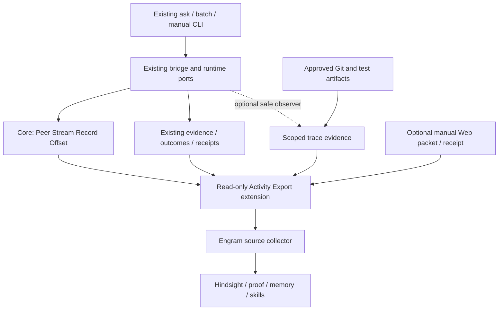

# Design — Activity Evidence / Optional Web Cooperation

## 1. Charter and baseline

The objective is to make existing PeerHub collaboration reusable as verifiable experience by Engram AI without turning PeerHub into a memory platform, a monitoring agent, a browser bot, or a second Engram. All documentation is English. P0 is small and useful without B/C. Optional capabilities may be rejected when their value, supported surface, or operating cost does not justify complexity. An activity delivered to an AI is not a task verified to succeed.

Pinned main: b1d877d689a9bc79d16054de7371b28b108049fd, v0.28.2, committed 2026-11-27 10:37:31Z. Remote main CI run 45983685529 and publish run 45991395950 were successful when inspected. No open PR at inspection; open issues returned #504 (review leftovers), #503 (ag refusal/session), #502 (cache percentage), #498 (diagnostic edges). NOW.md describes #504 and incomplete cc telemetry; issue state and release claims may differ, so re-fetch before editing; do not repeat already-fixed work. Engram baseline: c59c0e42bb6584bc873269b7128a1c94ecba3229; read its normative Rev06 CONTRACTS §5, SPECIFICATION §7–8 and TEST_CATALOG T92–T100. See SOURCES.

### Current capabilities and gaps (code inspection, not a live store audit)

| Concern | Existing source | Gap / decision |
|---|---|---|
| Prompt and response | ask.py appends prompt; bridge_ledger._materialize appends response with reply_to and delivery/execution IDs; ack later | Expose existing public record fields, do not rebuild or rerun |
| Delivery and feedback | bridge_deliveries, append-only bridge_evidence; bridge_ask_outcomes (mark_outcome); session events and receipts | Separate revision channels; late feedback is not a Record; latest outcome not entire history |
| Usage | adapters/telemetry.py, usage_normalization.py, session_receipts.py, ask_budgets.py, profile_stats.py | Existing normalized and delta logic; improve coverage only where independently reproducible; see §4 |
| Tool activity | incremental event parser tracks tool presence and terminal; bounded stdout/display; provider native events vary | No complete durable public trace feed; optional independent safe observer |
| Artifacts/evaluation | extensions/artifact.py CAS; extensions/eval.py TraceSpan, ExecutionTrace, export_telemetry, evidence-aware eval | Reuse supported interfaces only, do not assert automatically wired into ask or always safe/private |
| Snapshot | CoreStore(readonly=True).iter_records_snapshot; read_uow, stream list, record read, session list/show | No global event cursor; long snapshot pins WAL; new streams and late revisions require design |
| Memory | extensions/memory.py derived lifecycle/context pack; M3 contract | Leave intact; Hindsight is outside PeerHub; no two-way memory replication |
| Remote/Web | existing ca/oa/ga official API routes; cc/cx/ag native CLI | No verified public generic consumer Web chat execution adapter; manual handoff or official export only initially |

Core invariants from CONVENTION and EXECUTION_KERNEL_BOUNDARIES: append-only authoritative Records, response before offset, fenced claims/settlement, no blind retry after uncertain execution, bounded calls and explicit errors, diagnostics read-only, no Core→Extension imports. Do not rename frozen kinds/tables or change certainty, session reuse, request identity or permission defaults to support observations. Current ag fails closed without explicit writable permission. No observation path may grant writes.

## 2. Architecture / non-goals

Solid arrows indicate authoritative input or read projection, dashed arrow is best-effort observation. No synchronous memory calls in ask. Extension errors never alter the successful/failed/uncertain execution result, claims or offsets. No implicit work on import/diagnose/export; no network for P0/B export. Default paths, CLI output and latency behavior remain unchanged with capture disabled. Do not import Engram, Hindsight, Ollama, PostgreSQL, GUI automation, browser libraries or vendor SDKs into base dependencies. Existing runtime ports and CLI extension registration are allowed composition seams; no modification under peerhub/core/ planned. A new kernel hook, Core index, migration, or delivery-side durable event is allowed only as a separately justified decision after proving a gap with a regression test. Prefer bounded overlap/resnapshot and truthful partial coverage over unnecessary schema changes. Default CI remains network/provider-free.

## 3. P0: Activity Export

Read adapter in peerhub/extensions/activity.py (name proposed; may be split if justified), CLI in peerhub/cli/activity_cmd.py, registered by app.py. Existing Core read APIs for Record mapping, source-owned read model for bridge/outcome/usage. Use read-only opening, current-schema validation, one short read snapshot per page; no Core migrations, schema initialization, offset advance, claim, session recovery, or provider invocation. Missing DB must fail without creating a file or selecting a different store. Resolve explicit --db and validate user enrollment outside this CLI. No SQL access from Engram to PeerHub private tables. Inside PeerHub use version-aware read queries with allowlisted columns; no duplicated write rules. Snapshot all relevant high-waters and inventory generation. Channel-specific identity/revision, coverage, bound and scope per CONTRACTS. Include historical replay, response appended before ack, refusal, blocked, incomplete/truncated, failed-not-started, uncertain, reconciliation, correction; do not export full private result_json, account secrets, shell env or raw provider authentication IDs. Unknown and gaps explicit. Metadata-only by default; content only when explicitly permitted. If user authorizes reading one project, do not enumerate arbitrary paths or another store automatically. Existing database access is not a same-user security sandbox; Engram controls scoped enrollment and egress.

Historical no-change path: Engram can enumerate stream list with cursor, record read after position and session list/show; per-stream record positions and exact reply_to, bounded export. Current stats summarize latest outcome only. In absence of exporter, declare partial late evidence coverage. No PeerHub offsets used as ingestion checkpoints. Do not claim full historical trace backfill. Allow P0 implementation independently of optional evidence writes.

## 4. P0: Usage evidence

Do not implement a new tokenizer or duplicate usage tables. Existing PROVIDER_USAGE_CONTRACT currently defines cc/cx/ag as session_cumulative, ca/oa/ga as delivery; ask_budgets derives comparable deltas using previous validated same-session receipts. These are baseline definitions, not universal vendor guarantees. Confirm per pinned CLI version and resume behavior against docs and synthetic/approved evidence. Native reported counters and canonical normalized counters are distinct; preserve source, receipt, scope, attribution, field evidence, observed time and coverage. Do not add parent cumulative and child deltas, include reasoning as a second output sum, or infer billing from context occupancy, subscription quota or message length. Retain explicit zero only if reported. Distinguish cache reads, cache creation, uncached input, provider input total, output and reasoning counts; units tokens, quota percentage points, money (if sourced, currency and time). A first cumulative sample lacks comparable previous sample unless proven zero baseline; resets, invalid counters, generation changes, session loss, concurrent calls and incomplete usage => unknown. Reuse ask_delivery_tokens and existing correction semantics; do not use latest attempt to aggregate every attempt. Expose actual measured/estimated/unattributed/missing coverage and per-field provenance, not false precision. Track usage of failed actual invocations where available, no invented zero for pre-spawn or refusals. Deduplicate replay by delivery/invocation, account anonymized, session history preserved.

Triage current #502 and cc output_incomplete from NOW.md by inspecting fresh HEAD and fixtures; don't undo existing fixes or promise to eliminate unknown. Targeted repair of parser/telemetry may be appropriate separate PR with evidence, but do not loosen terminal success checks, increase default output unboundedly, or manufacture deltas. Web usage unknown unless official authorized evidence supplies measured fields; no inferred subscription benefit. Exports never call provider quota probes. Cost per verified task is computed in Engram from verified outcome and measured attribution; accepted means used, not verified.

## 5. P1: Optional CLI execution trace

Goal: observable conversation and tool events, not hidden reasoning, all tokens or reconstructed system prompts. For PeerHub-mediated cc/cx/ag prefer the same supported structured stdout events already consumed by the bounded parser. Do not change argv, resume/transport, permission policy, output semantics or process lifetime merely to capture. Current BoundedProcess callback can mark parser failure if it raises; optional observer MUST be isolated (catch and record its own failure, no throw into primary parser, no synchronous IO on drain path). AG streaming path has its own validation; attach only at verified seam and test both modes. Never install hooks silently or wrap arbitrary shell. Use allowlisted typed event extraction rather than raw JSONL retention. Observation IDs stable by provider native turn/item/call/event and execution scope; duplicate incremental items, start/update/completion and subagents recorded without double count; no concatenation of unbounded deltas. Incomplete/malformed/oversized unknown event becomes coverage marker. Preserve original prompt reference and final response reference rather than duplicating them. A readable trace is the subset exposed by the provider, capture mode, allowed workspace and data rights.

| Adapter | Feasible evidence | Limits |
|---|---|---|
| cc | stream-json user-visible message blocks, permitted tool name/ID, arguments/results allowlisted; result and usage; official hooks (optional, owner-approved) | Exclude thinking/redacted_thinking/signatures, private settings and secret tool results; subagent/tool correlation tested; transcript_path not a license to scan all logs |
| cx | exec --json thread/turn/item events; documented completed command_execution and exit status; file change items only when schema and fixture prove availability | Drop reasoning items; missing stdout/exit or partial event = unknown; never infer actual write from intent |
| ag | supported stream-json init/step_update/result, tool steps only for pinned verified step schema; usage may be cumulative | Existing transport fallbacks, permissions and refusal checks preserved; no unsupported private files; older flat JSON only final results |
| ca/oa/ga | existing official request/response metadata and usage | No local shell/files unless independently observed; no invented hidden context |
| other direct CLI sessions | Engram owns general hook/history enrollment; optionally consume user-provided trace files | Do not build duplicate global hook manager or scan entire home; no claim coverage outside explicit sources |

Default capture OFF for new trace; metadata-only export independent. Opt-in METADATA collects typed identifiers, timings, counts, tool categories, outcomes and bounded refs; CONTENT enables individually approved redacted user-visible transcript/tool fields and scope. No full raw stdout/stderr retention, no recording hidden CoT/thinking/reasoning content, no secrets/env/credentials. Use existing sanitizer for its documented limited role, separate content filtering: field allowlist, scope classification, known secrets, credential-shaped fields, paths, multiline/escaped/encoded/split boundaries, secret test sentinels. Redaction before disk/output/truncation; unknown content quarantine or omit, not claim perfect scanner. Do not store secret-derived raw hashes outside private store; sensitive equality side channel considered. No capture of external workspace data or unapproved attachments. Unknown event schema fails closed for evidence but not task. Provider permission denials never changed into success.

Bounded in-memory queue and single writer per capture instance only when enabled. Prefer existing artifact CAS/eval interfaces if verified for privacy, ownership, lifecycle; otherwise small local per-store sidecar with append-only normalized event batches and safe digests, no new mandatory DB or server. No blocking provider drain; drop optional detail with explicit gap counters and durable partial marker when possible; no claim gap-free capture after process crash. Durable publication uses temp file + fsync where supported + atomic rename, bounded file/queue/record count, symlink/reparse and path guard, integrity verify; if fsync/disk failure, trace unavailable, existing delivery remains truth. Final marker distinguishes captured/partial/missing/cancelled. Retention only extension-owned content and user-approved policy; core prompt/response not purged. Sidecar scope and generation validated against selected store; restore/clones stale cursors, no silent reuse. Backup opt-in, credentials excluded, protected permissions; record source revocation and downstream invalidation in Engram. If no complete recovery or ACL, keep disabled. No implicit background daemon; optional capture within existing invocation and explicit import/reconcile. Do not change existing primary parser or combine errors in observer and delivery.

## 6. P1: Actual file changes, commands, tests

### 6.1 File evidence

Record effects separately from tool requests/reports and independent observations. Start with Git tracked/untracked changes in explicitly approved repository/worktree, no filesystem-wide watcher. Use read-only Git commands via existing binary resolver, scoped cwd and no shell interpolation. Candidate probes: HEAD/tree identity, status --porcelain=v2 -z, git diff --no-ext-diff --no-textconv --raw -z and cached diff, approved bounded file content hashes; pin safe flags/env, disable optional locks and untrusted external diff/filter effects where possible, handle Git subprocess timeout. Do not reset, stash, stage, commit, clean, checkout, create worktree or initialize repo automatically. Start/end snapshot must include dirty pre-existing state and head/index/worktree identities. Compare content hashes for already-modified files where authorized; git status alone misses subsequent modifications. Untracked file paths and hashes only within approved roots and limits; ignored/excluded files not scanned, report gaps. Preserve create/modify/delete/mode/rename candidate, binary and symlink/reparse metadata; don't follow links, resolve path containment using safe handle and recheck for race; no arbitrary archive extraction. Existing files outside scope excluded. Changed then reverted between snapshots not observable unless supported tool events; no claim complete file activity. Non-Git directory capture optional explicitly bounded manifest of allowlisted paths; default defer. Capture patch/content OFF; metadata/hash sufficient for MVP. If approved patch, cap, redact, no secret diff (even removed lines), redact path names as needed and use artifact ref. Pre-existing dirty state preserved, no automatic attribution from time proximity; attribution observed delta vs provider-reported vs exact isolated task, ambiguous when concurrent work/shared worktree. Use isolated worktree supplied by caller when high confidence needed; no silent workspace changes. Read-only task still may have observed external changes: report as uncertain, not assume peer changed them. Record scope, before/after digest, time, completeness, caps and evidence source. Never treat write permission as proof of changes.

### 6.2 Command evidence

Use only structured provider tool result with stable call ID, tool kind, allowed/redacted command display or fingerprint, approved relative cwd ref, start/end/elapsed only where observed, exit code when actual observation exists, stdout/stderr coverage (bounded/redacted artifacts optional), timeout/cancel/denied states. A command proposed or mentioned in prose is not executed. Tool reports are evidence from adapter, not independently OS-audited facts. No shell interception, global process spying, environment dumping, auto-rerun or replay of arbitrary commands. Command string is untrusted data, never executable from export. Exact command correlation through execution/attempt/turn/tool IDs; if absent record AMBIGUOUS_LINK, no heuristic promotion. Existing test harness or CI records can be explicitly attached by owner with Git SHA, test run ID, report hash and scope. Parse supported JUnit XML only offline with strict limits and no DTD/entities/remote fetch; distinguish tests passed/failed/skipped/error/not-run/unknown, actual runner exit and counts; zero tests is not success. Failing tests with exit=0 or conflicting reports => conflict, not pass. No test auto-run from capture; Engram Quality Gate owns independent verification or user-authorized tests. Never count accepted outcome as successful test.

## 7. P2: Web AI adapters — bounded, compliant cooperation

We distinguish consumer Web chat, official API and official cloud coding task surfaces. Existing oa/ca/ga peers remain official API peers with their own billing, quota, account and runtime contracts; no aliasing web subscriptions to API entitlements. Web applications may have tools, browsing, long conversations and distinct model availability; no claim parity with API. Consumer terms and country/account/org policies may prohibit automation, harvesting and certain downstream AI uses; review applicable terms and permissions before any integration or memory reuse, including derived content. Official consumer export is evidence availability, not a blanket license to train or develop competing AI. No model training from these data in scope. Unknown permission blocks capture/use.

P2a design candidate: manual handoff only, explicit user action at each external disclosure. PeerHub prepares local redacted, size-bounded review packet to file or stdout, shows intended provider and scope; user manually opens official site, chooses account/model, reviews and submits in their own browser; user manually supplies reply via approved file/stdin or official export. No automated browser input/output, DOM harvesting, extension scraping, cookies/tokens, unofficial endpoints, network calls, login or captcha handling, anti-bot circumvention, shared session credential or quota bypass. No automatic clipboard monitoring. Do not use automation merely because technically possible or a user has paid subscription. No automatic cloud fallback. No global web history scanning. A human receipt is not a provider-authenticated response, exact model/usage/tools generally unknown; mark source USER_ATTESTED and provider label user supplied. Optional URL locator private and validated; never fetch. No content published to public links, no automatic upload. Preserve explicit cancel, expiration, correction and duplicate receipt semantics, and distinguish pending submission, user-attested submitted, imported reply, incomplete and unknown. Never block ask waiting for human, never fake Bridge certainty/terminal/session, never register web as live auto peer under existing ask. Keep manual workflow separate command namespace, no changes to existing ca/oa/ga. If plain packet and Engram import sufficient, omit durable Web handoff queue and use only small stateless packet/receipt, requiring both to correlate.

P2b: user-provided offline exports. ChatGPT eligible account data export includes conversation JSON; Claude export includes conversations but not original uploaded files; Gemini Apps activity via Google Takeout where available. Provider owns actual format and completeness. Engram owns historical bulk import, source consent, parsing and dedup across other AI histories. PeerHub may support a single normalized manual receipt import or reference to Engram's approved local file; no duplicate provider archive parsers in both. Do not turn imported conversations into native asks or fabricate session/usage. Preserve conversation branches, user-visible role, timestamp nullable, attachments as unavailable unless approved bytes, provenance, explicit partial. No hidden reasoning or automatic service contact. Check terms for intended storage/analysis and user rights; default review before passing to Hindsight/other models. Import of authorized synthetic exports tested offline. Provider-owned actual history may be missing; cannot recover deleted data.

P2c deferred: official cloud coding or explicitly authorized official integration separate from consumer Web. Claude Code official cloud task and Codex cloud/Antigravity remote agents are candidates for independent feasibility reviews, not general Web chat adapters and not needed for initial scope. A cloud task might upload repo/history, write files remotely, spend quota and return asynchronously: explicit approval, source scope, official docs, identity/permission/policy, durable external job receipt/cancel and uncertain semantics before design. Do not force existing synchronous RuntimeTarget.deliver to represent asynchronous task. Any automated consumer Web adapter stays BLOCKED unless provider explicitly authorizes specific interface and intended use, applicable terms verified, safety/security/maintenance budget approved and new ADR accepted. No Playwright/Selenium/CDP workaround shipped. Safe manual route is valuable even if C2/C3 never happen.

## 8. Scope, lifecycle and resource boundaries

| Phase | Added state | Default behavior |
|---|---|---|
| P0 export | None; cursor returned, stored by consumer | Read-only explicit operation |
| P1 trace/changes/tests | Optional owned evidence files under selected store private state/work path after convention check; no mandatory schema | OFF; caps and explicit scope |
| P2 manual | Optional small packet and receipt artifacts with digest; no autonomous job | OFF; user submits and imports |

Avoid per-ask full repository snapshots by default; use bounded roots and skip when cost exceeds budget, report partial. Proposed cap initial: export 100 events/page (max 200), 1 MiB UTF-8 serialized response, default trace queue 256 events and 8 MiB/ask retained normalized evidence, capped individual event 64 KiB, content mode separately approved, path scan up to 2,000 files/64 MiB hash input/2 s per snapshot as tuning candidates. Not measured guarantees; reserve space for envelope/cursor, actual latency and size gates from benchmark, configurable validated upper bounds, no unsafe default zero/unlimited. Never truncate structured JSON invalidly; digest/locator/omission marker and continuation. Bounded time not guaranteed instantaneous on blocked OS I/O, report unavailable. Disabled regression compare same fake asks; enabled overhead target median <= 5% for representative sufficiently long fake runs, plus absolute latency and memory budget measured; P0 export does not run on ask path. No fixed universal SLA. No provider call, quota cost or network in test/export/collection. Optional telemetry never holds Core write transaction across filesystem or model work. Disk pressure, interrupted write, repeated crash, stale lineage, deletion, restore and revoke tested. Keep existing .peerhub source data and backups; no deletion, reset or rotation of source. Packaging excludes data/exports/traces/accounts/secrets. Engram portable relocation refers to store via approved relative/logical identity and refreshes locator, not rewriting source history.

## 9. Decisions and risks

| ADR | Decision | Trigger for revisit |
|---|---|---|
| PH-01 | P0 exporter only is required integration | verified source gap |
| PH-02 | Core/kernel unchanged by default; source-owned reader | unavoidable read contract gap |
| PH-03 | read-only snapshot, channel cursors, honest partial | proven source global feed needed |
| PH-04 | reuse normalized usage/deltas, no fake totals | version-specific evidence |
| PH-05 | trace opt-in, sanitized typed events, no hidden reasoning | provider adds authorized event contract |
| PH-06 | independent observer cannot fail primary parse/delivery | performance/fault evidence |
| PH-07 | Git delta + approved hashes, not OS audit | actual unobserved effects needed |
| PH-08 | commands/tests observed vs reported vs verified | independent proof adapter |
| PH-09 | optional CAS/sidecar only, no new DB by default | measured volume/recovery gap |
| PH-10 | manual web packet/receipt, offline authorized import | terms-authorized interface |
| PH-11 | no browser automation, no consumer entitlement inference | explicit provider authorization |
| PH-12 | Engram owns cross-source memory and history bulk import | owner-approved boundary change |
| PH-13 | no duplicate memory, quota, routing or session registry | demonstrable missing owner |
| PH-14 | staged opt-in features, offline CI, no main merge/release | owner approval and release gates |

Risk register: RSK01 lost late evidence (separate watermarks, recovery tests); RSK02 restore collision (lineage fence/digest conflict); RSK03 private result/credential leakage (allowlist, content scope, synthetic sentinels); RSK04 WAL pin and large exports (short pages, caps, backup alternative); RSK05 trace callback alters outcome (independent observer, fault tests); RSK06 usage false double sum (scope/delta rules); RSK07 dirty/concurrent workspace attribution (snapshot + ambiguity); RSK08 prompt injection via trace (data only, no execution); RSK09 trace disk loss (explicit partial and no delivery failure); RSK10 format drift (version capabilities, quarantine unknown); RSK11 terms breach (manual only, legal review and rights); RSK12 consumer/API confusion (separate identity/billing); RSK13 duplicated experience (exact task/attempt/source IDs); RSK14 expansion complexity (optional gates, stop at P0 if enough); RSK15 unauthorized cloud source upload (blocked by default); RSK16 invalid retention/backup (owned state, consent revocation); RSK17 existing baseline regression (CI, type/architecture gates); RSK18 unverified task success (independent proof). Each has corresponding test group in TEST_PLAN. Decisions are proposed design defaults, not user approval to enable live capture or access personal accounts.

## 10. Handoff and definition of done

Start with P0 proof and contract freeze, not broad refactor. WP6b of Engram is separate now authorized as design track, not a main merge or live capture authorization. Engram's existing importer does not depend on P1/P2. Cross-repo verify exact contract fields and sample fixture in synthetic source, publish any contract amendment on feature branch, communicate consumer compatibility before release. Do not edit Rev06 baseline or Engram repo from PeerHub task. No implementation in this document. Follow repository AGENTS.md and CONVENTION.md, keep frozen specs, owner tests and release boundaries.
