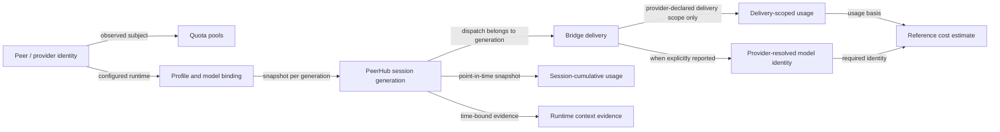

# Peer and Session Usage Monitoring Review (2026-10-15)

## Decision and scope

This review refines the existing session-monitoring proposal in
[`plan-session-monitoring-2026-10-13.md`](plan-session-monitoring-2026-10-13.md).
It is a pre-TDD design addendum, not implementation approval. Keep monitoring
observational: report durable session state, recent execution health, provider
reported usage when its meaning is known, context evidence, and account quota
evidence. Do not turn the dashboard into billing, budget planning, forecasting,
or model-routing policy.

The final ratified pre-TDD packet at the end of this document is the normative
contract for the remaining grouped-monitoring work. Earlier review notes,
implementation records, and roadmap text are historical context; where they
conflict with that packet, the packet controls.

The existing proposal covers session inventory/state, profile/model/effort
binding, fresh/reuse counts, context evidence, account-pool quota evidence,
recent confirmed calls, expiry/eligibility, and freshness/completeness. This
addendum's first implementation slice now persists provider usage in the
existing Bridge telemetry receipt and exposes safe binding, count, and latest
usage fields in `session list/show`. Full grouped monitoring, preferences,
coverage rollups, and quota/model/context dependency drill-down remain planned.

**Current-decision correction (2026-10-15):** older paragraphs in the Oct. 13
proposal describe the absence of a normalized durable ledger. That was accurate
for the proposal's then-current state, but is superseded here: the existing
unique `bridge_evidence.kind=session_telemetry` receipt already uses
`schema_version=3`; the remaining monitoring work preserves that contract and
builds bounded projections from it. The single-receipt authority remains
unchanged; no parallel facts table is approved.

**Implementation status (2026-10-15):** the delivered slice uses a versioned
provider-candidate contract and the existing unique `session_telemetry`
receipt. It strips candidate data before public result snapshots, binds
delivery scope to the fenced terminal delivery, and marks session-cumulative
CC/CX/AG values unattributed. `session list/show` reads safe typed telemetry
from that receipt. This does not complete the broader monitoring catalog or
projection work itemized below; remaining requirements stay design/TDD work.

CC, CX, and AG separately challenged provider scope/normalization, public usage
labels, CI selection/concurrency, release SHA/tag binding, history depth, and
release DAG contracts. The fixes were reviewed to approval; current cumulative
usage is never differenced, public snapshots label scope/attribution, and the
release matrix requires all eight current candidate JUnit files. Local focused
tests and pyright passed. The superseding GitHub Actions run
[`38727946482`](https://github.com/greatgc-flow/peerhub/actions/runs/38727946482)
passed on Ubuntu and Windows; its full-suite timings were 6m35s and 28m29s,
respectively. The earlier run references below are historical evidence only.

## Peer review

CC and CX recommend excluding monetary cost, cross-provider token averages,
cumulative session tokens, and per-session quota allocation until their
measurement semantics and sources are reliable. AG agrees on excluding cost
and message payloads, and suggests reported-token accumulation where adapters
provide it. Reconcile this by allowing normalized, attributable per-turn token
facts as a later monitoring metric, while keeping cumulative totals and
averages out of the initial view until coverage and provider semantics can be
proved. Missing values remain unknown; they are never zero-filled.

All three reviews called out the same risks: partial token reporting biases
averages downward; context occupancy is not billing usage; account quota is
shared rather than session-attributed; raw provider payloads and vendor session
IDs must not leak; and per-session or per-frame N+1 reads threaten bounded
latency.

### CX cross-review (2026-10-15)

The independent read-only CX review found a stale AG resume caveat and two TDD
handoff ambiguities. The document now records the observed cumulative result
scope for `agy 1.3.5` after exact process-boundary resume, while retaining
USM-15b as the stricter gate for deriving per-delivery deltas. The review also
required separating AG stream RED tests from the later transport implementation
and specifying the live CC/CX usage-scope call budget; both are now explicit in
the TDD sequence and live matrix. The final read-through found no blocker; the
overlap between usage-scope and exact-selection call budgets is also explicit.
Its optional suggestion to omit step summaries from the initial
scope was considered: the user requirement is to preserve CLI-measurable data,
so the v2 receipt keeps an optional bounded step shape, but adapters only
populate it when their event scope is validated; absent/partial step coverage
stays explicit, and unsafe/raw events are never persisted. The illustrative
CLI version is marked synthetic. This review is a design cross-review, not a
peer consensus vote or implementation approval.

## Metric catalogue

| Surface | Include | Meaning and source | Guardrail |
|---|---|---|---|
| Peer overview | retained-session total when the scope projection is complete; fresh/reuse counts and completeness; bounded recent delivery-certainty states; latest activity age; latest quota pools and freshness | Session history and writer-owned projections; call receipts; bounded existing activity projection; quota observations | State the selected stream/window scope. Do not claim current eligibility, success/error totals, or latency where no source proves it. Do not present bounded recent activity as an all-time total. |
| Session row/detail | PeerHub handle, stream, generation, state, latest pointer, created/last-used/expiry, profile/model/effort binding, fresh/reuse counts, latest confirmed call mode/result, context tokens/window/percentage/source/age, quota pool observations | Retained session history, binding snapshot, call/telemetry receipts, pinned quota observations | Never expose vendor session IDs, prompt/response text, raw adapter output, credentials, or account identifiers. Unknown and stale are explicit. |
| Recent usage | Provider-reported input/output/cache counters when present; include source/model, reporting coverage, time, and outcome | Typed existing `session_telemetry` receipt; broader bounded coverage/rollup remains proposed | Keep provider-native counters distinguishable. Session-cumulative values are unattributed and never become per-delivery aggregates. |
| Execution health | Bridge delivery-certainty states, fresh/reuse calls, per-peer started-to-terminal elapsed average and recent measured samples | Durable delivery/call receipts and bounded projections | Do not infer success/error cause from certainty. Label elapsed time as PeerHub-observed and composition-sensitive, never AI/provider-only. Failed-before-start requests are not provider calls. |

The default dashboard should show concise peer summaries and a small bounded
session sample. `session list/show` remains the complete paginated inventory.
Machine-readable output may carry the full bounded summary with explicit
coverage metadata. Do not add a second collector: read the same pinned,
read-only diagnostic snapshot used by `diag` and `diag --live`; `monitor` may
compose its explicit quota refresh with that snapshot.

## Token and cost rules

1. Preserve existing context semantics: `last_input_tokens` is last-request
   context occupancy, not total billed input. Calculate occupancy percentage
   only from a matching reported context window. Do not use watermarks or
   cumulative provider usage as a substitute.
2. A future token section may show measured per-turn counters when the adapter
   provides a validated normalized shape. It must carry provider/model/source,
   measured-turn count, eligible-turn count, and coverage. Never silently add
   missing turns as zero. Do not show an average unless every turn in the named
   bounded window has the same validated counter semantics; otherwise show
   totals only for the measured subset with coverage, or omit the aggregate.
   Never sum across providers or models merely because field names match. A
   truncated window must report dropped/unmeasured turns in its coverage.
3. Do not show unit cost or average cost from token counts. No stable price,
   discount, tier, currency, or billing source is currently persisted. A
   provider's explicitly estimated amount may only be added later as a
   provider-specific estimate, with its estimate basis, adapter/CLI version,
   session-vs-delivery scope, and coverage. Never call it billed cost or combine
   estimates across providers. Authoritative account-level billing evidence
   belongs to a separately scoped accounting feature.
4. Do not attribute account quota to a session or divide it among sessions.
   Show quota only at its observed account/pool scope, with state, age, and
   reset evidence.

## What current evidence cannot tell us exactly

“Not exposed in monitoring yet” is different from “not knowable from stored
evidence.” These limits apply to the current source, before a session reader is
implemented:

| Requested fact | Current evidence | Exactness limit | Safe statement today |
|---|---|---|---|
| Current context occupancy and context-window size | Terminal `session_telemetry` receipts are written with null token/window/percentage values and `source=unknown` | No verified, attributable occupancy/window measurement is wired into the receipt. Record-position watermarks are not tokens. | Unknown; do not infer from billing usage. |
| Total tokens used over a session or lifetime | Adapters parse some usage fields; results can be attached to response metadata. Bridge keeps a raw latest usage snapshot for native sessions and calculates deltas only under specific conditions. | Providers expose different field semantics; some counters are cumulative, some per-turn, some fields absent. Missing usage is not a zero. The original v1 proposal did not have the now-delivered schema-v3 receipt or the remaining coverage projections. | Provider-reported usage may be shown for an individual attributable delivery after validation; no exact universal cumulative total. |
| Average tokens per turn | Same incomplete, mixed adapter reports | The denominator is unknown when some turns omit counters; cross-model/provider fields may differ. | No general average. A future bounded same-semantics sample may report coverage and a conditional average. |
| Actual monetary/unit/average billed cost | No persisted authoritative billing amount, invoice linkage, contract tier, discount, or per-request billing evidence | CC documents a client-side estimate, and its Admin API can provide organization/time-bucketed billing evidence for eligible accounts; neither currently provides a reliable amount attributed to each PeerHub delivery across peers. Token counts alone cannot reconstruct actual charges. | Actual per-delivery billed cost is unknown. A CC estimate is a distinct possible metric and must be explicitly labeled, versioned, and scope-validated. |
| Number of actual model inference turns inside a delivery | Bridge records confirmed deliveries/calls | A CLI delivery may include provider-internal tool/model loops that adapters do not consistently expose. One `session_call` is not necessarily one model inference. | Count confirmed Bridge calls, label them as calls/deliveries, not model turns. |
| Exact all-time error totals | Durable delivery evidence exists; current activity diagnostic keeps only the newest 50 best-effort ask observations per peer | The activity sample is bounded and can omit events; no all-time peer outcome/error projection currently exists. Legacy certainty and terminal classification can also be incomplete. | Show recent sample counts with its window. All-time error counts require a writer-maintained counter and completeness flag. |
| Provider-only generation latency / time to first token | `operation_elapsed_seconds` and same-delivery `session_call.started_at` → terminal evidence | Existing operation duration includes local work and startup; Bridge start-to-terminal elapsed time also includes adapter completion. Neither isolates provider inference. | Report PeerHub-observed elapsed time with scope; provider-only latency and TTFT remain unknown. |
| Session actually resumable at the provider right now | Local retained state, binding, last use, and eligibility evidence | The remote provider can expire, revoke, or invalidate a session between calls. Only a later resume attempt can confirm acceptance, and probing may have side effects/cost. | Show local eligibility/last-known state, not guaranteed provider availability. |
| Quota or spend attributable to a particular session | Provider quota observations at peer/account-pool scope | Accounts and pools can be shared across sessions and external clients; providers do not report a reliable session allocation. | Show shared quota evidence at its observed scope only. |
| Exact whole-peer session/error totals in every live dashboard frame | Retained-session scope projection planned; no typed all-time error projection | Monitor caps displayed sessions/scopes; complete session inventory remains paginated. Terminal certainty does not establish provider success/error. | Exact retained count only when scope projection is complete; otherwise mark partial. Error totals remain unavailable beyond bounded recent evidence. |
| Provider-resolved model/effort actually used for every sub-turn | Session binding stores selected profile/model/effort attributes | A configured alias or CLI target is not proof of a provider's resolved backend or hidden internal sub-turn settings. | Report the stored selection/binding as configured; do not claim internal provider execution details. |

The reliable current facts are narrower: PeerHub session handles and local
state; recorded binding attributes when present; fresh/reuse delivery counts
when the projection says history is complete; confirmed Bridge-call receipts;
and quota observations with source/freshness when collected. These are still
not all exposed through the monitoring CLI today.

## Official provider documentation research (2026-10-15)

Internet research can settle several field semantics, but it cannot prove what
the installed CLI versions on a particular machine emit. These findings are
from official provider documentation and current upstream schemas/source; the
repository's installed binaries and live accounts were not queried.

| Peer/source | Resolvable from official documentation | Remaining work or limitation |
|---|---|---|
| AGY / Antigravity CLI | Its JSON result documents `duration_seconds`, `num_turns`, and input/output/thinking/cache/total usage. `stream-json` adds per-step usage and duration. In a continuous stream-input process, result usage, turns, and duration are cumulative session counters; individual `step_update` usage/duration is per step. The 2026-10-15 live probe also observed cumulative result counters in one exact `--conversation` resume across a process boundary. | PeerHub currently parses the final JSON result. A stream parser could capture validated step facts, but must discard `text_delta`, `tool_info`, subagent details, and other payloads to preserve privacy. The single resume pair establishes scope for that observed version and simple task, not safe deltas under model switches, concurrent use, compaction, retries, or tool/subagent-heavy asks; those remain gated by USM-15b/29 and the live matrix below. No cost field is documented. [Headless mode docs](https://www.agy.dev/docs/cli/headless/) |
| CC / Claude Code | Official Agent SDK docs specify per-turn `usage` scope and cumulative `total_cost_usd` / `modelUsage` behavior, including resumed sessions and subagent coverage differences. `total_cost_usd` is a client-side estimate from a bundled/selected price table, not authoritative billing. It can support a clearly labeled estimate if the installed CLI JSON output exposes it and the version/scope is validated. | The exact installed `claude -p` JSON shape/version must be checked against PeerHub's adapter before relying on those SDK fields. Resumed-session cost is cumulative in current versions (before v2.1.277 it covered only that call), so a delivery metric needs a baseline/delta and version-aware handling. The Anthropic Usage and Cost Admin API provides org-level, time-bucketed usage/cost dimensions, with data typically appearing within five minutes; it requires suitable organization credentials and has no PeerHub session/delivery key, so it cannot establish per-session billing. [SDK cost tracking](https://code.claude.com/docs/en/agent-sdk/cost-tracking), [Usage and Cost API](https://platform.claude.com/docs/en/manage-claude/usage-cost-api) |
| CX / Codex CLI | Current upstream `exec --json` code emits `turn.completed` usage from the latest accumulated total usage snapshot. The separate app-server protocol exposes `last`, `total`, and `modelContextWindow`, which can provide clearer per-turn/cumulative usage and context-window evidence. | Current PeerHub uses exec JSON, not that app-server telemetry. Context window and `last` usage therefore require an adapter/protocol change, then versioned integration tests. The completion event does not provide an authoritative per-call USD amount or prove provider-resolved model identity. [Codex exec JSONL exporter](https://github.com/openai/codex/blob/main/codex-rs/exec/src/event_processor_with_jsonl_output.rs), [app-server token usage schema](https://github.com/openai/codex/blob/main/codex-rs/app-server-protocol/schema/json/v2/ThreadTokenUsageUpdatedNotification.json) |

## Telemetry and evidence register

This register separates values PeerHub can observe from facts learned through
provider documentation and from facts that still require local validation or
cannot currently be attributed. “Measurable” means the adapter can parse the
value; it does not mean the monitoring CLI already displays it or that the
provider's semantics are interchangeable. The initial source review did not
query provider binaries; subsequent paid, version-pinned probes are recorded in
the linked CLI audit and are not release qualification.

### Common PeerHub measurements

| Item | PeerHub evidence available now | Coverage / interpretation |
|---|---|---|
| Session inventory, state, age, expiry, configured binding | Local session history and binding snapshots | Exact only within the selected stream/peer and retained-history scope. Configured profile/model/effort is not proof of provider-resolved execution. |
| Fresh/reuse counts | Writer-maintained per-stream/per-peer projections | Use only when completeness metadata permits; state selected scope. |
| Confirmed call and terminal outcome | Durable Bridge certainty states and call evidence | Counts Bridge deliveries/calls, not internal provider model turns. Do not infer success/failure from certainty. |
| Latest operation duration and recent activity | `operation_elapsed_seconds`, same-delivery monotonic start/terminal pair, and bounded activity sample (currently at most 50 per peer) | End-to-end PeerHub elapsed time; not provider-only. Activity is not an all-time durable call count. |
| Context occupancy/window | Session telemetry receipt schema exists, but current writer records null token/window/percentage with `source=unknown` | Not presently measured. Never substitute usage tokens or a public model's advertised maximum. |
| Quota observations | Existing quota probe/projection at peer/account-pool level | Shared-pool observation with source/freshness; no session allocation. |
| Durable provider usage | Adapter parses versioned, allowlisted usage candidates; the Bridge terminal transaction stores safe provider usage in the authoritative `session_telemetry` receipt | Delivery-scoped facts are eligible only when the provider/schema contract says delivery scope. Cumulative CC/CX/AG snapshots are displayed as unattributed observations. No replay/result snapshot is a monitoring source. |
| PeerHub all-time error totals | Durable delivery evidence exists, but activity is bounded and no complete all-time outcome projection is present | Requires a writer-maintained aggregate and migration/completeness treatment; do not scan all history on each monitor read. |

### Per-peer telemetry

| Peer | Parsed/measurable in current adapter path | Official information that can be looked up | Requires PeerHub change or local validation | Still unknown / not inferable |
|---|---|---|---|---|
| **CC (Claude Code)** | The adapter validates final JSONL `result.usage`; because exact resumed `claude -p` scope has not been validated against the installed CLI, the current contract conservatively declares it session-cumulative. Persisted usage is tagged `unattributed`, not differenced into per-delivery usage. | Agent SDK documentation describes its own `usage` as per-turn and `modelUsage`/`total_cost_usd` as potentially cumulative. That does not by itself establish the scope of PeerHub's CLI result across resumed invocations. Anthropic's Admin Usage/Cost API is organization-level and cannot attribute spend to a PeerHub session. | Future delivery-scope support requires a documented, versioned CLI source contract and fresh/resumed live evidence. Any reference price estimate requires exact resolved model and eligible delivery usage. | Actual invoice amount per PeerHub delivery/session; provider quota/spend attributable to one session; exact model/backend for hidden subagents; current exact context occupancy absent a verified field; inference-only latency. |
| **CX (Codex CLI)** | The adapter validates `turn.completed.usage`; current exec JSON counters are session-cumulative on resume and stored as `unattributed`. The app-server schema separately exposes last/total usage and `modelContextWindow`, but PeerHub has not adopted that protocol. | Official upstream exporter and app-server schema document these distinct fields. | A future app-server adapter may add last-turn/context-window evidence under its own versioned lifecycle and privacy tests. | Exact context occupancy/window through current exec adapter; invoice-level USD cost for a CLI delivery; provider-resolved backend/model for every internal turn; model-only latency; session-level quota allocation. |
| **AG (Antigravity CLI)** | The adapter validates result usage and currently records the versioned result counters as session-cumulative/unattributed. It never subtracts snapshots into delivery usage. | Official headless docs enumerate result usage, `duration_seconds`, and `num_turns`; current results do not document cost. | Safe per-step usage may be added only if a future stream contract binds it to the fenced terminal delivery. | Actual billed cost; provider quota attributable to one session; exact model-only latency; exact provider-side context occupancy absent a supported field. |

### CLI option and paid-canary findings

The installed CLI option matrix, exact probes, event/count observations, and
update procedure live in the [Peer CLI option audit](peer-cli-option-audit-2026-10-15.md).
These findings change the telemetry and session design as follows:

- The 2026-10-15 public ask canary passed 12 tests across CC/CX/AG; 3 skips
  were only the separately opted-in fresh/exact four-turn selector tests.
  Basic usage, native resume recall, writable sentinel creation, and process
  cancellation were exercised. Per-test wall times are saved in the option
  audit but represent whole test scenarios, not model-only latency.
- CC `--permission-mode plan` and AG `--mode plan` denied a live write request
  in direct probes while returning normal successful text results. Treat plan
  refusal as task-level denial, not necessarily process failure. Pin these
  modes only after PeerHub integration tests verify read/search capability,
  writable-mode transitions, and binding fingerprints. The legacy CC
  `permission-mode default` spelling is no longer accepted by this installed
  version and must not be copied into the adapter.
- Both CC and AG accept streamed JSON user input and produce per-turn terminal
  results in one continuous process; a small two-turn live probe confirmed
  native conversational recall. AG terminal usage and `duration_seconds` are
  cumulative over session turns, while the tested agent-response step reports
  per-turn usage. Separate-process AG `--conversation` resume also returned a
  cumulative total. Readers must not count these cumulative totals as one
  delivery without a verified baseline or complete per-turn event ledger.
- One paired, single-sample probe per CC/AG showed lower total wall time for
  two turns in one process than two explicit-resume processes (CC: 5.47 s vs
  9.78 s; AG: 10.41 s vs 19.32 s). This justifies a repeated benchmark and
  process-reuse design spike, not a default or product speed claim. Persistent
  child processes would change Bridge lifecycle, cancellation, per-delivery
  terminal framing, session serialization, and crash recovery; do not include
  them in the monitoring-table migration.
- AG streamed input is also a candidate replacement for its 30 KB Windows
  prompt-argument ceiling. Test it first as a per-delivery process with one
  stdin message and a closed stdin, independently of long-lived process
  reuse. This isolates prompt transport/output framing from process pooling.
- Local CLI versions were CC 2.1.299, CX 0.162.1, AG 1.3.5. These are
  environment measurements, not package compatibility policy. Exact
  per-delivery quota depletion and invoice cost remain unknown.

### Updated classification of unknowns

- **Can be settled by documentation:** AGY continuous-process cumulative result semantics; CC estimate-vs-billing distinction, subagent inclusion, and resumed-session cumulative scope/version caveat; Codex app-server availability of last/total usage and model context window.
- **Can be made observable with PeerHub changes:** AGY per-step token/time facts via allowlisted stream parsing; CC provider-estimated cost with explicit estimate/scope/version labels and baseline handling; CX context and last-turn usage if PeerHub adopts app-server telemetry; exact all-time PeerHub error totals through writer-maintained projections.
- **Still not knowable from public docs alone:** tool/subagent-heavy AG per-turn usage completeness; whether these observed versions represent other supported machines; exact invoice-level cost attributable to every PeerHub delivery across peers; model-inference-only latency; provider-side session validity without attempting resume; CX backend-resolved model per internal turn. These require more local/versioned tests, provider/account-specific evidence, or remain unavailable.

### Maintenance rules

- Keep this register in English beside the monitoring design, with one row per
  supported peer and shared rows for PeerHub-owned evidence.
- For each claim, record its evidence class (local parser/writer, provider
  documentation, live versioned test, or unknown), last-verified date, and a
  direct official source link. A documentation lookup is not a local runtime
  verification.
- Recheck official links and version caveats when an adapter, CLI contract, or
  provider billing/usage API changes. Update the register in the same change
  that changes parsing or persistence semantics.
- Promote a value from “unknown” only after a versioned fixture or safe live
  measurement proves its meaning and attribution. Preserve null/unknown when
  coverage is absent; do not infer zero or fill gaps from public model limits.
- Keep the final “Still unknown” cells as the user-facing unresolved list; do
  not repeat settled documentation findings in that list.

AGY stream events contain response fragments and tool invocation inputs/outputs in
addition to useful telemetry. Any future implementation must parse an allowlist
and must not persist or expose raw stream events.

## Counting and freshness contract

- **Session total** means retained PeerHub session handles in the selected
  stream/peer scope, including lost and tombstoned rows when the view is an
  inventory. “Active” means current eligibility under the existing session
  contract, not merely `state=ACTIVE`.
- **Confirmed call** means one distinct delivery with durable STARTED evidence
  and a `session_call` receipt. It counts even if execution later fails. A
  request replay does not add a call; a new delivery does. `NOT_STARTED` and
  unconfirmed `MAY_HAVE_STARTED` are excluded.
- **Outcome counts** must distinguish successful terminal, failed terminal,
  unresolved/uncertain, and excluded pre-start failures. Never combine
  uncertain work with failure or success. If complete all-time peer totals are
  needed, add writer-maintained counters with explicit migration completeness;
  do not scan all deliveries on each frame.
- **Recent activity** is a bounded sample (initially latest 50 per peer, or a
  smaller declared monitor window). Expose sample size, time range, and
  truncation/completeness. Existing `activity_rollups` has the bound but is
  best-effort ask activity, so it must not be described as exact durable call
  accounting.
- **Latency** from `operation_elapsed_seconds` covers end-to-end PeerHub ask
  operation timing, not model generation alone. Existing diagnostic output
  provides median over its bounded ask sample. Do not add a latency p95 to
  monitor in this slice; no lifetime percentile claim.
- **Context and quota** values always carry evidence source and age/state. A
  later call without terminal telemetry invalidates an older context value as
  current. Quota is selected at the snapshot time, never copied from an old
  ask result.

## Bounded-read and privacy requirements

The reader must use one pinned read-only SQLite snapshot, writer-maintained
counts, and indexed bounded recent-call/usage queries. No provider subprocess,
network request, vendor database read, migration, or repair may run from
`diag`, `diag --live`, `session list/show`, or the snapshot portion of
`monitor`. Avoid one query per session: load page rows and their latest
call/telemetry/quota evidence in a bounded batch. Existing `session list`
pagination and monitor scope/coverage rules remain authoritative.

Reconstruct public JSON from field allowlists. Treat user-controlled stream
names as potentially sensitive. Never serialize raw `detail`, response
metadata, adapter output, or provider/account identifiers.

## Unified monitoring and telemetry design (pre-TDD)

This section resolves the expanded request to browse all useful monitoring
items, select groups, choose defaults, and retain measurements as evidence for
future quality comparisons. It extends the existing CLI/monitoring contract in
[`peerhub-cli-monitoring-inspection-2026-10-14.md`](peerhub-cli-monitoring-inspection-2026-10-14.md).
It is a design target only; no CLI, schema, or adapter implementation is
authorized by this document.

### Decisions and boundaries

1. `diag` remains the read-only snapshot command, `diag --live` remains the
   read-only watcher, `observation refresh` remains the explicit quota
   collector, and `monitor` remains the combined collection-and-display
   workflow. Do not create a second provider collector or change these side
   effects. The monitor snapshot reads one pinned read-only DB snapshot;
   provider work stays in its explicit refresh phase.
2. Monitoring exposes every **safe, measurable, attributable scalar or
   categorical fact** emitted by PeerHub or an allowlisted provider CLI. “All
   CLI info” does not mean persisting raw stdout, prompts, responses, tool
   arguments/results, environment variables, paths, credentials, account IDs,
   vendor session IDs, or opaque provider payloads. Unknown fields remain
   absent/null with coverage; they are never reconstructed from text.
3. Separate immutable measured evidence, writer-maintained projections for
   bounded totals/trends, and read-only report rendering. Store allowlisted
   evidence before deriving dashboard values. Derived averages/percentages
   carry denominator, scope, coverage, and source semantics. Display
   preferences do not belong in the telemetry database.
4. Reuse existing durable sources where sufficient: quota `observations`,
   Bridge delivery/evidence/session receipts, activity rollups, and provider
   usage already attached to terminal/response metadata. Add versioned
   telemetry facts only where current evidence loses provenance, fields,
   scope, or step granularity. Do not create a parallel source of truth or
   retain raw and normalized copies without a declared reason.
5. Do not add an accounting/budget/forecasting/routing subsystem. Optional
   reference-cost estimates are informational only: accept a provider-reported
   estimate when its CLI schema/scope is validated, or calculate an
   API-equivalent estimate from a versioned public price snapshot when exact
   model and token categories are known. Persist the source, URL, currency,
   effective date/version, calculation basis, and coverage. Do not fetch prices
   during monitor rendering. Label these as estimates, never billed amounts;
   never infer subscription spend/quota depletion or sum unlike peer estimates.
   Existing quota pace remains conditional pool-level evidence, not spend or
   per-request cost.

### MECE group catalog and default selection

Every displayed field has exactly one primary group. Summary cards may repeat
derived totals only when they link to the owning group's source and coverage.

| Stable group ID | Owns | Canonical source | Examples / exclusions |
|---|---|---|---|
| `overview` | Cross-group peer summary and highest-priority state | Derived from groups below; no independent counters | Peer state, retained/current session counts, last activity age, health warnings. |
| `execution` | PeerHub delivery and operation health | `bridge_deliveries`, `bridge_evidence`, bounded activity receipts | Delivery-certainty states, fresh/reuse, Bridge-observed started-to-terminal elapsed average, and recent samples with start-time binding; no inferred success/error or provider inference-turn count. |
| `sessions` | Retained PeerHub session lifecycle and reuse | `bridge_session_history`, `bridge_sessions`, session receipts and writer projections | Handle, state, configured binding, age/expiry, fresh/reuse, eligibility and completeness; never vendor IDs. Full inventory remains paginated. |
| `usage` | Provider-reported token and usage facts | Validated telemetry facts linked to a Bridge delivery | Per-delivery input/output/cache/thinking/total where emitted, CC model usage/cost estimate if validated, reporting coverage; not context occupancy or billed cost. |
| `context` | Runtime context occupancy evidence | Validated telemetry facts or terminal telemetry receipt | Occupancy tokens, matching window, percentage, source and age; never billing input or advertised model maximum. |
| `capacity` | Provider/account-pool quota observations | `observations`, resource-pool identity, existing quota projections | Used/remaining, reset, freshness, 7-day pace and conditional ETA when supported; never allocated to a session. |
| `runtime` | Selected configuration and adapter provenance | Session binding snapshots and safe adapter invocation metadata | Configured provider/model/profile/effort, CLI version when safely observed, adapter/schema version, selected-vs-reported distinction; no hidden-backend claims. |
| `coverage` | Data quality and completeness | Telemetry/session projection metadata and source freshness | Measured/missing/unsupported counts, stale/unknown sources, legacy gaps, counter resets, truncation and provenance. |
| `store` | PeerHub storage and diagnostic integrity | Read-only diagnostic report and projection audits | DB/schema status, projection integrity, bounded record/observation totals; full integrity scans remain explicit `diag integrity`. |

Default view: `overview`, `execution`, `sessions`, `usage`, `context`,
`capacity`, and `coverage`, in that order. `runtime` and `store` remain
available on demand. Defaults affect rendering only, never collection or
persistence. `--group all` includes every group.

### Quota, model, session, usage, and context relationships

The groups above are MECE ownership boundaries, not independent facts. The
monitor must preserve the following relationship graph while keeping each
measurement at its actual scope:



The `session-cumulative usage` edge is not a delivery-attribution edge. The
outer Bridge receipt may link that observation to the delivery that was in
flight when it was captured, but this is correlation only.

| Relationship | Cardinality and owner | Required attribution | Forbidden inference |
|---|---|---|---|
| Peer subject → quota pool | A PeerHub peer subject can expose zero or many provider-owned pools; provider account identity is distinct and is not collected by default. A pool can be shared by sessions, model choices, other clients, or another peer subject. `capacity` owns the observation. | Preserve peer subject, provider, stable pool reference/type when explicitly exposed, window, source, captured time, freshness, and completeness. Keep independent pool observations separate; show subject-to-pool membership only when evidence establishes it. | Never assume one peer equals one provider account or pool, allocate pool movement to a model/delivery/session, or sum unlike/overlapping pools. |
| Peer → configured profile/model | A peer can have many explicitly configured profiles; profiles are local selection policy, not provider entitlement records. `runtime` owns the declarative catalog and per-key source/provenance; `sessions` owns the selected binding snapshot. | Expose provider-qualified profile, selection mode, configured model/alias, effort, source layer, and observed CLI/adapter version. Snapshot the selected binding on a generation and effective per-delivery override where applicable. Keep configured model, provider-reported resolved model, and unknown resolution as separate fields. | Do not infer quota access, context window, model availability, or resolved backend from a profile/configured alias. Add entitlement or window to profile only when an explicit versioned provider source establishes that relation. |
| Binding → session generation → delivery | One generation has one compatibility binding snapshot and many deliveries; each delivery references at most one accepted generation. | Use PeerHub handles/generation and delivery receipts as local join keys. Keep effective mode, binding fingerprint, and timestamps at dispatch/terminal boundaries. | Do not join by vendor session IDs in monitor output or silently attach an unbound/legacy delivery. |
| Delivery/session generation → usage facts | A provider-reported delivery-scoped receipt attaches to its delivery. A session-cumulative receipt is a point-in-time observation attached to the generation; the delivery in flight is correlation metadata only. `usage` owns counters; `coverage` owns evidence quality. | Persist source/schema/version, generation, observation time, reported scope, and model-identity evidence. For session-cumulative sources, display the latest snapshot per generation/source as **unattributed cumulative usage**; never sum snapshots or difference them into delivery usage. Only a receipt whose provider contract explicitly defines delivery scope and binds the reported counters to that delivery is eligible for per-delivery metrics. | Correlation, monotonicity, or serialized local calls alone do not prove provider usage attribution: hidden/provider-side activity may exist. Do not infer call deltas, averages, or cost from cumulative snapshots; do not treat missing as zero or add overlapping cache/reasoning subsets. |
| Session generation/model → context sample | A generation may have many time-bound context samples; each sample may identify a reported model and matching window or remain unknown. `context` owns occupancy evidence. | Store sample time, source, reported model/binding, occupancy tokens, window, and freshness together. Only derive percentage from occupancy and window from the same compatible sample. | Do not use account quota, token billing usage, public advertised model limits, or `last` turn usage as current occupancy. A Codex app-server `modelContextWindow` proves a window value; `last`/`total` remain usage fields until live/versioned validation proves a context-percent formula. |
| Usage/model → reference cost estimate | An estimate is derived, never a source observation. Per-delivery estimates are eligible only for explicitly delivery-scoped provider usage and resolved model identity. | Require compatible token categories and provider-resolved model identity; retain estimate kind, currency, price source/URL, price version/effective date, calculation time, and usage coverage. A provider CLI estimate is shown only at its declared scope. Label API-equivalent estimates separately from provider-reported estimates. Same-basis averages require an explicit covered-delivery denominator. | A configured model/alias alone cannot select a price row. Session-cumulative snapshots are ineligible for per-delivery cost/averages and are surfaced as unattributed usage. Unresolved model means `null`/unattributed. Never call estimates actual spend/billing or infer subscription quota consumption. |

The navigable view should follow `peer → quota pools` and `peer → configured
profiles/models → session generations → deliveries → usage/context evidence`.
Profile inspection shows the effective local source layer and configuration;
it does not mutate profiles or claim provider entitlement. Quota is
a parallel peer/account-capacity branch, not a parent of the model/session
chain. Cross-links may join the branches only where a provider supplies an
explicit, versioned relationship. This preserves queryability without
pretending that a shared quota pool is session-attributable.

For `session_cumulative` providers, monitoring shows the newest provider
snapshot for each session generation and provider source, marked unattributed
to individual deliveries. Older snapshots remain audit evidence, not additive
rows. Per-turn averages and per-delivery reference costs exclude these
counters and report excluded/unattributed coverage explicitly.

CLI selection contract:

- `peerhub monitor --group usage --group sessions` selects exactly those
  groups and overrides defaults for that invocation. Repeating a group is
  idempotent. `--group all` means the catalog's complete nine-group order and
  cannot be combined with any other `--group` value. Unknown IDs fail before
  DB open or provider spawn. Preference paths are rooted at the current working
  directory; `--db`/`PEERHUB_DB` never changes the workspace root.
- `peerhub monitor groups` prints the stable catalog, order, default status,
  and collection effects; it is read-only and works without a DB/provider.
  With corrupt effective preferences it prints the catalog with
  each group's `default_selected=null`, bounded collection-effect metadata,
  and top-level status `ERROR` and exit 1; it must not silently fall through
  to a lower-precedence layer. The catalog is still emitted. Its JSON contract
  is `schema_version`, `status`, `groups`
  (stable catalog objects `{id, order, default_selected, collection_effect}`),
  and `preference={status, source, reason}`.
- `peerhub monitor defaults show`, `defaults set --group ...`, and `defaults
  reset` inspect/change display preferences without provider calls or Core DB
  writes. `--global` explicitly selects the global preference; otherwise
  changes apply to the workspace. `set` requires one or more known group IDs,
  removes duplicates while preserving catalog order, and replaces only the
  chosen layer's file. Without `--global`, it writes the workspace file even
  when a global file exists. `reset` removes only the chosen layer's file;
  resetting workspace reveals global/package defaults, and resetting global
  does not alter a workspace override. Reset of a missing file is successful
  and reports `changed=false`. `set` and `reset` can repair a corrupt target
  file without reading or modifying another layer.
- Defaults resolve workspace `.peerhub/config/monitor.toml` over global
  `$PEERHUB_CONFIG_HOME/monitor.toml` when `PEERHUB_CONFIG_HOME` is set; the
  variable names a directory, not a file. When unset or empty, use
  `~/.peerhub/config/monitor.toml`. Resolve these over packaged defaults. Keep
  this separate from `models.toml`; the TOML contract is
  `schema_version = 1` plus `[monitor] default_groups = ["..."]`. The list is
  one atomic preference value, not per-group field merging. Validate IDs and
  atomically replace only the selected preference file. `defaults show` emits
  `schema_version`, `status`, `selected_groups`, and `preference={status,
  source, reason}`. Sources are only `workspace`, `global`, or `packaged`; do
  not serialize file paths or parser exception text. For malformed TOML,
  unsupported schema, or invalid IDs, `reason` is respectively
  `invalid_toml`, `unsupported_schema`, or `invalid_group`. A corrupt effective
  file yields status `ERROR` and exit 1 for `defaults show`; it never opens DB.
  `groups --json` uses the same bounded preference error object with
  `default_selected=null` for every catalog entry.
- Existing `--view`, `--json`, interval/cycle behavior, store selection, first
  committed snapshot, and refresh cadence remain intact. Group selection may
  not trigger extra probes. Each JSON frame carries `selected_groups`,
  `available_groups`, preference source, and coverage per selected group.
  Grouped frames use `MONITOR_FRAME_SCHEMA="2.0"`; schema changes are
  versioned separately from the existing 1.1 dashboard frames.
  Each group object is `{status, data, coverage}`; coverage is
  `{scope, window, sample_size, truncated, complete, reason}` with nulls only
  where a field does not apply. Group status is `OK`, `PARTIAL`,
  `UNAVAILABLE`, or `ERROR`. Frame status precedence is `ERROR` > `PARTIAL` >
  `OK` (`UNAVAILABLE` makes the frame `PARTIAL`). Usable partial/unavailable
  data exits 0; a grouped read error exits 4; missing store/schema retain the
  existing 5/6 exit codes. The snapshot mode never returns provider refresh
  errors because it performs no refresh.
- Add `peerhub monitor --snapshot` for a single pinned, read-only grouped frame
  with no quota refresh, provider call, or Core DB write. It accepts the same
  `--group` selection and output view flags. It conflicts with explicit
  watch/collection options (`--interval-seconds`, `--cycles`, `--peers`,
  `--timeout-seconds`, `--collect-every`, `--allow-agy-token-use`, and
  `--system-dir`) rather than silently ignoring them. The existing monitor
  watch mode retains its current refresh cadence and initial/complete frames.
- TTY output uses group headers and concise summaries; JSON/NDJSON uses
  structured group objects, never scraped terminal text. `all` stays bounded:
  exact projections show complete totals when their coverage is complete;
  row-level detail is a latest-100 sample with `sample_size`, window, and
  `truncated` status. Monitor does not page raw delivery/receipt history.
  `session list/show` remains the complete retained-session inventory.

### Durable evidence model

| Layer | Contents | Rule |
|---|---|---|
| Existing facts | `bridge_deliveries`, append-only `bridge_evidence`, session history/receipts, quota `observations`, activity observations | Keep current sources authoritative; preserve certainty and idempotency. |
| Provider telemetry fact | Versioned allowlist from confirmed CLI result or safe terminal step, keyed to a Bridge delivery and local session handle when known | Extend the existing unique `bridge_evidence.kind=session_telemetry` receipt. Persist in the same fenced terminal transaction; dedupe by delivery and deterministic local step identity. Store provider kind, safe CLI version if available, adapter/schema version, source field, capture time, scope (`delivery`, `session_cumulative`, `step`), and numeric/enum values. No raw payloads or opaque IDs. |
| Coverage projection | By peer/provider/model/profile/window: eligible, measured, missing, unsupported, reset/non-monotonic counts; outcome counts; latest sequence and coverage start | Update transactionally with facts; legacy backfill declares exact coverage or incomplete. Never recount full history in monitor. |
| Usage/health rollups | Bounded-window or calendar-bucket sums/counts and latency distribution inputs for attributable facts | Writer-maintained, idempotent, with denominator and semantics version. Never aggregate across incomparable providers/models/fields. Percentiles name the bounded sample or approximation. |
| Monitor preferences | Selected default group IDs only | TOML config, not Core DB; no secrets or provider-state values. |

#### Projection, query, and completeness contract (peer-ratified)

The existing `bridge_deliveries` row keyed by `delivery_id`, append-only
`bridge_evidence` receipts, `bridge_session_history`,
`bridge_session_monitor_stats`, and `bridge_session_monitor_scope` remain the
only source facts. Reuse the existing session/scope fresh-reuse projections;
do not add parallel raw-fact tables. Add only rebuildable aggregate/coverage
projections when a requested metric cannot be produced within the bounded
read contract. Projection definitions must name their source row, key,
dimensions, numerator, denominator, semantics version, completeness watermark,
and retention assumptions before RED tests begin.

- **Eligible additive facts:** current delivery-certainty counts from each
  durable `bridge_deliveries.delivery_id`; fresh/reuse events from existing
  unique `session_call` evidence; provider counters only when a versioned
  source contract binds them to that delivery. The idempotency key is the
  stable source `delivery_id` (and evidence kind where needed). Apply a
  contribution once in the same fenced SQLite transaction as its authoritative
  source write. Identical retries are no-ops. Delivery certainty gauges move
  by subtracting the previous state and adding the new state only on an actual
  Bridge transition. If existing reconciliation semantics correct a source
  fact, replace/reverse the old contribution atomically; do not invent
  correction semantics in the monitor layer. Never count an
  uncertain/unstarted call as a confirmed provider execution. The current
  schema has no universal typed success/error outcome, so all-time
  provider-error totals are unavailable; do not infer them from certainty,
  exit code, or terminal duration fields. A same-delivery `session_call` has a
  durable `started_at`; combined with terminal time it supports an observed
  elapsed interval, but this interval includes provider, adapter, and Bridge
  completion work and cannot be attributed to AI alone.
- **Latency capture:** at confirmed STARTED, extend the existing unique
  `session_call` receipt with `clock_domain` (a Bridge process-instance UUID),
  `started_monotonic_ns`, and the sanitized immutable configured
  profile/model/effort binding for that generation. At first terminal commit,
  persist `clock_domain`, `terminal_monotonic_ns`, and derived integer
  `elapsed_ns` in the append-only `terminal.detail.peerhub_timing` object in
  the same fenced transaction. Start and terminal timing objects each use
  sub-schema version 1; only terminal evidence contains `elapsed_ns`. It is
  an integer and `latency_reason=null` for a valid pair; otherwise it is null
  with `latency_reason` set to `missing_start`, `domain_mismatch`, `invalid_ticks`, or
  `terminal_before_start`. Derive the display field
  `peerhub_started_to_terminal_elapsed_ms` only when both evidence rows belong
  to the same delivery, domains match, values are valid integers, and terminal
  ticks are not less than start ticks. Do not fall back to wall-clock subtraction
  on missing start, retry/recovery, process restart, or domain mismatch. Keep
  wall timestamps for ordering and UTC bucketing. The metric includes all work
  from confirmed Bridge STARTED to terminal receipt; it is not AI/provider
  duration or an error diagnosis. Store integer `latency_sum_ns`/count and
  missing-start, domain-mismatch, invalid-tick, and terminal-before-start
  counts in the peer/day projections as disjoint categories. Latency-eligible
  deliveries require a durable `started` event or a valid `session_call`
  receipt; a terminal refusal or other request with neither is outside this
  metric and is not a missing latency sample. `missing_start` means start was
  confirmed by `started` evidence but its matching `session_call` timing
  receipt is absent. Persist no
  binding cohorts or histogram yet; use the bounded latest-100 per-delivery
  sample, with its sample size and start-time binding, to inspect outliers.
  Python documents the monotonic clock as non-adjustable with an undefined
  reference point, so the implementation must persist the domain and compare
  only paired values from that domain; use integer nanoseconds to avoid float
  precision loss. [Python time.monotonic_ns documentation](https://docs.python.org/3/library/time.html#time.monotonic_ns).
- **Coverage projection:** add rebuildable
  `bridge_monitor_delivery_scope`, primary key `(stream_id, peer_id)`, with
  nonnegative current-state gauges (`not_started_count`,
  `may_have_started_count`, `started_count`, `terminal_count`), terminal
  telemetry coverage counters (`measured_count`, `absent_count`,
  `unsupported_count`, `unknown_count`, `missing_count`), separate delivery
  and telemetry coverage-start/high-water sequences and completeness flags,
  integer `latency_sum_ns`, `latency_count`, `latency_missing_start_count`,
  `latency_domain_mismatch_count`, `latency_invalid_count`,
  `latency_terminal_before_start_count`, and `semantics_version`. These four
  reason counters are disjoint; invalid ticks exclude terminal-before-start.
  Only terminal deliveries with durable `started` evidence or a valid
  `session_call` enter the latency evidence population; never-started terminal
  refusals are excluded, not classified as missing latency. The denominator for usage coverage remains terminal
  deliveries only. A
  valid usage-coverage numerator requires an attached `session_telemetry`
  receipt whose own `certainty='TERMINAL'`. A valid receipt without usage is
  `ABSENT`; no attached receipt is `MISSING`; unsupported known schemas are
  `UNSUPPORTED`; malformed or mismatched attached receipts are `UNKNOWN`.
  None of these invalid/missing forms count as `MEASURED`. Session-cumulative
  usage remains non-additive regardless of this coverage classification.
  Existing refusal receipts are `STARTED` and excluded from the denominator.
  Remove the refusal-path `session_telemetry` write (retain refusal evidence
  and `session_call`); refusal provides no validated usage/context sample and
  must not advance the latest telemetry pointer. Preserve the existing unique
  per-delivery receipt index. During migration, repoint legacy session stats
  from a nonterminal receipt to the greatest valid terminal receipt for that
  handle, or null when none exists; never rewrite append-only evidence.
- **Daily trend projection:** add rebuildable
  `bridge_monitor_delivery_day`, primary key
  `(stream_id, peer_id, terminal_day_utc)`, with terminal-delivery count, the
  five disjoint telemetry-coverage counts, and the same integer nanosecond
  latency sum/count/
  missing/domain-mismatch/invalid counters. `terminal_day_utc` is the UTC
  epoch-day derived from immutable `terminal_at`. It reports terminal volume,
  evidence coverage, and PeerHub-observed elapsed time only, not provider
  success/error or token sums. Persist peer/stream/day aggregates only; do not
  add binding-cohort tables or a histogram in this slice. Aggregate latency is
  composition-sensitive when profiles/models change. Recent per-delivery
  samples include the configured profile/model/effort captured at call start.
  Only delivery-scoped provider metrics with explicit contracts may later add
  their own versioned columns/buckets.
- **Projection lifecycle:** create scope/day contributions on terminal and
  certainty transitions under the same fenced transaction; delivery rows are
  never deleted and terminal fields/evidence are immutable. Rebuild in
  monotonic bounded chunks from `bridge_deliveries` joined to
  `bridge_evidence`; use source sequence domains separately. Backfill the
  retained source set, but mark a family's completeness only if its stored
  coverage start/high-water and no-pruning guarantee prove the range. Legacy
  history that cannot be proved complete is visibly `incomplete`, never
  guessed all-time. Replacement and rollback are atomic. No separate raw fact
  or per-delivery contribution ledger is added; the unique durable delivery
  rows and fenced transition path are the idempotency authority.
- **Non-additive evidence:** session-cumulative usage, context samples, and
  pool quota stay point-in-time facts. Keep all accepted telemetry receipts;
  `bridge_session_monitor_stats.latest_telemetry_seq` points to the greatest
  valid terminal receipt by `(observed_at, evidence_seq)` for that session.
  Update the pointer in the
  same receipt transaction only when that tuple increases. Equal timestamps
  use the greater evidence sequence. A late receipt remains immutable history
  but cannot regress the pointer; a lower counter is a reset observation,
  never a delta. Label this pointer `latest_by_observed_order`, with no claim
  of provider sequence. Missing/corrupt receipt means latest is unknown and
  coverage incomplete. Snapshot count/freshness may be tracked; token values
  are never summed or differenced.
- **Read budget:** one pinned read-only SQLite transaction per monitor frame,
  at most six set-based `SELECT` statements total, independent of selected
  groups and history size. All selected groups share one read model. The six
  query families are (1) peer/runtime state, (2) stream/activity summary,
  (3) retained session page plus session projections/latest-receipt pointers,
  (4) delivery/terminal page, (5) latest pool observations, and (6) bounded
  time-bucket and coverage projections. Group renderers may not issue their
  own reads. Validate the final query plan against production-shaped stores;
  no N+1 reads or full-history scans are permitted. This is an acceptance
  target, not a claim that the current monitor already meets the budget.
- **Initial frame caps:** 3 peers, 20 stream scopes per peer, 100 session rows, 100
  latest delivery/receipt rows, and 30 daily buckets from the latest 30 UTC
  days. Each bounded list reads
  `LIMIT cap+1`; the extra row establishes `truncated` and exact `sample_size`
  without a separate count query. Latest telemetry is fetched through the
  per-session pointer and is not limited to the recent-receipt sample. Overflow
  reports `truncated=true` with a named sample window; it does not claim an
  all-time total. Exact counts come from complete writer projections and carry
  a separate `complete` flag. Full session inventory remains `session list`
  pagination; monitor has no raw-row cursor protocol.
- **Coverage and repair:** projection rows include `complete`, source
  watermark/range, coverage start, and a bounded reason enum. Backfill reads
  immutable sources in monotonic chunks; mark complete only when the scanned
  retained source range proves the watermark and no pruned gap exists.
  Otherwise show incomplete/unknown. Repair is an explicit maintenance operation,
  chunked and idempotent; construct replacement projections and publish them
  atomically. Monitor reads never backfill, repair, count the whole history,
  or call providers. `store` group integrity checks remain bounded; full
  integrity scans stay under explicit `diag integrity`. Require
  `EXPLAIN QUERY PLAN` to show indexed scope reads without full-history monitor
  scans, and warmed monitor-frame query/render p95 at or below 150 ms on the
  canonical fixture defined in the final packet. Treat p95 as a local
  engineering acceptance target, not a GitHub-hosted time assertion. If the
  local target or a deterministic gate fails, revise the projection/query
  plan before GREEN; raise the query ceiling to eight only with a
  benchmark-backed design amendment. This p95 is a performance metric, not a
  per-provider or usage metric; latency output remains average plus recent
  named samples only.

These constraints are unanimous across CC, AG, and CX review rounds. The key
resolution is that durable projections serve exactly attributable facts;
bounded samples alone cannot satisfy trend/completeness goals, while
cumulative provider snapshots cannot safely be made additive.

Physical schema decision for TDD: extend the existing append-only
`bridge_evidence.kind=session_telemetry` receipt. The accepted Oct. 13 PH-T091
contract already provides one immutable telemetry receipt per delivery and a
unique partial index; adding a second measurement ledger would contradict that
authority and duplicate delivery metadata. Keep `bridge_deliveries.result_json`
and response metadata as immutable API/replay snapshots, not as dashboard
sources. Monitoring reads the typed receipt and writer-maintained projections;
no new `bridge_telemetry_facts` table is added.

The delivered provider-usage slice versions the telemetry detail contract as
`schema_version=3` and validates it in the Bridge writer. It preserves the
existing session/context fields and adds provider identity, source kind,
adapter/CLI/schema versions, capture time, configured binding, metric scope,
provider-native allowlisted counters, normalized counters/formula version,
and explicit per-field evidence/coverage states. The configured model and
provider-resolved model are distinct fields; `resolved_model` remains null
unless the provider reports it. Legacy v1/v2 telemetry receipts stay
immutable and are interpreted according to their original shape; readers
branch by schema version rather than silently relabeling the old `model`
field. The remaining grouped-monitoring work does not bump this telemetry
schema; its new `session_call.detail` timing contract is separately versioned
as v2 in the final packet.
When stream events are enabled, embed a bounded list of per-delivery safe
numeric step summaries keyed by deterministic local `step_index`/step type;
collapse repeated ACTIVE/DONE updates to one terminal step. Cap at 512 steps
and 64 KiB per receipt; on overflow preserve terminal result and typed
provider-receipt counters only when their declared scope supports them, mark
step coverage truncated, and include dropped count when known.
Never store raw lines, response fragments, tool inputs/outputs, subagent
payloads, opaque provider event/session IDs, or secrets. Missing usage remains
explicitly unknown. Existing `idx_be_session_telemetry_once(delivery_id)`
enforces one authoritative receipt; session facts and any writer projection
update in the same fenced terminal transaction. Projections are rebuildable
from these receipts and carry denominator/semantics version. Add only
projection tables required by bounded monitor queries; never recount all
evidence on monitor reads.

Canonical v3 detail shape (illustrative keys; no raw event object):

```json
{
  "schema_version": 3,
  "handle": "local-session-handle",
  "generation": 3,
  "observed_at": 1792047600.0,
  "last_input_tokens": null,
  "context_window": null,
  "context_pct": null,
  "source": "unknown",
  "window_reported_at": null,
  "configured_model": "configured-model",
  "resolved_model": null,
  "provider_kind": "ag",
  "captured_at": 1792047600.0,
  "adapter_version": "2",
  "provider_cli_version": "example-version",
  "configured_binding": {"profile": "ag.standard", "model": "gemini-3.8-flash-low", "effort": null},
  "usage": {
    "scope": "delivery",
    "source": "agy.result.usage",
    "reported": {"input_tokens": 12861, "output_tokens": 1, "total_tokens": 12862},
    "normalized": {"provider_input_tokens": 12861, "output_tokens": 1},
    "field_evidence": {
      "provider_input_tokens": {"state": "MEASURED", "scope": "delivery", "formula_version": null},
      "cache_read_tokens": {"state": "ABSENT", "scope": "delivery", "formula_version": null}
    },
    "coverage": {"state": "MEASURED", "reason": null}
  },
  "steps": [],
  "step_coverage": {"state": "ABSENT", "measured": 0, "dropped": 0}
}
```

All IDs, timestamps, values, bindings, and versions in this schema example are
synthetic placeholders, not production IDs or compatibility guarantees. In
this example AG `total_tokens` and `num_turns` are preserved in the native
  reported map, while no per-delivery projection is inferred from the cumulative
  result. Public response snapshots retain the legacy flat `usage` value only
  with explicit `usage_scope=session_cumulative` and
  `usage_attribution=unattributed`; the typed receipt remains the monitor source. The `source`
and state vocabulary must use the current adapter/source identity and
`Observation` semantics; the sample values are synthetic and are not a claim
that context was measured. Existing receipt consumers remain backward
compatible with v1 detail; v2 fields are additive and unknown fields are
rejected by the new writer validator.

The delivery receipt is the immutable measured fact and indexed Bridge-owned
telemetry authority; health assessments and monitor aggregates remain derived
layers. Reuse CoreStore's existing schema-version/migration path and Bridge
writer ownership. Never read vendor DBs. No provider metric is dual-written
to a second evidence table or copied into generic terminal evidence details.

Initial provider field allowlists:

| Peer | Durable safe facts | Scope and gate |
|---|---|---|
| CC | Input/output/cache-read/cache-write; per-model counters and estimated amount/basis only if present in installed JSON; turns/duration only if returned and validated | Keep current CLI `result.usage` as a conservative session-cumulative observation until exact resumed CLI scope is verified. SDK `usage` semantics do not prove the CLI result envelope's resume semantics. Estimates are never billed amounts. |
| CX | Current `turn.completed.usage`; if a supported app-server path is later adopted, `last`, `total`, and `modelContextWindow` distinctly | Current exec completion derives from a cumulative total snapshot on resumed threads. Preserve generation/time provenance; a local baseline/reset signal does not make it delivery-scoped. App-server is a separate adapter decision; never inspect private session files. |
| AG | Current result input/output/cache-read plus currently unpersisted thinking/total, `duration_seconds`, and `num_turns`; optionally per-step numeric usage/duration from stream-json | `num_turns` is a CLI conversation-turn count, not an inference-call count. Report duration as CLI-reported elapsed time, not model-only latency. Docs and the 2026-10-15 simple live probe show cumulative result counters across continuous turns and one exact fresh-process `--conversation` resume. Never derive delivery deltas from cumulative result counters; any future per-step field needs a versioned delivery-binding contract. Stream parser accepts only safe numeric fields and drops text/tool/subagent payloads. |

Keep provider-native counters and versioned normalized mappings side by side;
do not merge fields into universal “tokens used” until semantics are validated.
CC cache-read/cache-write and uncached input stay distinct. Missing CX/AG
counters are not zero. A context percentage requires a matching occupancy
numerator/window, not billing usage.

The first normalization must be lossless for current adapter facts. In
particular, CC currently combines `input_tokens`, cache-read, and cache-write
into one adapter `input_tokens` value after parsing; the adapter contract must
retain each original allowlisted field before deriving any optional total.
Historical deliveries for which only the combined value survives must keep
the component fields unknown; do not reverse-engineer them.
Define separate native counters and normalized fields such as
`provider_input_tokens`, `uncached_input_tokens` (only where provider
semantics prove it), `cache_read_input_tokens`,
`cache_creation_input_tokens`, `output_tokens`, `thinking_tokens`, and
`provider_total_tokens`. Every derived total records its formula/version and
never overwrites native values. CX's CLI `input_tokens` must not be relabeled
uncached without source evidence. Store `duration_seconds`/`num_turns` only as
provider-reported CLI result facts and do not interpret them as pure inference
duration or model invocation count.

### Improvement indicators

Persist facts for later PeerHub-version comparisons, but label results
observational rather than causal. Cohort by PeerHub version, adapter/schema
version, provider, configured model/profile/effort, time window, and scope.
Initial indicators are:

- delivery-certainty distribution and refusal/pre-start counts, not universal
  provider success/error rates;
- fresh/reuse share and resume acceptance where resume was attempted;
- PeerHub-observed started-to-terminal elapsed average and recent measured
  samples, labeled composition-sensitive; no provider/AI-only latency claim;
- provider-reported per-delivery token fields and coverage, separately by
  provider/model/field semantics;
- optional CC estimated amount, separately labeled and estimate-basis/version
  specific;
- context occupancy only after direct-source validation, with matching window
  and age;
- quota freshness, observed headroom/pace, and missing-pool coverage;
- telemetry completeness, source availability, counter reset/decrease rate,
  projection completeness, and sample truncation.

Do not interpret token reductions alone as quality or speed improvement:
prompt/task, model/effort, cache, retries, and reporting coverage can change.
Show configuration cohorts and completeness beside trends.

### Cross-check disposition

The earlier session proposal, provider-document research, current adapters,
Bridge receipts, monitor cadence, and recorded peer-review findings reconcile
as follows:

- Retain bounded read-only snapshots and explicit collection boundaries; reuse
  quota observations and activity/session projections instead of adding a
  collector.
- Retain confirmed-call semantics, bounded history, explicit freshness and
  coverage, privacy allowlists, and one-snapshot reads.
- Expand “usage may be shown” into a durable, versioned, attributable telemetry
  fact and completeness contract. Existing response metadata alone is not a
  sufficient monitor ledger.
- Keep exact cross-provider cost, per-session quota, hidden provider model
  identity, and pure inference latency out of claims. CC estimates can be an
  optional provider-specific observation after local validation.
- Do not introduce an SDK, OpenTelemetry exporter, or vendor DB parser for
  this slice. Existing CLI JSON and SQLite writer contracts are the narrowest
  adequate path; revisit only if a named metric cannot be obtained there.
- Group selection affects rendering only. It does not alter acquisition,
  retention, or collection cadence.

The initial document cross-check was source-backed. Follow-up paid probes and
their precise scope are recorded in the linked CLI option audit. CX, CC, and
AG cross-reviews were subsequently run; their first two rounds remain
conditional, then the final amended packet received explicit approval from CX,
CC, and AG. The unanimous vote authorizes local tests-only RED as specified
below; it does not authorize production changes before their RED tests exist.

### Legacy-branch research reconciliation

The audit used `origin/legacy/v0-main-final` at
`57a137cd6a0cc7e89124ea2b87b72995087627a5`, including the ratified quota
research, the old diagnostics architecture, and telemetry contract/tests.
These are design evidence, not a directive to restore the old implementation.

- **Adopt:** source-specific collection followed by loss-aware normalization
  and a read-only renderer; immutable measured evidence with rebuildable
  writer projections; explicit provenance, observation/capture time, scope,
  freshness, and completeness; and a strict distinction between observations
  and health/admission assessments. Current `Observation` already provides
  `MEASURED`, `ABSENT`, `UNAVAILABLE`, `ERROR`, `STALE`, and `UNKNOWN`; reuse
  these meanings for monitor coverage rather than inventing zero-valued
  substitutes. Keep quota observations as pool-scoped evidence, not request
  cost or session allocation.
- **Adopt as provider-field rules:** Codex `input_tokens` is inclusive where
  the inspected source says so; cached input is a subset and must not be added
  again. Preserve provider-native inclusive input/output and subset counters
  (cache and reasoning) separately. A CLI event name does not prove
  per-delivery scope. Distinguish a complete ask from its internal model/tool
  steps; “last response usage” can undercount an ask. Cumulative values may
  only be differenced against an exact same-session/generation pre-dispatch
  baseline, with reset, compaction, concurrency, retry, model-switch, and
  missing-baseline cases left unknown or explicitly partial. Source
  disagreements and null/unknown scope must not be silently summed.
- **Adopt as metric boundaries:** provider token counts, runtime context
  occupancy, provider quota-pool usage, and billed/provider-estimated cost are
  separate measures. A public context limit does not measure current
  occupancy; API billing does not establish subscription quota consumption;
  provider cost estimates remain estimates with source/version/basis.
- **Do not port legacy collectors:** statusline-log scraping, private vendor
  state databases, account identifiers, private account/credit inventory,
  or mutation commands hidden behind diagnostics. Those old source paths are
  outside current PeerHub's safe CLI telemetry boundary. Credit consumption
  was separately audited in legacy and remains outside read-only monitoring.
- **Use legacy claims with their adjudication:** the ratified CX research
  records unsupported claims and unresolved runtime behaviors; raw AG/CX/CC
  discussion drafts are not independent proof. Historical cost/token logs
  with null scope or incomplete coverage are not a trustworthy backfill
  denominator. Backfill only from attributable current Bridge evidence and
  mark historical coverage incomplete otherwise.

Relevant legacy references: `docs/design/quota-efficiency-RATIFIED-cx-astra-2026-09-13.md`,
`docs/design/HUB-REPLACEMENT-GAP7-DIAGNOSTICS-2026-08-24.md`,
`docs/history/from-engram-repo/protocol-docs/engram-peer-governance/diag-telemetry-architecture.md`,
`peerhub/telemetry/contract.py`, and its immutable evidence/projection tests.
The current architecture has since moved: apply the semantics above through
current adapters, `bridge_evidence`/session receipts, and CoreStore migrations;
do not reintroduce legacy private-state collectors.

### TDD entry gate

The physical-schema decision is closed by this addendum: reuse the current
unique receipt and extend its versioned detail. Before implementation, prepare
version-tagged golden fixtures from documented schemas and locally observed
CLI output. Fixtures use synthetic IDs and secret sentinels. Provider tests
stay opt-in and disclose token/quota risk; deterministic tests never spawn
provider CLIs or access the network. Add these contracts to existing USM-01–08:

- **USM-09 — Full group catalog:** every exposed field has one primary group
  and catalog metadata (ID, title, order, fields, default, collection effect).
- **USM-10 — Group selection:** exact named selection, idempotent duplicates,
  exclusive `all`, invalid input fails before DB/provider work, and selection
  never changes collection.
- **USM-11 — Group preferences:** packaged/global/workspace precedence;
  show/set/reset; invalid TOML/IDs fail closed; atomic writes preserve files on
  failure and touch neither Core DB nor providers.
- **USM-12 — Output schema:** groups, coverage, source, status, and selected
  defaults appear in stable JSON/NDJSON; bump versions when inclusion/meaning
  changes; one snapshot contract is shared where applicable.
- **USM-13 — Safe capture matrix:** CC/CX/AG fixtures persist only allowlisted
  numeric/enum facts with source, scope, timestamp, binding, and versions.
- **USM-14 — Atomicity/idempotency:** terminal and telemetry facts commit or
  roll back together; retries cannot duplicate delivery or step facts;
  uncertain calls acquire no fabricated usage.
- **USM-15 — Counter semantics:** fixtures cover per-turn/cumulative, resume,
  model change, decrease/reset, omissions, and partial reports; invalid deltas
  remain unknown and record a coverage reason.
- **USM-15a — Inclusive/subset arithmetic:** Codex inclusive input and output
  remain unchanged when cached/reasoning subset fields are present; derived
  totals declare formulas and never double-count subsets. Complete ask usage
  is distinct from the last internal response; duplicate/retried steps cannot
  inflate it.
- **USM-15b — Cumulative baseline non-attribution:** exact session, generation,
  model, and monotonic pre-dispatch baselines still do not make a cumulative
  provider observation delivery-scoped. Persist/reset-diagnose those snapshots
  as generation/time evidence, but never subtract them into delivery usage.
  Only a separate, versioned provider source that natively binds usage to the
  fenced delivery may qualify for delivery metrics; missing or invalid evidence
  is unknown/partial.
- **USM-16 — Step dedupe/privacy:** repeated ACTIVE/DONE events count once;
  prompts, responses, tool payloads, paths, raw JSON, vendor IDs, and credentials
  never persist or render. Per-row size/step caps preserve terminal results and
  report dropped-step coverage instead of silently truncating.
- **USM-17 — Context semantics:** percentage is null if occupancy/window is
  missing, stale, or mismatched; usage and public model maximum never substitute.
- **USM-18 — Coverage denominator:** missing/unsupported/failure differs from
  zero; reports include eligible, measured, missing, stale, truncated counts
  and named time/scope.
- **USM-19 — Projection consistency:** facts update rollups exactly once in
  the same transaction; explicit audit catches drift; monitor never recounts
  all history.
- **USM-19a — Receipt schema/immutability:** extend the existing
  `session_telemetry` detail with schema v3 under the current unique
  delivery-receipt index; a repeated terminal callback cannot create another
  receipt or mutate the first. This schema-v3 requirement was delivered by
  A4 and is retained here as history, not a new schema change in the grouped
  monitor slice. The new `session_call.detail` v2 timing contract is separate.
  No parallel provider-facts table or duplicate evidence kind exists. Replay
  `result_json`/response metadata remains immutable API output and is not
  queried as the monitor ledger. Migration rollback preserves the prior
  user-version and all evidence if DDL/backfill fails.
- **USM-20 — Improvement cohorts:** versions, provider, binding, and coverage
  differences remain visible and cannot masquerade as regressions.
- **USM-21 — Bounded all-groups view:** large stores stay within page/window
  query bounds; `all` does no provider work or N+1 reads; history drills down
  through cursors.
- **USM-22 — Legacy completeness:** backfill marks exact coverage only where
  evidence proves it; unknown history stays null/incomplete; upgrade is atomic.
- **USM-23 — Partial group failure:** unavailable groups carry reason while
  other groups remain usable; status and exit code follow diagnostic contracts.
- **USM-24 — Indicator validity:** config/version/provider/window cohorts are
  separate; no cross-provider token or cost averages appear.
- **USM-25 — Preference/backup safety:** config stores group IDs only; backup
  behavior for the new preference is explicit; no secrets/account/path data.
- **USM-26 — Provider option matrix:** argv snapshots assert current and
  proposed commands for each peer, read-only/writable, fresh/resume, model,
  effort, OS, and supported CLI versions. The retired CC `default` permission
  mode and unsafe/bypass flags cannot reappear unnoticed.
- **USM-27 — Read-only plan modes:** CC/AG plan invocations can read a known
  workspace fixture, cannot create or modify a sentinel, preserve output
  parsing and resume recall, and are distinguished from task-level denial
  even when CLI exit is zero. Writable sentinel tests still pass. Mode is in
  the session binding/fingerprint and mode changes cannot silently resume.
- **USM-28 — AG stdin stream transport:** one JSON user message through
  `--input-format stream-json --output-format stream-json` has one associated
  terminal result, correct conversation ID and session receipt, bounded line
  sizes, and canonical response/usage decoding. Malformed/truncated input or
  output remains uncertain as specified by the delivery certainty contract.
  Prompts over the current Windows argv limit pass through stdin without
  leaking raw prompt text to telemetry/logs. This can ship independently from
  persistent child processes.
- **USM-29 — Stream usage scope:** CC results are attributed to the current
  input turn only for versioned output contracts that prove this; AG
  `step_update` facts are validated as per-step and terminal result counters
  as session-cumulative for the versioned continuous/resume paths that prove
  this (the current live evidence covers `agy 1.3.5` and simple asks).
  Duplicate ACTIVE/DONE events, multiple agent responses, tools/subagents,
  omitted usage, reset, retry, and model-switch fixtures cannot double-count
  or invent complete ask usage.
- **USM-30 — Persistent-process experiment gate:** before implementing process
  reuse, run at least 20 randomized matched pairs per peer/profile; require
  at least 15% lower median end-to-end time with a paired confidence interval
  excluding zero, no p95 regression over 5%, and no more than 5% higher
  attributable token usage. These are proposed go/no-go thresholds, not
  observed optima. Process lease/serialization, crash-to-explicit-resume,
  cancellation, per-delivery commit, and replay/idempotency tests must all pass
  before enabling reuse; otherwise keep one child per ask.
- **USM-31 — Evidence freshness:** all live probe entries include exact local
  CLI versions, profile/model, invocation mode, request count, wall-time
  definition, results, skips/failures, and measurement caveats. Raw prompts,
  outputs, paths, session/vendor IDs, credentials, and request IDs never enter
  committed evidence. A new CLI version appends a new run without overwriting
  prior results.
- **USM-32 — Live compatibility matrix:** for each changed provider path, an
  explicitly opted-in live test records version/model/profile, invocation,
  request count, expected recall/output, observed usage scope, elapsed-time
  definition, and sanitized outcome. Cover one fresh call, native resume, and
  exact prior-handle selection after a separate fresh session. Add plan/read-only
  or stream transport cases only for adapters whose argv/parser changes. A
  live pass supplements, never replaces, deterministic fixtures; a skipped or
  unavailable provider is reported as unverified, not pass.
- **USM-33 — Fault and ambiguity matrix:** deterministic fake-process tests
  inject missing executable, auth/rate-limit-shaped nonzero exit, zero-exit
  refusal, malformed/empty/truncated JSONL, unexpected event order, duplicate
  terminal events, partial usage, output/line cap, timeout, cancellation,
  process-tree exit, resume-not-found, session-ID mismatch, model/mode change,
  concurrent use, compaction/reset/decrease, and crash between terminal result
  and commit. Assert exact delivery certainty, no fabricated usage, no leaked
  sentinel secrets, child cleanup, and atomic rollback/idempotent retry. Never
  deliberately exhaust real quota or invalidate a real authentication state.
- **USM-34 — Live usage-scope discriminator:** the paid AG probe uses a fresh
  two-turn stream process and a separate exact `--conversation` resumed
  process, compares each `step_update.usage` with cumulative result usage, and
  verifies session identity and monotonic/reset behavior. For CC and CX, live
  resume captures first and second result usage to classify per-turn versus
  cumulative semantics. The 2026-10-15 AG probe already supplies the documented
  2-turn stream + 2-turn exact-resume sample for `agy 1.3.5`; it is evidence,
  not a substitute for testing a changed PeerHub parser. On an unchanged
  binary/path, reuse that evidence rather than spending quota again. If CC/CX
  usage parsing or CLI version changes, budget 2 asks per affected peer (one
  fresh, one resumed); if AG stream parsing changes, budget 3 asks (two in one
  stream process, one exact resume). Tool/subagent-heavy, refusal, and
  multi-step behavior is first covered with sanitized fixtures; paid variants
  are required only when supported parsing behavior changes. A scope
  observation alone does not authorize delta accounting; USM-15b remains the
  gate. If a full 4-ask exact-selection matrix is already required for the
  same peer and unchanged run, its initial fresh/resume pair satisfies the
  2-ask CC/CX scope check; do not add those calls again.
- **USM-35 — Failure-isolated monitor:** inject one provider/section error,
  corrupt optional preference config, stale quota data, and incomplete history;
  unaffected groups remain readable from one snapshot, unavailable values
  retain reason/freshness, and exit status follows the CLI diagnostic contract.
- **USM-36 — Cumulative attribution isolation:** CC/CX/AG fixtures assert the
  declared scope. For `session_cumulative`, store a generation/time observation
  correlated to the in-flight delivery, render only the latest snapshot per
  generation/source as explicitly unattributed, never sum or difference
  snapshots, and exclude it from per-delivery averages/cost. Delivery usage
  requires a provider-contract delivery-scoped receipt bound to that delivery.
  The sole binding key is the outer `session_telemetry.delivery_id` supplied
  by the currently fenced Bridge terminal callback; the adapter contract must
  declare delivery scope for that provider/schema. `session_cumulative` rows
  carry the same outer ID only as a correlation link and must render a
  different attribution state. No second per-delivery fact table or write path
  is allowed; derived monitor rollups read this receipt only.
- **USM-37 — Resolved-model cost gate:** configured profile/model alias alone,
  provider fallback, missing or ambiguous resolved model, incompatible token
  categories, and cumulative usage all produce null/unattributed per-delivery
  cost. A deterministic dated public-price fixture calculates only when exact
  provider-resolved model identity and compatible delivery usage are both
  evidenced. No test performs network lookup or presents estimates as billing.
- **USM-38 — Peer/profile/quota relationship integrity:** profile inventory
  exposes provider-qualified ID, selection mode, configured model/alias,
  effort, effective source/provenance, and runtime version when observed;
  session generation retains the selected binding. Reuse the existing
  observation model: `subject_ref` is the PeerHub peer subject,
  `resource_pool_ref` points to the globally identified pool, and registered
  pool metadata carries provider/kind; do not add a parallel pool registry.
  Preserve each observation's kind, source, window, effective/captured time,
  freshness, and coverage. Shared pool observations remain linked but are not
  double-counted. Tests
  prove profile edits/selections do not infer or mutate entitlement, quota
  allocation, model availability, or context window; aliases never become
  resolved models. No provider account identifier is collected by default.
- **USM-39 — Context dependency integrity:** context occupancy, reported
  context-window size, usage counters, and quota are separately typed and
  sourced. A percentage requires occupancy and window from compatible,
  time-bounded evidence for the same reported model. Codex `last`/`total` usage
  and a profile model maximum cannot be substituted for occupancy. Missing,
  mismatched, or stale evidence remains explicitly unknown.
- **USM-40 — Receipt transport/privacy boundary:** the adapter may return a
  bounded internal `provider_telemetry` candidate, but Bridge validates and
  extracts it into the single `session_telemetry` receipt in the fenced
  terminal transaction. The internal field is removed before result digest,
  `bridge_deliveries.result_json`, replay/public response, and response
  metadata. Preserve existing generic `usage` compatibility behavior, but
  prove monitor reads only the typed receipt. Duplicate/conflicting terminal
  callbacks cannot replace the first committed telemetry fact; failure rolls
  back terminal and receipt atomically. Secret/raw payload sentinels never
  appear in persisted or rendered data. A RED assertion verifies the receipt's
  `delivery_id` exactly equals the terminal callback's current delivery ID,
  the runtime/provider/schema contract permits the declared scope, and no
  other table or metadata field stores normalized usage for monitor accounting.
  A malicious/unexpected provider-supplied delivery ID is ignored or rejected;
  it can never override the fenced Bridge `did`. Invalid/mis-scoped candidates
  fail closed to a bounded `UNKNOWN` coverage reason with no token counters or
  raw candidate; they do not fail the user's otherwise-valid terminal result.
  A receipt persistence/transaction failure does fail the transaction and
  rolls back terminal plus receipt together. Coverage projections retain
  bounded validation-reason counts by provider/schema/version and expose their
  measured/eligible ratio, so schema drift cannot silently erase coverage.

#### Normative precedence for the new dependency requirements

The following final decisions supersede any earlier wording in this document
that proposes deriving delivery usage by subtracting cumulative snapshots or
implies that the local absence of concurrent calls proves provider attribution:

1. Provider scope is authoritative. `delivery` requires provider documentation
   or a versioned provider contract that defines per-invocation/per-turn
   counters. Bridge binds that terminal invocation's candidate to the exact
   current `delivery_id` in the one typed receipt; there is no provider-supplied
   delivery ID to trust. `session_cumulative` is only a
   generation/time observation; no subtraction, per-delivery average, or
   per-delivery price is allowed for current CC/CX/AG sources.
2. The monitor shows the latest cumulative snapshot per session generation and
   provider source as `unattributed`; older snapshots are audit evidence and
   never add to totals. A correlated Bridge delivery is a navigation link, not
   an accounting attribution. Report measured, absent, unsupported, and
   unattributed coverage separately so omitted values do not disappear.
   `session_telemetry` is the only immutable usage-fact source; summary rollups
   are rebuildable projections and must not become another receipt ledger.
3. A price estimate based on public prices requires both explicit
   delivery-scoped usage and the provider-resolved model ID evidenced for that
   same delivery. Configured profile/model aliases, model catalogs, and
   fallback assumptions are insufficient. Unknown resolution yields null.
4. Profiles stay declarative model-selection configuration. Profile list/show
   reuse the existing provider-qualified profile resolver and expose
   selection mode, model/alias, effort, per-key source layer, and CLI/adapter
   version where known. Session history snapshots the binding used. Do not
   expand `models.toml` with quota/account entitlements absent a versioned
   provider source. Quota pool
   observations are an independent capacity branch; never encode inferred
   quota/model/context entitlement in `models.toml`.
5. Context window and current occupancy remain distinct. The Codex app-server
   protocol currently exposes `last`, `total`, and nullable
   `modelContextWindow`; it does not make `last`/`total` occupancy values.
   The Gemini CLI headless reference documents result-level aggregated stats
   and per-model token breakdowns. Anthropic's current monitoring reference
   documents optional OpenTelemetry usage/cost signals, which require explicit
   opt-in configuration and do not establish a PeerHub subscription quota.
   Use these as schema discovery only; validate provider scope against the
   exact supported local CLI versions and sanitized live evidence before
   changing a parser.
6. Candidate validation is fail-closed but does not block an otherwise valid
   user response: unsupported provider/schema/scope, malformed candidate,
   provider-supplied delivery ID, or invalid counters persist no candidate
   values and map to a bounded `UNKNOWN` reason in the receipt. A database or
   projection failure remains an atomic transaction failure and rolls back
   terminal plus receipt; these two error classes are tested separately.
   Coverage queries and tests count each bounded rejection reason by
   provider/schema version and report eligible versus measured coverage; do
   not invent an alert threshold before a representative baseline exists.

Research sources checked 2026-10-15: [Codex app-server token usage schema](https://github.com/openai/codex/blob/main/codex-rs/app-server-protocol/schema/json/v2/ThreadTokenUsageUpdatedNotification.json), [Gemini CLI headless output](https://github.com/google-gemini/gemini-cli/blob/main/docs/cli/headless.md), and [Claude Code monitoring](https://code.claude.com/docs/en/monitoring-usage). These sources document available signals and shapes; PeerHub's local fixtures and versioned CLI contract determine what is safe to persist.

### Dependency-addendum consensus and TDD boundary

CC, CX, and AG unanimously approved USM-36–40 and the normative precedence
above on 2026-10-15, including exact fenced-delivery binding, spoofed-ID
rejection, non-blocking fail-closed telemetry validation, atomic receipt
failure, and reason-level coverage. The initial implementation began with
tests-only RED. Subsequent adversarial review corrected CC usage to
session-cumulative/unattributed, made receipt normalization authoritative,
preserved valid partial native counters, and tightened CI/release evidence
gates. Current tests and review status are recorded below; the broader monitor
reader/projection roadmap remains future work.

After the contracts and migration/index/query budgets are reviewed, implement
in this order: (1) versioned field semantics and golden fixtures, (2) selected
typed telemetry receipt and atomic writes, (3) writer projections and exact
coverage, (4) bounded group reader/JSON, (5) text rendering and preferences,
(6) adapter permission/session changes after their canary contracts, and (7)
the separate AG stdin transport slice after its RED tests exist. Run live
canaries only after the implementation under test is present. Persistent CC/AG
child-process pooling stays behind USM-30 and is not a prerequisite for
complete monitoring. Each slice updates command inventory,
schemas, evidence register, and release notes together.

### TDD handoff status (2026-10-15; initial-plan notes below are historical)

CC, CX, and AG unanimously approved the refined A1–A4 design and exact TDD
boundaries after three compact adversarial rounds. The approval is scoped to
the decisions below; it does not imply completion of the broader monitor CLI.
The current work has passed focused GREEN for the A1–A4 tests: 107 tests passed
across receipt, adapter/provider usage, monitor coverage, extension
architecture, and M2/M3 isolation. Pyright reports zero errors. Full CI and
the peer review limitations recorded below remain before release qualification.

| Decision | Normative contract | RED/GREEN evidence now present |
|---|---|---|
| A1 — atomic initialization | Do not introduce another extension-version runner. Keep DDL, registry seed, and bridge registry initialization in the existing fenced transaction. | Migration fault injection asserts DDL/data rollback, unchanged `PRAGMA user_version`, and no surviving minted evidence; an ordinary reopen must not enter historical recount. |
| A2 — usage denominator | Coverage counts eligible terminal (`certainty='TERMINAL'`) deliveries through a `LEFT JOIN` to the unique telemetry receipt. Missing receipt is `missing`, never synthetic `UNKNOWN`, `ABSENT`, or zero usage. No session snapshot means no receipt. | Scope filters exclude nonterminal/other-peer/other-stream deliveries; terminal legacy delivery without receipt increments `eligible` and `missing`. |
| A3 — legacy rebuild | Historic projection repair occurs only when absent/legacy, not on ordinary open. One indexed scope scan returns per-generation and scope counts; no per-session/per-delivery query loop. Incomplete attribution remains unknown; a nonempty scope containing only pre-start deliveries is known zero, matching the previous recount semantics. | Representative fixture: 5,000 sessions × 10 deliveries (50,000 deliveries); at most two scope reads, `EXPLAIN QUERY PLAN` must use `idx_bd_scope_generation`, ordinary open fails if the recount function is reached, and a pre-start-only scope remains complete known zero. |
| A4 — provider semantics and model dependency | Keep provider-native `reported` fields lossless. Share one allowlisted normalizer between parser and persistence. Use provider-qualified common names only where semantics are documented. Keep configured profile/model separate from provider-resolved model; unresolved stays null. Shape changes require receipt `schema_version=3`; do not keep an ambiguous `model` alias. | CC cache/input bucket distinctions, CX/AG native fields, candidate revalidation, configured-vs-resolved model tests, and schema-version assertions. Unknown or unsupported semantics stay unknown; no cost is inferred. |

The relationship remains **quota pool → provider/model catalog → configured
profile → session-generation binding → accepted delivery → usage/context
receipt**. Each edge carries its own source, scope, time, and confidence. A
profile is selection policy; it cannot establish entitlement or context
window. A session binding snapshots configured values; it cannot establish
provider resolution. A cumulative usage receipt is an observation and remains
unattributed to a delivery. Usage coverage uses delivery eligibility only for
the denominator and does not relabel cumulative usage as per-call usage.

CC, CX, and AG separately reached unanimity on schema v3 after comparing a
version bump with a deprecated `model` alias. All selected v3: keeping the
alias under v2 could make existing readers interpret configured selection as
provider-resolved execution. CX's first two code-review attempts failed with
the adapter's `AuthRequired` error for its tldraw OAuth MCP transport; a
no-tools schema vote succeeded, but a final code-diff vote was unavailable in
this round. CC and AG approved the final summarized diff.

The new shared normalizer and read-model module are classified as M1 and are
covered by the extension import allowlist and M2/M3 isolation gate. The design
is still a partial implementation: grouped monitor presentation, coverage
rollups/projections beyond the read-only coverage aggregate, selectable group
preferences, complete profile/quota/context drill-down, and GitHub status-check
migration remain outstanding. The live evidence below is version-bound
support for adapter contracts, not release qualification or statistical
performance proof.

The sequence that follows is the remaining design roadmap, not a claim that
those slices have already been implemented. Keep each one independently
reviewable; RED tests may fail locally, but remain uncommitted and unpushed
until their slice reaches GREEN.

0. **Release/CI evidence integrity (PH-T074 and G6 wiring):** RED then GREEN.
   Add/extend `tests/communication/e2e/test_live_gate_tool.py` so dirty trees
   are refused with exit 2 before provider spawn, including when the removed
   legacy `--allow-dirty` flag is supplied; no JUnit/G3 stamp may be written.
   Retain a clean-tree positive control that stamps exact HEAD. In
   `tests/communication/soak/test_soak_ci_wiring.py`, invert the assertion
   that currently requires job-level `continue-on-error: true`; assert
   correctness failures remain job failures, evidence upload stays
   `always()`, and the release graph still treats G6 as non-blocking. Dirty
   canary runs are refused too; do not add an unstamped dirty bypass.
   **GREEN owner:** remove `--allow-dirty` from `tools/live_gate.py`, enforce
   dirty-tree refusal for every stage before provider spawn, and remove the
   job-level `continue-on-error` from `.github/workflows/soak.yml`. Keep the
   artifact upload `if: always()` and G6 outside publish dependencies.

1. **Provider parser/schema fixtures:** tests only, before receipt migration.
   Store sanitized golden input fixtures under
   `tests/communication/fixtures/telemetry/`; record the accepted AG event and
   numeric-field allowlist in this design contract. Finalize it before tests
   whose oracle depends on AG step fields. For the documented AG
   `stream-json` contract, accept only `init`, `step_update`, and terminal
   `result` envelopes; for a step accept `step_index` (nonnegative integer),
   `state` (`ACTIVE`/`DONE`), `step_type` (the observed enum
   `user_input`/`agent_response`/`tool`/`checkpoint`), `duration_seconds`
   (finite nonnegative number), and `usage.{input_tokens,output_tokens,
   thinking_tokens,cache_read_tokens,total_tokens}` (nonnegative integers).
   Capture usage only when present on completed steps, preserve step index and
   type, and do not sum across steps until a provider-specific formula is
   proven. Treat `conversation_id` as transient correlation only. Discard
   `text_delta`, `tool_name`, `tool_info`, `subagent_info`, `cwd`, `tools`,
   and all unknown/raw fields; unknown enum/value shapes become incomplete
   coverage, never a parse crash or fabricated zero. The official [AGY
   headless stream-json contract](https://www.agy.dev/docs/cli/headless/#streaming-json)
   documents these event and field shapes; the version-pinned sanitized live
   fixture remains the test oracle. Cover CC/CX output
   fixtures and AG schema/parser behavior without persistence, including
   missing, duplicate, reordered, truncated, and oversized events. This
   establishes the parser contract needed by the receipt schema.

2. **Receipt contract:** USM-13, USM-15/15a/15b, USM-16/17/18, and USM-19a.
   With schema finalized, add synthetic CC/CX/AG golden fixtures. Assert exact native fields,
   scope, null/unknown behavior, secret rejection, deterministic step
   collapsing, byte/step caps, immutable one-receipt uniqueness, migration
   rollback, and counter-baseline validity. Do not depend on a live CLI.
3. **Write atomicity and projections:** USM-14, USM-19, and USM-22. Exercise
   Bridge terminal transaction/fencing, retry/replay, projection idempotency,
   incomplete legacy backfill, and an audit/rebuild oracle. Keep the existing
   delivery/result snapshot contract unchanged.
4. **Read model and output:** USM-01–08, USM-20–24, and USM-35. Prove one pinned
   snapshot, bounded query counts, explicit denominators/freshness, no N+1,
   and no provider work. Group rendering consumes that read model rather than
   adding another collector.
5. **Preferences and CLI:** USM-09–12 and USM-25. Validate precedence,
   atomic TOML writes, invalid-input fail-closed behavior, stable JSON/NDJSON,
   and read-only `show`/`reset` behavior without DB or provider writes.
6. **Adapter contracts and live-boundary RED tests:** USM-26/27/28/29/31–34.
   First derive golden JSONL/CLI fixtures from sanitized captured shapes and
   write argv/parser and exception tests; then implement the AG transport in
   its own RED/green slice. Add opt-in canary definitions, but run a canary
   only after the matching adapter slice is implemented. Preserve current
   public ask defaults until that slice passes.
7. **Performance experiment only:** USM-30 is a separate decision gate, not a
   prerequisite to monitoring. Run randomized matched pairs in a clean
   workspace with identical task/model/profile, capture per-turn and
   end-to-end metrics, and apply its stated thresholds before enabling any
   persistent process reuse. The 2026-10-15 two-turn smoke comparison is not
   enough to pass this gate.

TDD exit requires the deterministic suite and migration checks to pass, a
reviewed trace from each USM contract to its RED test, documented query/receipt
bounds, and updated evidence/CLI references. Only then should implementation
proceed to the next slice. Paid probes remain explicitly opt-in and their
request count and quota risk must be disclosed at invocation.

Each slice's RED phase is local and uncommitted; push, merge, or required CI
starts only after that slice's GREEN changes make the deterministic suite pass.
For slice 0, GREEN owns both `tools/live_gate.py` and `.github/workflows/soak.yml`
as named above. For extension architecture, no new M2/M3 module is assumed in
this design. If implementation introduces one, that same slice must register
it in `tests/continuity/test_m2_m3_exit_gates.py` and classify its imports in
`tests/communication/architecture/test_arch_extension_graph.py`; if it reuses
existing modules, verify those architecture gates remain green. Trace each
PH-T074/G6 criterion alongside USM contracts to its RED test.

### Live and exceptional-case test plan

Live tests answer only questions a fixture cannot settle: installed CLI argv
compatibility, native session continuity, actual output/event shape, and the
provider's observed counter scope. All parsing, failure, privacy, migration,
fencing, and certainty rules are tested deterministically with fake
executables/fixtures; the default CI suite never spends provider quota. Tests
must use a temporary isolated workspace, synthetic marker prompts, bounded
timeouts/output, and cleanup in `finally`, and must assert the persistent
workspace digest before/after read-only cases.

| Stage | Required cases | Pass oracle / exception handling | Quota policy |
|---|---|---|---|
| Preflight (no provider call) | Supported executable/version, help/argv snapshot, config/profile resolution, sandbox/permission argument, session fingerprint | Fail before spawn for invalid profile/options; unsupported versions are explicit `UNVERIFIED`; never print credentials | No quota |
| Basic live ask (CC/CX/AG) | Fresh handle, text success, returned usage when available, one terminal result, cancellation after confirmed start | Correct peer/session binding and certainty; absent usage remains unknown; zero-exit refusal is not counted as task success; worktree is cleaned | One bounded ask per changed peer path |
| Resume and selection (CC/CX/AG) | Fresh then native default resume/recall; create another fresh session; explicitly select first handle and recall its marker | Same native session identity on resume, generation changes only on fresh, exact selection unaffected by intervening session; resume-not-found/mismatch fails closed | Separate opt-in; 4 asks per peer when full matrix is needed; first fresh/resume pair also covers USM-34 scope checks. Don't rerun on unchanged path when version-pinned evidence still applies |
| Read-only/write mode (CC/AG when changed) | Read a known fixture, attempt sentinel create/modify/delete in plan mode, then authorized writable sentinel operation; repeat resume with mode fingerprint | Plan cannot mutate; writable control succeeds; CLI exit 0 alone is not the oracle; no other repo files change | Opt-in, minimum calls for both modes |
| AG stream and usage scope (AG when changed) | Two user messages in one stream process; one exact resume in another process; duplicate/terminal event behavior; long stdin prompt; cumulative result vs per-step counters | Correct conversation ID, one receipt per delivery, per-step usage not confused with cumulative totals, no raw event/text/tool content persisted. Tool/subagent completeness stays `PARTIAL/UNKNOWN` unless proven | Opt-in; 3 asks per changed path. Existing 2026-10-15 evidence used 4 turns (two-turn stream + two-turn separate-process resume); no speed claim |
| CC/CX usage scope (when parser/version changes) | Fresh result followed by exact resumed result for the same native session; compare raw provider counters and source scope | Scope matches the pinned CLI contract; current cumulative sources remain unattributed and never produce baseline deltas | Opt-in; 2 asks per affected peer (one fresh, one resumed), included in the 4-ask full selection matrix when both run together; evidence reuse is allowed only for unchanged binary/path |
| Fault injection (all peers) | Missing binary, nonzero exit, zero-exit refusal, malformed/truncated output, timeout/cancel, output caps, interrupted process, stale/wrong session, retry/replay | Deterministic fakes assert certainty transitions, cleanup, rollback, no duplicate evidence, and no invented counters; live providers are not forced into auth/rate-limit failure | No quota |
| Migration and monitor isolation | Old DB with complete/incomplete history, duplicate callback, failed migration, provider section unavailable, corrupt preference TOML, large unrelated history | Atomic rollback; legacy coverage honest; one bounded snapshot/no N+1/no provider invocation; other groups remain available with reason | No quota |

Run live cases only after their deterministic RED/green parser and state
contract is stable, and only for the CLI path whose behavior changed. Record
the exact case IDs and totals in the evidence ledger; never treat an optional
skip as successful verification. Any live failure blocks enabling that argv
or telemetry path, while unrelated monitor groups may still ship if their
contracts pass.

## Pre-TDD additions

Add the following RED contracts to the existing session-monitoring test plan
before implementing the read model:

- **USM-01 — Scope and completeness:** fixture with multiple peers, streams,
  live/lost/tombstoned sessions, >20 scopes for one peer, missing projection rows, and legacy
  incomplete projections; peer overview reports exact retained totals only
  when complete, otherwise `value=null` with `scope_cap`,
  `legacy_incomplete`, or `projection_missing` reason. With exactly 20 scopes
  for a peer all totals remain eligible for exactness; 21 or more scopes for
  one peer produces `scope_cap`. Validate disjoint group
  and frame status/exit-code precedence.
- **USM-02 — Call/certainty semantics:** replay, forward certainty transitions,
  refusal, unresolved execution, and pre-start rejection; each delivery
  contributes at most once to its current certainty category. Do not infer
  terminal success/failure without a typed outcome source.
- **USM-03 — Activity versus calls:** best-effort ask observations differ from
  durable call receipts; output labels each source/window and never claims the
  50-row activity sample is an all-time count.
- **USM-04 — Usage coverage:** mixed adapters, missing fields, cumulative
  counters, and model changes; counters remain attributable, unknown values are
  null, and no incomparable average is emitted.
- **USM-05 — Context/quota separation:** billing usage exceeds context
  occupancy and quota is shared; context percentage uses only matching
  occupancy/window evidence and quota remains account/pool scoped.
- **USM-06 — Latency label:** capture monotonic start/terminal values in one
  Bridge process domain; emit elapsed time only for a same-delivery valid pair,
  label it PeerHub-observed and composition-sensitive, preserve missing and
  domain-mismatch counts, and include per-sample start-time binding. Never
  label this AI/provider-only latency; percentiles are out of scope in this
  slice.
- **USM-07 — Bounded snapshot:** grow unrelated delivery/evidence history and
  session count; query/row work stays within the declared page/window bound,
  with no per-session N+1 reads or live provider work.
- **USM-08 — Privacy allowlist:** sentinel prompts, responses, vendor IDs,
  paths, tokens, and raw adapter payloads never appear in text or JSON views.

Do not implement live price crawling, quotas-per-session, forecasting, budget
controls, or adaptive routing as part of this monitoring work. A small,
versioned public price snapshot may support informational API-equivalent
estimates after the model and token-category mapping is validated; it must not
be a runtime network dependency or be presented as subscription spend. Same-
basis estimated per-delivery averages are optional and require explicit
coverage/denominator. Revisit them only after normalized adapter semantics and
coverage are demonstrated in fixtures for each supported peer.

## Cross-review amendments required before TDD

These are binding acceptance criteria for the plan and first RED tests. They
resolve source-backed CX/CC/AG findings; they do not authorize implementation
until all three peers approve this exact amended packet.

- **Outcome denominator and evidence authority:** `bridge_deliveries` remains
  the denominator for confirmed, terminal-failed, uncertain, and pre-start
  outcomes. `bridge_evidence(kind=session_telemetry)` remains the single
  immutable authority for measured usage facts; do not create synthetic
  telemetry for pre-start or uncertain deliveries. Distinguish “no measured
  receipt” from zero usage and show coverage against the delivery ledger.
  Reuse PH-T082 for atomic rollback when the receipt counter update affects
  zero rows; reuse PH-T093 for invocation/resolution uniqueness, unknown-mode
  coverage, idempotent evidence folds, and missing projection-row failure.
  Add regression cases proving a missing expected projection row cannot
  silently succeed or emit fabricated usage.
- **Counter scope and session deltas:** current CC/CX/AG result counters are
  conservatively session-cumulative. Display the latest snapshot with
  `session_cumulative` / `unattributed` labels; never difference current CLI
  snapshots into a delivery value, even when a local baseline looks monotonic.
  Response metadata retains its legacy flat `usage` shape with additive scope
  and attribution labels. Future delivery metrics require a provider contract
  that natively binds the counters to the fenced delivery.
- **Schema and field ownership:** finalize the sanitized AG step schema from
  parser fixtures before migration/transport work. Define one owner for every
  displayed field: session owns configured binding; runtime owns observed
  adapter/CLI provenance; coverage is completeness metadata; store is DB
  integrity. Summary cards link to the owner and must not duplicate facts.
  Context remains selectable and explicitly unknown until an actual matching
  occupancy source is proven; do not imply a current measurement.
- **Bounded query/read oracle:** before choosing indexes or adding projections,
  name each required query, filter/order, maximum rows, returned bytes, and
  expected query count. Test `EXPLAIN QUERY PLAN`, row/byte caps, and absence
  of raw step blobs in summary reads against representative large history.
  Keep one immutable evidence authority; add only rebuildable projections
  needed by named bounded queries. Do not claim a portable hosted-runner
  wall-clock SLO; use deterministic CI gates, with the local p95 acceptance
  target defined in the final packet.
- **Privacy and input validation:** test that no prompt/response/tool payload,
  vendor/session identifier, credential, adapter/config filesystem path, or
  request ID reaches telemetry or grouped fields. Keep the existing explicit
  `store_selection.path` field as a separate local store diagnostic. Bound
  and sanitize profile/model/version/stream display fields, including control
  characters and oversized values. This does not change the separate
  replay-response retention contract.
- **Live gate evidence integrity:** current `tools.live_gate --allow-dirty`
  can stamp G3 against `HEAD` while testing uncommitted source, and G5 cannot
  detect that mismatch. Remove this bypass; reject every dirty worktree before
  provider spawn, including canary mode and the legacy flag, and write no JUnit
  or G3 stamp. Clean candidate live evidence must match the exact candidate
  SHA, with a positive control that a clean candidate can still stamp.
- **Soak failure semantics:** `.github/workflows/soak.yml` currently applies
  job-level `continue-on-error: true`, hiding hard correctness-oracle failures
  despite the workflow comment. Change the CI contract so correctness failures
  fail the soak job while G6 remains non-blocking to publishing; keep evidence
  upload on `always()` and test missing evidence separately.
- **Live exceptions and scope:** deterministic fakes cover prerequisite
  absence, unsupported CLI version, auth/rate-limit-shaped errors, refusal,
  malformed/truncated events, duplicate/out-of-order events, timeout,
  cancellation, process-tree cleanup, changed session/model/mode, concurrent
  use, reset/decrease, interrupted commit, and output caps. Live skips carry
  machine-readable peer/cause and remain `UNVERIFIED`; never turn a skip into
  a pass. No test deliberately exhausts quota or invalidates credentials.
- **Existing CLI and test evidence:** `session list/show` with cursor paging
  already exists; test its boundaries as current functionality instead of
  proposing a new command. Existing PH-T082 and PH-T093 contracts are
  authoritative and should be extended, not duplicated under new IDs.

## Approved implementation gate

CX, CC, and AG unanimously approved this plan, its amendments, and the RED
ordering on 2026-10-15. Implementation proceeds as independent test-first
slices. Each slice starts with local tests-only RED; tests and implementation
are committed together only after the matching GREEN tests pass. Each RED maps
to one USM/PH contract; schema migration, monitor CLI, adapter transport, and
process reuse remain separate slices. After deterministic tests pass, run only
the minimum affected live cases, record skips as unverified, then run the
complete local suite and CI. Do not enable new adapter defaults or persistent
process reuse based only on monitoring tests.

### Historical implementation progress (recorded before this packet)

The table below records the state before the final pre-TDD packet was ratified;
its open-run and remaining-work notes are historical and superseded below.

| Slice | Result | Verification and review |
|---|---|---|
| 0 — PH-T074 / G6 evidence integrity | Commit `70c958d2`: dirty live-gate evidence is rejected before provider spawn, including the removed legacy bypass; soak correctness failures remain failures. | RED reproduced first. Targeted tests: 15 passed. Release/soak regression set: 123 passed, 2 deselected. |
| 1 — AG stream parser contract | Commit `6fd3daff`: bounded allowlist parser, sanitized golden fixture, duplicate-key rejection, fail-closed ordering/state/size checks. | Parser, adjacent adapter, and architecture set: 57 passed; pyright: 0 errors. CX, CC, and AG unanimously approved the final diff. |
| 2 — Telemetry receipt v2 scaffold | Commit `a2c7c748`: extends the existing unique `session_telemetry` receipt with version, provider/adapter provenance, sanitized binding, and explicit unknown usage/step coverage. Generic result usage is deliberately not promoted. | Targeted adapter/receipt/bridge set: 135 passed; retained-session/adapter subset: 79 passed; pyright: 0 errors. CX, CC, and AG approved. |
| 3 — PH-T082 projection atomicity | Commit `7649cd1a`: terminal telemetry persistence fails and rolls back if its stats projection is missing; registry initialization reconstructs missing projection rows from durable evidence and leaves unprovable historical counts unknown. | Retained-session tests: 37 passed; pyright: 0 errors; architecture gate: 4 passed. CX, CC, and AG approved. |
| 4 — A1–A4 receipt semantics and bounded rebuild | Commit `3d59c6ff`: schema-v3 configured/resolved model separation; shared provider-native usage normalization; terminal-delivery usage-coverage aggregate; and indexed per-scope historical projection rebuild. No extension-version runner or parallel telemetry ledger was added. | Tests-only RED preceded implementation. Focused Windows set: 107 passed; pyright: 0 errors; architecture/M2-M3 gates and 5k-session/50k-delivery registry-rebuild query plan pass. CC and AG approved the final summary and A3 edge correction. CX later approved the design and schema-v3 choice. The earlier run `38722958886` was cancelled; superseding CI run `38727946482` passed. |

Slice 4 now persists allowlisted provider usage using a shared normalizer and
reports terminal-delivery receipt coverage. Provider usage remains
session-cumulative/unattributed where documented; step transport and context
occupancy/window are still `UNKNOWN` until their adapter contracts are proven.
Schema-v3 telemetry receipts remain immutable and readers validate their
schema version.

Remaining approved slices are: broad bounded monitor group reader/output and
complete coverage projections (USM-01–08/14/19–24/35); group catalog,
selection/default preferences and CLI rendering (USM-09–12/25); validated
step transport and context-window/occupancy adapters with live exception
gates (USM-15a/15b/26–34); GitHub required-status configuration and full PR
CI; followed by the separate persistent-process experiment gate (USM-30).
No new adapter default or persistent process reuse has been enabled. Draft
PR #103 exists to run the full repository CI; do not merge or release it as
the completed monitoring feature until these remaining slices are done.

## 2026-10-15 final pre-TDD ratification packet

This packet supersedes earlier open wording in this document where it differs.
Earlier delivered slices cover the session-usage receipt and its current
projections; the new grouped-monitor frame, selectable groups, preferences,
delivery/day projections, and latency metric remain unimplemented. CC, AG, and
CX completed independent critique and follow-up rounds and unanimously
approved the amended contracts below. TDD may begin from this packet.

### Accepted scope and source relationships

- Keep the nine stable MECE groups and their ownership from the catalog above.
  `runtime` exposes the effective configured peer profile, model/alias, effort,
  source layer, and observed adapter/CLI version. `sessions` exposes the binding
  snapshot actually selected for a PeerHub session generation. Neither proves
  provider entitlement, context window, or backend-resolved model. The
  complete local profile catalog remains `peerhub profile list`; runtime
  monitoring shows selected/effective profile provenance, not every unused
  profile as a session fact. `capacity` is a peer/account-pool observation
  independent of profile,
  model, session, or context; never allocate shared quota to a session.
- The dependency chain is configured peer/profile/model selection → immutable
  session-generation binding → Bridge deliveries → allowlisted usage/context
  observations. Context occupancy is valid only when occupancy and window
  share the same source sample, model identity, and freshness. Delivery-scoped
  cost estimates require a provider-resolved model and compatible delivery
  usage; cumulative snapshots and configured aliases cannot enter them.
- Complete session inventory is `peerhub session list/show` with cursor
  pagination. The monitor shows a latest-100 session sample with sample size,
  window, and truncation/coverage. It also shows an exact retained-history total by peer
  when the complete set of at most 20 stream-scope projection rows per peer is available.
  Add only `retained_session_count` and `retained_complete` to the existing
  `bridge_session_monitor_scope` row, keyed `(stream_id, peer_id)`. Count every
  `bridge_session_history` row, including tombstoned rows. Increment once with
  immutable session-history creation in that transaction; never decrement
  because history rows cannot be deleted. Migration backfills grouped counts;
  if the scope's history completeness cannot be proven, preserve the retained
  count as known-but-incomplete. In the monitor payload, expose
  `retained_sessions={value, complete, reason}`: `value` is null unless all
  peer scopes were enumerated and every scope count is complete; otherwise
  `complete=false` and `reason` is one of `scope_cap`, `legacy_incomplete`,
  or `projection_missing`. The lower-bound counts may remain internal; do not
  present them as the peer total. Do not add active/current/eligible gauges.
  More than 20 scopes for any peer truncates that peer's scope sample and makes its total
  incomplete. This minimal gauge was unanimously preferred over lifecycle
  counters; active-state counts are not provider eligibility.

### Exact durable projection contract

- Existing source authorities remain `bridge_deliveries` (never deleted,
  terminal fields immutable), append-only `bridge_evidence`, session history,
  and quota observations. Keep the unique per-delivery `session_telemetry`
  receipt; add no raw-fact or contribution ledger.
- Keep schema axes explicit: `session_telemetry.schema_version=3` remains
  unchanged; its nested provider `usage.schema_version=1` remains unchanged.
  Version the modified `session_call.detail` as schema 2 (legacy unversioned
  detail is v1). Store start timing under
  `session_call.detail.peerhub_timing={schema_version:1,clock_domain,started_monotonic_ns}`
  and terminal timing under
  `terminal.detail.peerhub_timing={schema_version:1,clock_domain,terminal_monotonic_ns,elapsed_ns,latency_reason}`.
  Do not mutate the append-only start receipt with terminal values.
  `clock_domain` is one process-instance UUID shared by the start and
  terminal writers. Ticks are strict non-boolean integers in the nonnegative
  signed-64-bit range. Persist `elapsed_ns` as the integer delta for a valid
  pair, otherwise null with the four-value `latency_reason` enum above; render
  milliseconds as `elapsed_ns / 1,000,000`. The call detail also snapshots
  sanitized `profile`, `model`, and `effort` from the immutable accepted
  session-generation binding; unavailable optional binding values are null,
  not copied from current profile configuration.
- A telemetry receipt is valid for coverage/latest-pointer purposes only when
  its evidence row's `(stream_id, peer_id, delivery_id)` matches the durable
  delivery, its kind is `session_telemetry`, its certainty is `TERMINAL`, its
  supported schema and usage shape validate, and its handle/generation match
  that delivery's immutable accepted session. An attached malformed,
  mismatched, nonterminal, or unsupported receipt can never be `MEASURED`;
  classify unsupported known versions as `UNSUPPORTED` and other attached
  invalid receipts as `UNKNOWN`. A missing row remains `MISSING`.
- Add `bridge_monitor_delivery_scope`, primary key `(stream_id, peer_id)`, with
  nonnegative current-state gauges `not_started_count`, `may_have_started_count`,
  `started_count`, `terminal_count`; terminal telemetry coverage counters
  `measured_count`, `absent_count`, `unsupported_count`, `unknown_count`, and
  `missing_count`; `delivery_coverage_start_seq`, `delivery_high_water_seq`,
  `delivery_complete`, `telemetry_coverage_start_seq`,
  `telemetry_high_water_seq`, `telemetry_complete`, integer
  `latency_sum_ns`, `latency_count`, `latency_missing_start_count`,
  `latency_domain_mismatch_count`, `latency_invalid_count`,
  `latency_terminal_before_start_count`, and
  `semantics_version`.
  Delivery cursors are in `bridge_deliveries.seq`; telemetry cursors are in
  `bridge_evidence.seq` and track terminal-evidence processing, including a
  terminal delivery whose telemetry receipt is missing. The telemetry start is
  the first processed terminal-evidence sequence, not the first receipt
  sequence; the high-water is the greatest terminal or attached telemetry
  evidence sequence processed for that scope.
  The certainty counters describe each delivery row's current state, not
  cumulative transition volume. On insert, increment `NOT_STARTED`; on a real
  forward certainty transition, decrement the old bucket and increment the
  new bucket in the same fenced transaction. A duplicate same-state callback
  contributes zero. Do not count a provider invocation from `NOT_STARTED` or
  `MAY_HAVE_STARTED` evidence.
- Coverage denominator is `bridge_deliveries.certainty='TERMINAL'`. A receipt
  contributes `MEASURED`, `ABSENT`, or `UNSUPPORTED` only if the attached
  `session_telemetry.certainty='TERMINAL'` and its v1+ usage coverage validates.
  A missing receipt increments `missing_count`; malformed, legacy-untyped, or
  certainty-mismatched receipts increment `unknown_count`. These categories
  are disjoint and sum to the terminal denominator. Refusal rows stay in
  `refusal_detected`/`session_call` evidence; they do not create telemetry,
  because they contain no validated usage/context sample. Legacy STARTED
  refusal telemetry remains immutable but never counts as terminal coverage.
  Repoint `latest_telemetry_seq` during migration to the greatest valid
  `certainty='TERMINAL'` receipt (using the identity/schema/payload rules
  above) by `(observed_at, evidence_seq)`, or null if none exists. Invalid,
  malformed, unsupported, or mismatched terminal receipts never advance it.
  For new valid receipts, advance that pointer only when the tuple is greater;
  keep late receipts immutable and do not regress the pointer.
- Add `bridge_monitor_delivery_day`, primary key
  `(stream_id, peer_id, terminal_day_utc)`, with terminal count, the five
  disjoint usage-coverage counters, integer `latency_sum_ns`/`latency_count`,
  `latency_missing_start_count`, `latency_domain_mismatch_count`,
  `latency_invalid_count`, `latency_terminal_before_start_count`, source
  high-water, completeness, and semantics version. Derive
  `terminal_day_utc` from immutable `terminal_at` in UTC epoch days. Latency
  uses same-delivery monotonic call/terminal evidence; do not add provider
  success/error classification or token sums because no universal typed
  terminal success/error contract exists and session-cumulative tokens are
  non-additive.
- Maintain delivery/scope/day projections atomically with existing fenced
  delivery transitions and receipt writes. Backfill by bounded monotonic
  source-sequence chunks inside one `BEGIN IMMEDIATE` transaction held from
  source snapshot through replacement publication. This serializes concurrent
  Bridge writers, makes concurrent repairs single-file, and ensures readers
  observe the old or new projection, never a mixed set. If the lock cannot be
  acquired within the existing SQLite busy policy, fail without changing the
  old projection and allow an explicit retry. Use delivery and evidence
  sequence domains separately. Migration rollback restores old schema
  version, evidence, latest pointers, and projection rows. Completeness is
  `true` only when the retained source range and no-delete guarantees prove
  coverage; else retain useful counts but mark them incomplete. Repair is an
  explicit operation, not ordinary monitor/open work, and uses the same lock,
  bounded chunks, and atomic publication contract.
- Every monitor frame shares one pinned read-only SQLite snapshot and a shared
  read model. Hard target: no more than six set-based `SELECT`s total across
  selected groups, not six per group. The six query families and caps,
  and the `EXPLAIN`/performance gates are defined above. The usage-coverage reader must
  consume `bridge_monitor_delivery_scope`, never aggregate every delivery on
  each frame. Deterministic blocking gates are the six-SELECT ceiling, row
  caps, and indexed plans with no full-history scan. Keep warmed p95 <=150 ms
  as a blocking local engineering acceptance target on the named fixture
  below, not a GitHub-hosted elapsed-time assertion. CI may report p95 as
  informational evidence. If the local target or any deterministic gate is
  missed, stop and amend the query/projection design before GREEN; raise the
  query ceiling to eight only with measured evidence.

### Canonical monitor performance fixture

Name the benchmark fixture `monitor_frame_scale_v1` and use it for both
performance and bounded-query tests: 3 peers × 20 stream scopes per peer;
20 recent retained sessions per scope (1,200 recent rows total), plus 3,800
tombstoned rows for 5,000 retained sessions total; 50,000 terminal deliveries
distributed over those sessions/scopes; 30 UTC day buckets; 8 quota pools per
peer; and at least 100,000 unrelated rows in the same store (at least 20,000
each across deliveries, evidence, and observations). Keep the configured caps
(3 peers, 20 scopes per peer, 100 sessions, 100 recent deliveries, 30 day buckets)
active. Warm 20 monitor frames and record p95 plus machine, Python, and SQLite
versions. This consolidates the Oct. 13 workload dimensions and the existing
5,000-session/50,000-delivery registry-rebuild fixture; the latter alone is
not evidence for monitor-reader performance.

### GitHub Actions contract

- Pull requests run the full deterministic Ubuntu suite and the six installed
  package compatibility smoke cells. Windows runs the reviewed
  `platform_sensitive` inventory for code/test changes and is skipped only for
  prose-only documentation changes. Run the collection-time reverse check in
  the full `ubuntu-full` job before its test run; it must prove the checked-in
  module inventory exactly covers every collected module with tests marked
  `platform_sensitive`. The Windows job runs the marked tests and verifies
  every inventory module is present in JUnit with no skips. All new migration,
  SQLite, clock, and concurrency boundary tests join that inventory in the
  same RED slice.
- Pushes to `main` run the full Windows deterministic suite. The scheduled
  weekly run and explicit release-candidate dispatch run the full 2 OS × 4
  Python matrix. Publish keeps its existing candidate-bound full matrix and
  local-only live validation contract.
- Publish one stable aggregate status that fails on any required job failure,
  cancellation, missing expected job, or unverified expected lane, while
  accepting only intentional docs-only Windows skips. PR runs cancel when
  superseded; non-PR runs use unique run IDs so pushes and candidate dispatches
  do not replace one another in the concurrency queue.
- Keep live/quota-consuming tests out of GitHub Actions. Upload CI JUnit only
  when useful for failure diagnosis, use short retention and overwrite-safe
  reruns, and publish duration/skip summaries. Do not add xdist to the
  reference gate without a separate measured pilot and shared-state audit.

### TDD execution packet

Start RED in the order below, keeping provider/network probes out of the
deterministic suite. Each new test must fail against current code for the
stated reason. Peers independently review designs and diffs; the owner runs
tests and verifies every patch.

0. **CI contracts:** update `tests/communication/package/test_ci_workflow.py`
   and `tools/ci_platform.py` tests for the marker-to-inventory reverse check,
   docs-only Windows skip, main full-suite lane, stable aggregate status,
   non-PR unique concurrency, failure-only artifact retention/rerun behavior,
   and explicit exclusion of live/quota tests. First prove each new contract
   fails against the current workflow.
1. **Refusal and receipt identity:** extend
   `tests/communication/bridge/test_retained_sessions.py` and
   `tests/communication/test_provider_refusal.py`. Prove a refusal writes no
   telemetry receipt and does not advance `latest_telemetry_seq`; legacy
   STARTED receipt pointers migrate to latest terminal receipt or null; pointer
   update is monotone by `(observed_at, seq)` including equal timestamps,
   out-of-order arrival, duplicate receipt, counter decrease, malformed and
   mismatched terminal receipts, and injected rollback. Invalid receipts never
   advance the pointer. Validate receipt scope, delivery, handle, generation, certainty,
   version and payload shape. A refusal receipt never makes a terminal
   delivery `MEASURED`.
2. **Clock and immutable binding:** inject a process-instance clock domain and
   monotonic ticks; normal start and
   terminal in one domain produce the exact elapsed milliseconds, while a
   different domain/restart, missing start, non-integer/negative ticks, and
   terminal-before-start produce no duration and increment their distinct
   reason counters. Duplicate terminal callbacks do not alter a committed sample. The
   `session_call` v2 detail and timing sub-object v1 validate strict fields.
   The stored binding is captured at call start, never read from current
   profile configuration. Keep `session_telemetry` v3 and nested usage v1
   unchanged.
3. **Projection atomicity and migration:** add tests under
   `tests/communication/diag/` for each certainty transition, idempotent
   duplicate, terminal coverage categories (all five disjoint), missing and
   mismatched receipts, UTC day boundaries, session retained count creation,
   grouped backfill completeness, deliberate gap/incomplete coverage, chunked
   rebuild idempotency, migration fault rollback, no evidence rewriting,
   delivery-scope latency sum/count, UTC-day split, all four disjoint latency
   reason counters (including terminal-before-start), and composition-sensitive
   labeling. Prove concurrent
   writers serialize behind `BEGIN IMMEDIATE`, concurrent repair is safe, and
   lock failure/crash leaves the old projection intact. Test absent/zero
   separately; no provider error or AI-only latency is fabricated.
4. **Bounded read model:** extend
   `tests/communication/diag/test_diag_monitor_read_model.py` with the six
   shared SELECT budget, one pinned snapshot, set-based joins, cap+1 and
   sample-size/truncation behavior at every bounded list (monitor has no cursor
   protocol; session list/show cursor tests remain controls),
   no provider calls, and stable per-metric completeness. Use
   `monitor_frame_scale_v1`; assert `EXPLAIN QUERY PLAN` uses the
   scope/session/delivery/evidence indexes and no monitor query scans full
   history. Six SELECTs, index/scan assertions, and row caps are deterministic
   CI gates. Run the warmed 20-frame p95 locally, record the result and
   environment, and require <=150ms before GREEN; CI may report it without a
   wall-clock assertion.
5. **Group/config behavior:** add focused E2E cases in
   `tests/communication/e2e/test_cli_monitor.py` for catalog ordering,
   selection/deduplication/`all`, invalid group rejection before DB/provider,
   exact defaults, workspace/global/package precedence, corrupt-file error
   shape/redaction, atomic set/reset, `--snapshot` one-shot semantics, its
   watch-option conflicts, and DB/provider non-effects. Test the
   existing `--view`, JSON/NDJSON, cycle/interval, first frame, store selection,
   and quota refresh cadence as compatibility controls. Every watch frame uses the
   one shared read model and selected groups never change collection.
6. **Field ownership and dependencies:** fixture-test profile source layer,
   configured vs resolved model, model/effort binding snapshot per generation,
   account-pool quota with no session allocation, context only from one
   compatible fresh sample, cumulative usage only as latest unattributed
   snapshot, and cost estimate null absent a delivery-scoped counter plus
   provider-resolved model. Every output field belongs to one group; summary
   repetition links to owner/coverage.
7. **CLI/effect/privacy gates:** update
   `tools/command_inventory.py`,
   `tests/communication/e2e/cli_extension_effects.py`, JSON schema snapshots,
   and README/help snapshots. Prove monitor groups/defaults do not open/write
   Core DB or invoke providers; monitor frames use read-only DB access except
   the pre-existing quota refresh path. Sentinel tests reject credentials,
   vendor IDs, prompts, responses, adapter/config paths, oversized/control-
   character profile values, and raw adapter/event payloads from grouped
   monitor/session fields; the existing explicit store selection path remains
   covered by its compatibility snapshot.

Implementation ownership after RED passes: schema/version and atomic migration
in `peerhub/core/migrations.py`; session/refusal receipt and writer projections
in `peerhub/extensions/session_receipts.py`, `bridge_registry.py`, and the
central fenced transitions in `peerhub/extensions/bridge.py`; shared read
model and query plans in `peerhub/extensions/monitor_read_model.py` and
`diag.py`; preference resolution in a dedicated
`peerhub/cli/monitor_preferences.py`; argument/state flow in
`peerhub/cli/monitor.py` and `app.py`; grouped TTY/JSON rendering in
`peerhub/cli/view.py`. Do not split source ownership across a second telemetry
ledger or change profile file semantics. Register every new M2/M3 extension
module in both `tests/continuity/test_m2_m3_exit_gates.py` and
`tests/communication/architecture/test_arch_extension_graph.py`, keeping their
module lists/classification/import permissions consistent. Any code path not
covered by the tests above remains out of the first implementation slice.

### TDD execution status (2026-10-15)

- Phase 0 CI contracts: GREEN locally. The new contract tests first produced
  five expected failures, then passed after the workflow selector, marker
  inventory verifier, and required-lane aggregate were implemented. The
  focused module has 7 passing tests; pyright is clean. PR run
  `38734981452` passed on GitHub: Ubuntu deterministic suite, six
  installed-package smoke cells, Windows platform job, marker reverse-check,
  pyright, and the `ci-pass` aggregate all succeeded. The same gates passed
  again in `38736206373` and `38737105274` as timing and daily projection
  changes were added. Pointer repair also passed the full GitHub gate in
  `38738269131`.
- Phase 2 timing: RED reproduced for the missing process clock contract, then
  GREEN for a normal same-process sample and four invalid-clock cases. The
  implementation adds `session_call` detail v2 with timing sub-schema v1 and
  append-only terminal timing sub-schema v1; provider telemetry remains v3.
  A writer-maintained UTC daily projection now stores integer sum/count and
  the four disjoint latency reasons, pruned to a 30-day per-scope window in
  the same terminal transaction. Tests cover valid, invalid, missing-start,
  UTC-day split, daily accumulation, retention, and rollback cases. Focused
  receipt/refusal regression tests passed (125 tests before the daily
  projection additions); pyright is clean. Historical latency backfill and
  grouped CLI exposure remain pending; this is not a completed monitoring
  feature.
- Phase 3 coverage projections: RED reproduced for missing/unknown terminal
  coverage rollups. GREEN records one disjoint `MEASURED`/`ABSENT`/
  `UNSUPPORTED`/`UNKNOWN`/`MISSING` count in the terminal transaction and
  retains the UTC daily rows for 30 days. Receipt identity and normalized
  provider usage are revalidated before any state is counted; duplicate
  terminal callbacks add nothing, and rollback removes the rollup with the
  receipt. Per-scope start delivery sequence/day lets the reader mark a
  rolling window incomplete until its baseline is covered. Historical
  backfill is not implemented yet.
- Phase 1 pointer safety: RED reproduced a stale pointer to a non-telemetry
  terminal event. GREEN now performs a one-time, chunked repair from
  identity-matched terminal v3 receipts, ignores a later STARTED/malformed
  receipt, orders by `(observed_at,evidence_seq)`, and only advances the live
  pointer when that tuple increases. Focused bridge/monitor/CI regression
  tests passed locally, and the pointer repair is included in successful
  GitHub run `38738269131`.
- Phase 4 read-model contracts: RED reproduced because the shared read model
  had no bounded daily latency projection reader and counted malformed or
  identity-mismatched telemetry as measured. GREEN adds one UTC 30-day
  aggregate query for latency and one for writer-maintained usage coverage;
  neither recounts delivery/evidence history. Coverage groups expose the
  start sequence and completeness of the rolling window. The focused diag,
  bridge, monitor, and CI suites passed locally (120 tests before the latest
  direct malformed-receipt assertion) with pyright clean. These helpers are
  not yet wired into grouped monitor rendering; query-budget and scale-fixture
  gates remain pending.
- Post-ratification peer audit found two writer correctness gaps in the new
  daily projections. RED now reproduces a `MAY_HAVE_STARTED -> TERMINAL`
  delivery entering the latency population despite having no durable `started`
  or `session_call` evidence, and reproduces a projection date drifting from
  immutable `terminal_at`. GREEN limits latency participation to durable
  start evidence and derives both latency and usage-coverage UTC days from
  `terminal_at` (using the supplied observation time only for legacy rows with
  no parseable terminal timestamp). New focused tests cover uncertain-start
  exclusion, confirmed-start/missing-call accounting, and a midnight boundary.
  This corrects those writer semantics only; it does not complete the accepted
  `bridge_monitor_delivery_scope/day` projection, historical repair/backfill,
  retained-session totals, or the six-query monitor read model. The current
  `bridge_session_*_daily` tables are an intermediate implementation and must
  not be presented as satisfying the canonical scope/day, high-water, gauge,
  completeness, semantics-version, or repair contract. Before broad grouped
  monitor completion, add the canonical projections with an atomic migration
  and explicit retirement/compatibility plan for the intermediate daily tables.
- Independent CLI review: preserve the existing provider-refresh `monitor`
  default while routing `monitor groups` and `monitor defaults` read-only
  commands before database/provider setup; test option-presence (not argparse
  effective defaults) for `--snapshot` conflicts; assign lifecycle fresh/reuse
  only to `sessions` and delivery certainty/latency only to `execution`.
  `runtime` owns effective profile provenance and `sessions` owns the selected
  generation binding snapshot. No dissent on proceeding after these contract
  fixes; implementation remains pending.
- CI follow-up: docs-only Windows selection now also bypasses Windows Python
  setup and dependency installation after suite selection; its RED assertion
  and focused GREEN check pass. This optimization was added after CI run
  `38734981452`; revision `23e6761d` validated it on GitHub in run
  `38736206373`.

### Earlier implementation checkpoint (2026-10-15, superseded below)

- Independent CLI, data-model, and projection-contract reviews converged on the
  canonical `bridge_monitor_delivery_scope/day` contract after the
  uncertain-start and UTC-day attribution corrections. The CI review found the
  hosted workflow balanced: full deterministic Ubuntu coverage, reviewed
  Windows platform-sensitive selection, package smoke cells, and a required
  aggregate. No reviewer dissent remains on those contracts. This is design
  agreement, not a claim that all implementation gates are complete.
- The working tree maintains canonical scope/day delivery gauges, disjoint
  terminal usage coverage, latency sums/reason counters, terminal-day
  attribution, retained-session scope totals, and completeness/high-water
  metadata with fenced Bridge writes. `monitor repair` reconstructs canonical
  and compatibility projections under one bounded `BEGIN IMMEDIATE` rebuild;
  repeat repair is idempotent and ordinary monitor reads do not repair data.
  The CLI adds stable groups, workspace/global/package display defaults,
  read-only grouped snapshots, and bounded scope/session samples. A selected
  group avoids unrelated query families (for example, `store` performs no
  SELECT against peer/session/scope data).
- At this earlier checkpoint, RED/GREEN evidence included: the query-selection test first failed
  with three unrelated SELECTs and now passes; the full CLI contract suite
  passes (134 tests); grouped read-model tests pass (5); the monitor CLI/read
  model suite passes (61); pyright reports zero errors; and
  `tools/command_inventory.py --check` passes. The focused retained-session
  suite previously passed 66 tests after retained counts were added. These are
  local results; no GitHub run has tested this uncommitted working tree. The
  last successful hosted run, `38740564214`, validated commit `6794adde` only.
- Command inventory and behavioral effect proofs include monitor groups,
  defaults, snapshot, and repair. The enum-aware `monitor defaults set` help
  contract is fixed; all 134 public CLI contract tests pass. The TTY snapshot
  renderer is still JSON rather than a polished grouped view. Preserve the
  existing quota-refresh watch behavior while implementing grouped watch
  integration; selected groups must not change collection cadence.
- Follow-up peer review had found and reproduced additional implementation defects;
  fixes included a future `user_version` rejected
  inside the pinned read snapshot (exit 6); selected group SQL errors exit 4;
  duplicate `all` selections are idempotent; persisted binding values are
  revalidated at read time; and unrelated evidence no longer advances the
  telemetry high-water mark. Rebuild now aborts on missing/malformed terminal
  timestamps before replacing projections, terminal-to-terminal callbacks do
  not duplicate latency, and every live scope/day update checks its affected
  row count so a broken projection rolls back the delivery transaction. New
  regressions first reproduced these issues. See the following update for the
  final current-tree validation and remaining release gates.

### Working-tree follow-up (2026-10-15, supersedes stale checkpoint items)

- The latest projection-contract review agreed that latency evidence now checks
  exact integer schema versions (session-call v2, nested timing v1), malformed
  attached starts classify as `invalid_ticks`, and rebuild rejects duplicate
  terminal receipts. New tests cover historical parsing, live terminal
  classification (including JSON `1.0`), and duplicate-terminal rebuild
  refusal. The focused four-test regression set passes.
- Grouped watch is implemented for explicit `--group` selection and saved
  workspace/global preferences. It emits an initial read-only frame before
  provider refresh, retains `--collect-every` and the agy token-use stop, and
  reports selected groups, preference source, availability, and store scope.
  TTY output uses `FrameOutput`; non-TTY output is ASCII/escape-free and JSON
  remains NDJSON. Bare `monitor` deliberately retains its tested 1.1 dashboard
  contract for backward compatibility; `monitor groups/defaults` labels the
  configured selection as applying to `grouped_views`. Explicit `--group` or
  saved workspace/global selection opts into schema 2.0 grouped watch.
- This is an explicit compatibility boundary: the bare watch's packaged
  default remains the full legacy dashboard, while packaged group defaults
  apply to grouped snapshots and grouped watch only. The `groups`/`defaults`
  commands expose `selection_scope=grouped_views`, and tests pin the 1.1 vs
  2.0 split. In an unbounded grouped watch, a transient query error is shown
  on that frame and later cycles continue so recovery is possible; a bounded
  watch returns the last cycle's selected-group error (4) after its final
  frame.
- The CLI peer found that corruption in a required scope query could leave
  dependent groups marked OK. Read-model status now propagates such failures
  through selected dependent groups, while `scope_cap` remains partial coverage
  rather than a query failure. A CLI regression removes the canonical scope
  table and verifies `usage` fails closed. Corrupt preference handling emits a
  JSON error envelope when `--json` is selected.
- Current focused evidence: `test_cli_contract.py` passed 134 tests; combined
  monitor CLI/read-model passed 78; the full retained-session suite passed 82;
  architecture graph passed 4; CI workflow tests passed 7; pyright reports zero
  errors; command inventory and `git diff --check` pass. A reduced
  `monitor_frame_scale_smoke_v1` fixture covers three peers, 21 scopes per
  peer, 30 days per scope, indexed scope/day query plans, and bounded SELECT
  families. Its local warmed p95 was 11.024 ms (test ceiling 250 ms). It does
  **not** satisfy the accepted `monitor_frame_scale_v1` workload (5,000
  sessions, 50,000 deliveries, and at least 100,000 unrelated rows) or its
  blocking 150 ms p95 target; that acceptance gate remains open.
- Latest CLI/data/projection reviewers agree on the compatibility boundary,
  grouped dependency error propagation, and evidence validation. CI review found
  no workflow blocker. Hosted run `38753469854` passed for implementation
  commit `d5d839e2`: Ubuntu full deterministic suite, Windows selected suite,
  all six installed-package smoke cells, pyright, and `ci-pass`. A follow-up
  commit only corrects the scale-fixture label/acceptance note and pins the
  `selection_scope` CLI contract. The final follow-up run `38754540903` passed
  Ubuntu full, Windows platform suite, all six installed-package smoke cells,
  and `ci-pass`; the full matrix was correctly skipped for a PR. No full-suite
  local run was attempted by design. At the time of the earlier review, the
  `gc` ruleset enforced only deletion and non-fast-forward protection.

### Independent completion audit (2026-10-15)

The next review round found additional acceptance gaps; grouped monitoring is
not complete until these are resolved or explicitly re-scoped by peer review:

- **Actual bounded work:** the scope reader assigns window ranks over all rows
  in `bridge_monitor_delivery_scope` and filters to the configured peer/scope
  cap afterward. Bounded output is not a bounded read. Replace this with an
  indexed peer selection and per-peer `LIMIT cap+1` key query, then aggregate
  only those selected keys. The canonical fixture must inspect the actual
  grouped query plan and prove unrelated scope growth does not expand selected
  keys or full-table work; do not accept a plan assertion against a surrogate
  query.
- **Canonical scale acceptance:** `monitor_frame_scale_smoke_v1` is useful as a
  fast deterministic regression, but it does not replace `monitor_frame_scale_v1`.
  The latter must build 5,000 retained sessions, 50,000 terminal deliveries,
  30 day buckets, 24 quota pools, and >=100,000 unrelated rows, then warm 20
  frames and measure 20 frames. Record host, Python, and SQLite versions and
  prove warmed p95 <=150 ms locally. Keep hosted CI timing informational; run
  deterministic cardinality, query-family, row-cap, and actual-query plan
  assertions in CI.
- **Field ownership and safe unknowns:** `capacity` must expose only
  peer/account-pool observations actually persisted (amount, reset, freshness,
  source, and state when those fields are present); `runtime` must identify
  configured/effective profile provenance and observed adapter/CLI version
  only when source records carry them. Missing fields remain explicitly
  unknown. Context occupancy/window remain null until the writer and reader
  validate source-sample/model identity, timestamps, and freshness together;
  numeric shape alone is insufficient evidence.
- **Required CI status:** at the audit start, no active repository ruleset
  required a status check and `main` had no classic branch protection. Peer review agrees
  that `ci-pass` is the single stable check to require (it aggregates expected
  event-specific lane results); avoid requiring each matrix child separately.
  A main-only `ci-pass` rule is now active (strict/up-to-date, Actions app
  integration 15368); the existing general deletion/non-fast-forward policy
  remains unchanged. The API read-back confirms the rule; run `38754540903`
  confirms the aggregate check is green.

The second-round cross-review reached agreement on the requirements and gates.
The implementation syntax for bounded key selection is intentionally left to
the TDD comparison: indexed successor seek for at most four peer keys, then
per-peer indexed `ORDER BY stream_id LIMIT 21` branches (or an equivalent
bounded seek) before joining daily/session rollups. No peer endorsed retaining
full-table window ranking. The final query must preserve one read snapshot and
the six-SELECT ceiling; choose the simplest query shape that proves bounded
work on skewed data.

#### Agreed TDD sequence

1. **RED — scope selection and work.** Exercise the actual frame renderer with
   three selected peers, >21 scopes per peer, a very large first peer, and
   additional non-selected peers. Pin deterministic peer/scope order, exactly
   20 returned scopes per peer, cap+1 truncation, one snapshot, and <=6 SELECT
   statements. Inspect `EXPLAIN QUERY PLAN` for the actual executed scope SQL;
   instrument SQLite VM progress or equivalent work to prove unrelated scope
   growth does not cause a full-scope scan/window sort. Keep the existing
   smoke test as a fast supplemental test.
2. **RED — capacity provenance.** Seed `observation_rollups` and immutable
   `observations` for distinct account pools. Assert the group emits only
   allowlisted measured payload fields (including remaining amounts/fractions,
   limits and reset/window times when present), source, pool identity, and
   observed/captured/effective time. Apply the existing freshness evaluator at
   read time. Missing/invalid values stay unknown; never combine distinct
   pools, assign pool quota to a session, or call estimates billing. The
   approved 7-day PACE is a single-current-observation window projection:
   `used_fraction * 100 - elapsed_window_fraction * 100`, using that
   observation's `observed_at`, `window_started_at`, and `resets_at`. It is not
   a delta between two historical samples. Emit the existing typed
   `project_exhaustion` result without changing its schema; preserve its
   freshness state, conditional inferred-anchor label, and reason. A
   historical sample-to-sample consumption velocity is a distinct future
   metric and must not feed 7-day balance.
3. **RED — runtime provenance.** Separate immutable generation binding from
   currently configured profile values. Tests must prove profile/model/effort
   and source layer are labeled with their actual temporal scope. Current
   profile inspection may be shown as current configuration, never as
   historical session provenance. Persist source-layer provenance at session
   generation creation only if it can be captured transactionally without
   confusing provider-resolved values; otherwise expose unknown. Adapter
   version may be emitted from the versioned receipt; provider CLI version
   remains unknown until an observation actually records it. Do not spawn a
   CLI process during monitor reads.
4. **RED — context coherence.** Until a shared validator proves source,
   sample/model identity, session+generation, compatible window, and timestamp
   freshness/order, occupancy/window/context percentage remain null with an
   explicit unknown reason. Include negative fixtures for stale/future or
   malformed timestamps, mismatched source/sample/model, occupancy above the
   window, and inconsistent percentage. Never derive occupancy from usage
   counters.
5. **Acceptance — canonical scale and governance.** Build
   `monitor_frame_scale_v1` at the agreed 5,000 sessions/50,000 terminal
   deliveries/30 day buckets/24 quota pools/at least 100,000 unrelated rows.
   Run 20 warm frames, record host/Python/SQLite details and local p95 <=150ms;
   keep elapsed-time CI assertions informational while cardinality, cap,
   query-plan, and deterministic query-work gates run in CI. Require the
   aggregate `ci-pass` check on `main` only and verify GitHub reflects it,
   leaving the existing all-ref deletion/non-fast-forward rules unchanged.

The reviewers agree these requirements are necessary. The full-scale p95
remains an overall GREEN gate but does not prevent separate TDD slices from
moving forward while it remains visibly open. The query, field, and context
semantics above must be RED-tested before their implementation changes.

### TDD implementation progress (2026-10-16)

- Replaced full-table window ranking in the grouped scope reader with indexed
  recursive successor seeks for at most four peer keys, followed by indexed
  per-peer `stream_id` branches capped at 21 rows before ranking or rollup
  joins. The new test captures and explains the actual frame queries, checks
  exact 3×20 output and cap+1 behavior, and compares SQLite VM work before and
  after adding 20,000 scopes to the first peer. It passes; skewed work stays
  within the bounded-growth assertion and both plans use
  `idx_monitor_delivery_peer`. This test is additional evidence, not the
  canonical 5,000-session fixture.
- `capacity` now reads only quota/rate-limit rollups and exposes an allowlisted
  set of measured payload fields, provider/pool attribution, stored and
  read-time state, timestamps, age, freshness basis, TTL, and skew. It uses the
  canonical Observation parser/evaluator; expired or non-measured values have
  null measurements, and no pool value is assigned to a session. Distinct-pool,
  no-secret-leak, freshness, absent/unknown, and rate-limit tests pass.
- Capacity PACE contract correction: reviewer discussion surfaced a proposed
  two-sample seven-day delta. Cross-check against
  `plan-monitoring-v2-2026-10-12.md` §3 and `project_exhaustion` rejected that
  metric as design drift. The agreed meaning is current-window
  `used% - elapsed%` from one latest observation, with the existing typed
  projection and anchor provenance. A 5-hour window must not be labeled as
  7-day PACE. The replacement RED test checks one fresh weekly-window
  observation, inferred-anchor labeling, and typed unknown/stale/expired
  outcomes; it adds no historical observation scan or query.
- `capacity` now carries the existing typed `project_exhaustion` result for
  each latest quota/rate-limit observation. The RED test failed first on the
  absent field, then passed after the reader reused the pure policy function.
  The current 7-day pace comes from a single measured sample and its own
  window anchors; no historical scan was added. Tests cover weekly pace math,
  inferred anchor provenance, and typed unknown/stale/expired outcomes.
- `runtime` now carries receipt `adapter_version` and explicit nullable
  `provider_cli_version`. Saved binding values are labeled as a session
  snapshot with unknown historical field-source layers; current profile
  inspection is separately labeled `current_config`, reports current
  per-field layers, and is resolved from the selected database workspace when
  that location is identifiable. This prevents later config edits from being
  backfilled as historical facts and performs no CLI subprocess probe.
- Context occupancy, window, and percentage remain null with `UNKNOWN` and an
  explicit reason because no supported provider context source is currently
  wired. Adversarial tests cover a year-old sample, future/malformed times,
  source/sample/model/session/generation mismatch, invalid occupancy and
  percentage. No arbitrary global freshness TTL was introduced.
- The canonical `monitor_frame_scale_v1` fixture now seeds 5,000 retained
  sessions (1,200 active, 3,800 tombstoned), 50,000 terminal deliveries over
  60 scopes × 30 days, 24 quota pools, and exactly 100,000 unrelated rows
  (40,000 deliveries, 40,000 evidence, 20,000 observations). Scope-retained
  counters match the 83/84 per-scope distribution. CI asserts cardinalities,
  caps, query plans, and <=6 read statements without a timing threshold.
  Local Windows 11 / Python 3.14.8 / SQLite 3.50.4 run: 20 warm + 20 measured,
  p95 **75.543 ms** (<=150 ms); both structural and benchmark tests pass.
- Focused monitor CLI/read-model, scope, capacity, context, runtime, projection,
  and scale tests plus pyright and inventories are being rerun against these
  final edits. The hosted docs-only follow-up run `38756022559` passed Ubuntu
  full (5m33s), Windows platform inventory (6m27s), six package smoke cells,
  and `ci-pass`; a hosted run for the latest implementation is still required.
- The completed older hosted run `38759237641` passed Windows platform and all
  six compatibility smoke cells, but Ubuntu full failed the extension import
  graph and its nested release-CI rerun for the same undocumented existing
  `monitor_read_model` edges (`adapters`, `observation_model`). The graph
  allowlist now records those read-only edges plus the newly shared pure
  `quota_projection` dependency. Focused graph tests pass; final hosted rerun
  must confirm the full release gate.
- Ruleset `main-ci-pass` (ID `25168666`) now requires the GitHub Actions
  aggregate check `ci-pass` on `refs/heads/main`, with strict/up-to-date
  behavior and no bypass actors. The existing all-ref `gc` deletion and
  non-fast-forward ruleset was read back unchanged.

The canonical scale fixture and local warmed p95 acceptance now pass. Overall
monitoring completion remains open until the final focused checks pass and a
hosted run validates the pushed implementation commit.
