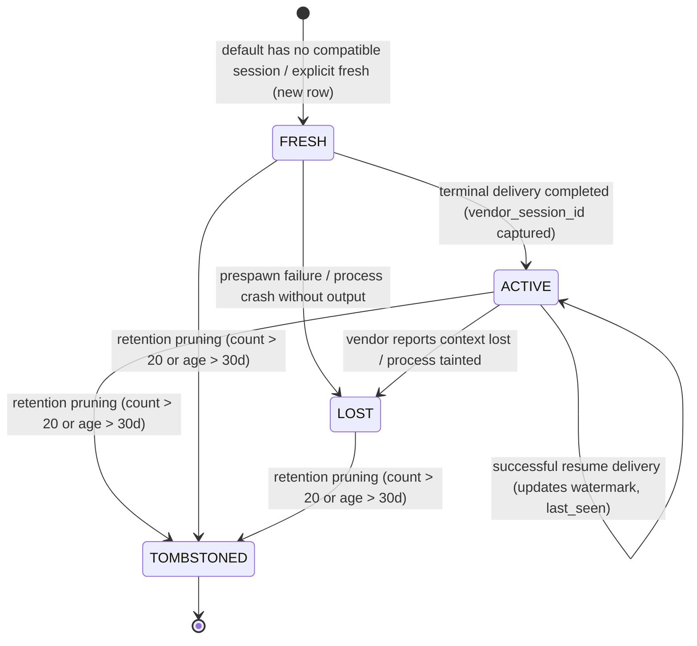

Plan document, 2026-10-13. Reference, not an instruction file.

# Session Continuity & Retained Session Reuse Plan (Release 0.18.0)

## Status and Authority

- **AS-IS and canonical PR/live-check sequence**: [Checkout analysis](analysis-session-reuse-as-is-2026-10-13.md). Its PR1-PR5 assignments supersede earlier stage assignments in both session plans; each PR is independently green.
- **Session inspection companion**: [Session monitoring pre-TDD specification](plan-session-monitoring-2026-10-13.md) (proposed metrics, views, alerts and test catalog; owner questions remain).
- Status: design approved (owner+cc+cx 2026-10-13), implementation not started; decision: --resume removed, default reuse + --fresh + --session
- **Target Release**: `0.18.0` (planned; follows the `0.16.0` stuck-streams PRs 1-3 candidate and remaining recovery/monitoring work; monitoring's original `0.16.0` allocation is superseded).
- **Consensus**: Owner + `cc` + `cx` unanimous agreement; `cx` critique verified against codebase truth.
- **Reference Document**: `docs/design/plan-session-reuse-2026-10-13.md`.
- **Owner-agreed decision**: Default reuse of the latest compatible session; `--fresh` opts out; `--session <handle>` selects exactly. The PeerHub `--resume` option is removed entirely, with no alias or compatibility path. Vendor CLI resume arguments remain adapter implementation details.
- **Precedence**: Supersedes prior ad-hoc reuse design notes; the historical session loss bug remains open until implementation. The current checkout still exposes explicit `--resume`; PR1 removes it from CLI, API, runtime caller paths, metadata writers and public documentation together. Default current-slot reuse is safe before retained-history selection lands in PR2.

---

## 1. Executive Summary and Motivation

### The Value of Session Reuse
Empirical measurements by the project owner demonstrated that resuming existing vendor sessions delivers substantial gains over repeated fresh bootstraps:
1. **Answer Accuracy & Context Coherence**: Continuing a live vendor session preserves chain-of-thought scratchpads, tool calling history, and internalized project context without lossy summarization.
2. **Token & Quota Efficiency**: Re-asking an active session avoids re-ingesting conversation history as raw prompt tokens, reducing prompt tokens by 40%–70% per turn and conserving strict weekly provider quotas (`cx`, `cc`, `ag`).

Callers therefore must be able to continue an ongoing conversation, or explicitly re-ask a **specific earlier session** by name.

### Current State Deficiencies & Bug Audit

Current source anchors and the bounded gap/interface audit are in the
[AS-IS map](analysis-session-reuse-as-is-2026-10-13.md#as-is-map), inspected at
HEAD `02f262c1de2417686409879ae7257fd28ea9634f` with existing worktree edits.
Earlier absolute paths into `ph-wt-sess` are not current checkout references.

1. **Single-slot mapping**: `peerhub/extensions/bridge.py:168` keys
   `bridge_sessions` by stream/peer; `:608` replaces the mapping on creation.
   Delivery/event evidence survives, but older sessions have no selectable registry.
2. **Capability poisoning**: `peerhub/extensions/adapters/base.py:828` assigns
   `self.resumable = resume`; `bridge.py:611` persists it and `:544` checks it
   later. A normal first call stores false capability. The existing paid recall
   canary enables the preference on both turns, masking the fresh-first failure.
3. **No public handles**: generation and mode/reason/injected IDs are available,
   but there is no opaque session handle, retained selector or list/show command.
4. **In-place vendor continuation**: current argv builders at `base.py:634`,
   `:683`, `:728` pass cc `--resume`, cx `exec resume`, ag `--conversation`.
   These remain adapter details. No fork behavior or concurrent resume safety
   is established by this inspection; retain existing single-flight fencing.
5. **Catch-up and watermark gaps**: `_native_delta` at `bridge.py:664` excludes
   all same-peer responses. Completion at `:1100` uses prompt position, then
   response append at `:1178` advances to response position, potentially skipping
   concurrent unseen records. Fix prompt-watermark safety in PR1 before making
   native reuse default; retained-session delta correctness belongs to PR2.

The earlier audit's 171-session count and 40%-70% token-saving observations are
historical owner evidence, not revalidated production measurements here.
Proposed signatures/schema below do not imply current implementation.


---

## 2. Legacy Findings (Mining `ph-legacy`)

The legacy PeerHub codebase checked out read-only at `D:\PkgDev\_sys\data\temp\ph-legacy` (tag `v0-legacy-final`, branch `origin/legacy/v0-main-final`) was comprehensively audited to evaluate historical handling of sessions, resume mechanics, continuity, context occupancy, usage, quota tracking, stores, CLI output, and test cases.

### 2.1 File:Line Pointers and Legacy Implementations

| Component / Subsystem | Legacy Location (`ph-legacy`) | Historical Semantics & Mechanism |
|---|---|---|
| **Session Lease Lifecycle** | [session_lease.py:42-118](file:///D:/PkgDev/_sys/data/temp/ph-legacy/peerhub/dispatch/session_lease.py#L42-L118) | `SessionLeaseCoordinator.create_session_and_lease` atomically created a session binding and active lease using `UnitOfWork` CAS transactions. Enforced single-binding invariant at [L72-L83](file:///D:/PkgDev/_sys/data/temp/ph-legacy/peerhub/dispatch/session_lease.py#L72-L83), raising `InvalidMutationError` unless the lease expired. |
| **Session Resume & Compatibility** | [session_lease.py:120-173](file:///D:/PkgDev/_sys/data/temp/ph-legacy/peerhub/dispatch/session_lease.py#L120-L173), [model.py:1350-1385](file:///D:/PkgDev/_sys/data/temp/ph-legacy/peerhub/dispatch/model.py#L1350-L1385) | `resume_session` evaluated `resume_session_binding`, verifying `current.session_id == request.requested_session_id`, `adapter_fingerprint`, `readiness_binding`, `session_generation`, and `state == ACTIVE`. On mismatch, marked state `STALE` via CAS revision increment. |
| **Lease Renewal & Heartbeats** | [session_lease.py:174-214](file:///D:/PkgDev/_sys/data/temp/ph-legacy/peerhub/dispatch/session_lease.py#L174-L214), [L228-L246](file:///D:/PkgDev/_sys/data/temp/ph-legacy/peerhub/dispatch/session_lease.py#L228-L246) | `renew_lease` and `close_lease` managed heartbeat leases with monotonic fencing tokens (`fencing_token = unit.allocate_fencing_token()`) and revision CAS guards. |
| **Binding State Enums & Models** | [contract.py:137-149](file:///D:/PkgDev/_sys/data/temp/ph-legacy/peerhub/dispatch/contract.py#L137-L149), [L812-L834](file:///D:/PkgDev/_sys/data/temp/ph-legacy/peerhub/dispatch/contract.py#L812-L834), [L963-L980](file:///D:/PkgDev/_sys/data/temp/ph-legacy/peerhub/dispatch/contract.py#L963-L980) | `SessionBindingState` defined 9 states (`ABSENT`, `CREATING`, `ACTIVE`, `SUSPECT`, `UNKNOWN`, `IN_USE`, `STALE`, `RETIRED`, `VERIFYING`). `SessionBindingKey` captured 4-part scope `(workspace_scope_id, instance_id, profile_id, conversation_scope)`. |
| **Session Context Observations** | [contract.py:304-334](file:///D:/PkgDev/_sys/data/temp/ph-legacy/peerhub/telemetry/contract.py#L304-L334), [sqlite_telemetry.py:451-503](file:///D:/PkgDev/_sys/data/temp/ph-legacy/peerhub/persistence/sqlite_telemetry.py#L451-L503) | `SessionContextObserved` stored immutable observations in `session_context_observations` with `generation_id`, `observed_tokens`, `window_tokens`, and `observed_at`. |
| **Session Context Projections** | [contract.py:335-360](file:///D:/PkgDev/_sys/data/temp/ph-legacy/peerhub/telemetry/contract.py#L335-L360), [projections.py:628-657](file:///D:/PkgDev/_sys/data/temp/ph-legacy/peerhub/telemetry/projections.py#L628-L657) | `project_session_context_observation` purely reduced observations into `SessionContextProjectionSnapshot`, verifying key/generation equality and monotonic timestamps. |
| **Context Window Inspection (`cx`/`cc`)** | [presenter.py:232-279](file:///D:/PkgDev/_sys/data/temp/ph-legacy/peerhub/telemetry/presenter.py#L232-L279), [L677-L721](file:///D:/PkgDev/_sys/data/temp/ph-legacy/peerhub/telemetry/presenter.py#L677-L721) | Read live SQLite thread rollouts from `CODEX_HOME/state_5.sqlite` parsing `token_count` (`model_context_window`, `last_token_usage.total_tokens`). Read Claude Code `status_input.log` with `_STATUS_INPUT_MAX_AGE_SECONDS = 86400` ([L48](file:///D:/PkgDev/_sys/data/temp/ph-legacy/peerhub/telemetry/presenter.py#L48)). |
| **Pacing & Threshold Formulas** | [presenter.py:338-349](file:///D:/PkgDev/_sys/data/temp/ph-legacy/peerhub/telemetry/presenter.py#L338-L349), [L334-L336](file:///D:/PkgDev/_sys/data/temp/ph-legacy/peerhub/telemetry/presenter.py#L334-L336), [L413](file:///D:/PkgDev/_sys/data/temp/ph-legacy/peerhub/telemetry/presenter.py#L413) | `_calculate_pacing` computed `ratio = round(used_frac / elapsed_frac, 2)`. Pacing indicators: `ratio <= 1.0` (🟢 safe), `ratio <= 1.15` (🟡 warn), `> 1.15` (🔴 danger). Critical flag `is_crit = used_frac >= 0.90`. |
| **App-Server JSON-RPC Sessions** | [codex_credit.py:75-142](file:///D:/PkgDev/_sys/data/temp/ph-legacy/peerhub/telemetry/codex_credit.py#L75-L142) | `_CodexAppServerSession` maintained short-lived JSON-RPC session correlating with client identity `"hub-credit"` and monotonic request IDs. |
| **Legacy CLI Session Policy** | [test_cli_session_policy.py:39-62](file:///D:/PkgDev/_sys/data/temp/ph-legacy/tests/integration/cli/test_cli_session_policy.py#L39-L62) | Tested flags `--session-policy <auto|reuse|fresh>`, `--session-id <id>`, `--room-id <room>`, and configuration `dispatch-policy.toml`. |
| **Incompatible Model Bug Test** | [test_direct_ask.py:587-670](file:///D:/PkgDev/_sys/data/temp/ph-legacy/tests/integration/application/test_direct_ask.py#L587-L670) | `test_direct_ask_session_resume_incompatible_model_forces_fresh` verified that mismatched adapter fingerprint prevents resume and forces `SessionAction.CREATE`. |
| **Phase 0 Spec Fixtures** | [session_lease.py:42,272-279](file:///D:/PkgDev/_sys/data/temp/ph-legacy/tools/phase0_fixture_runner/domain/session_lease.py#L42) | SL-02 compatible resume and SL-03 mismatch rejection fixtures in fixture runner. |

### 2.2 What to REUSE

1. **Monotonic Generation Allocation**: Monotonically increasing `session_generation` per stream and peer cleanly tracks session lineage.
2. **Strict Multi-Part Binding Integrity**: Mismatch in model, effort, permissions (`writable`), or workspace lineage strictly prevents invalid resume, matching the invariant proven in [test_direct_ask.py:587-670](file:///D:/PkgDev/_sys/data/temp/ph-legacy/tests/integration/application/test_direct_ask.py#L587-L670).
3. **Telemetry Pacing Formulas & Thresholds**:
   - Pacing ratio: $\text{Ratio} = \text{round}(F_{used} / F_{elapsed}, 2)$.
   - Canonical thresholds: $\le 1.00$ (🟢 safe), $1.00 - 1.15$ (🟡 warn), $> 1.15$ (🔴 danger), and $\ge 0.90$ critical alert.
   - Status log freshness window: $\le 86,400\text{ s}$ ($24\text{ h}$) maximum age for status input files before marking STALE.
4. **Targeted Vendor State Inspection with Thread ID Binding**: Direct inspection of vendor SQLite thread states (`CODEX_HOME/state_5.sqlite`) and statusline streams to extract ground-truth context window consumption. Note: Legacy's inspection in `presenter.py:253` used an untargeted query (`SELECT rollout_path FROM threads ORDER BY updated_at DESC LIMIT 1`) that blindly selected the globally newest thread; reusing that query would misattribute another session's telemetry. PeerHub must strictly bind `vendor_session_id` (`WHERE thread_id = ?`) to attribute context telemetry accurately to the active session.
5. **Key Bug Encoding Test Cases**:
   - Incompatible fingerprint/model forcing fresh generation.
   - Idempotency key replay preserving session identity.
   - Mutual exclusion of conflicting flags.

### 2.3 What to DROP (No Backward-Compatibility Shims)

1. **DROP Legacy CLI Flags**: Drop `--session-policy <auto|reuse|fresh>`, `--session-id <id>`, and `--room-id <room>`. The v0 CLI grammar is completely deprecated; no compatibility shims or redirects will be provided.
2. **DROP Complex Phase 0/1 Leased Abstractions**: Drop `SessionLeaseCoordinator`, `SessionBindingKey`, `SessionBindingSnapshot`, `LeaseSnapshot`, `RoomParticipationCoordinator`, and `UnitOfWork` revision CAS loops. PeerHub Session Bridge builds directly on the clean `ClaimStore` (`ClaimToken`) and SQLite ACID transactions.
3. **DROP Over-Engineered State Sets**: Drop `SessionBindingState.VERIFYING`, `IN_USE`, `ROTATION_PENDING`, and `DRAINING`. A compact 4-state machine (`FRESH`, `ACTIVE`, `LOST`, `TOMBSTONED`) provides full operational clarity.
4. **DROP v0 Schema Adapters**: Drop all v0 schema migration shims and legacy table readers. Core schema version guard strictly rejects pre-v1 databases with exit code 6.

### 2.4 What Legacy Got Wrong

1. **Unauthenticated Caller Session IDs**: Legacy permitted callers to supply arbitrary strings (`--session-id conv-42`), leading to collisions, namespace pollution, and leakage of vendor session IDs.
2. **Over-Engineered Ephemeral Leases Without Durable Session Addressing**: Legacy relied on complex `SessionLeaseCoordinator` CAS loops and volatile state machines rather than durable SQLite records and random opaque handles. Note: `ph-legacy` lacked both `bridge_sessions` and `_native_delta`—the single-slot overwrite and same-peer response exclusion defects belong to the *current* Bridge implementation (Section 1.2), not `ph-legacy`.
3. **Capability vs. Preference Conflation**: Historical runtimes conflated adapter capability with caller invocation flags, leading to widespread disabled resume states.
4. **Untargeted Vendor Thread Inspection**: In [presenter.py:253](file:///D:/PkgDev/_sys/data/temp/ph-legacy/peerhub/telemetry/presenter.py#L253), legacy queried `threads ORDER BY updated_at DESC LIMIT 1` without binding the specific session or thread ID. In multi-session workflows, this blindly selected whatever thread was globally newest, misattributing another session's rollout telemetry.
5. **Lack of Retention and Expiry Enforced at Resolution**: Legacy had no tombstoning mechanism or retention quota. Stale sessions lingered indefinitely without lifecycle pruning or resolution-time age checks.

---

## 3. First-Ship Scope vs. Deferred Capabilities

| Capability | Scope Tier | Rationale / Boundary |
|---|---|---|
| **Capability vs. Preference Separation** | **First-Ship (1)** | Bug fix: separate adapter resume support from per-call caller preference; unblock `resumable=1` persistence. |
| **Retained Session Registry** | **First-Ship (2)** | Store historical sessions by random opaque handle; track binding, generation, watermark, truncation, baseline; atomic latest pointer. |
| **Monotonic Generation Allocation** | **First-Ship (2)** | Strictly increasing `session_generation` per `(stream, peer)`; prevents generation collisions. |
| **Retention & Tombstone Policy** | **First-Ship (2)** | Bounded history: keep $N$ latest sessions per `(stream, peer)` (default 20) and max age (30 days); tombstone older sessions before growth. |
| **`ask --session <handle>` Addressing** | **First-Ship (3)** | Resolve to original stream/peer; fail fast on any mismatch (`--stream`, `--peer`, `--workspace`, binding); sequentially mutate in place. |
| **Sequential Identity Promise** | **First-Ship (3)** | Explicit contract: session identity, NOT a historical snapshot; no time-travel or tree rollback. |
| **Idempotency & Request-ID Replay** | **First-Ship (3)** | Stable request idempotency key (`ask:<rid>`); selector intent persisted in prompt metadata; cached terminal replay precedes handle liveness; immutable identity validated before any cached replay; original-handle recovery for overwritten generations; conflicting selectors rejected per TC-SR-28. |
| **Corrected Catch-Up Delta** | **First-Ship (1/2/3)** | Resumed sessions receive all stream records beyond their own `context_watermark`; no blind exclusion of intervening peer responses. Pre-append rejection and durable queue consumption for overflow. |
| **Structured Output & Notices** | **First-Ship (2/3/4)** | Always emit `session` in stdout JSON (object or null on error); text mode appends exactly one stdout trailer; stderr is for errors and threshold advisories; never inject session metadata into the prompt. |
| **Help Text & Diag Integration** | **First-Ship (1/3/4)** | `ask --help` first line states default reuse of the latest compatible session; read-only `session list/show` and `diag` expose identity, binding, state, generation, and telemetry. |
| **Session Telemetry (Context & Quota)** | **First-Ship (4/5)** | Inform-only telemetry in `session.telemetry` (`--json`); last-model-request occupancy numerator; strict null rule; stderr advisory on threshold ($\ge 70\%$ context or quota threat/exhaustion); inspection in `diag`. |
| **Session Forking / Branching** | *Deferred* | Requires vendor `--fork-session` (`cc`) and thread duplication (`cx`/`ag`); complex sandbox divergence. |
| **Cross-Stream Session Reuse** | *Deferred* | Sessions remain strictly scoped to their originating `stream_id`; cross-stream context leakage violates Stream privacy boundaries. |
| **Concurrent Resumes** | *Deferred* | Vendor CLI backends corrupt session state under concurrent access; single-flight execution enforced by claim fence. |
| **Automatic Fallback Restriction** | **First-Ship (3)** | Fallback to fresh generation restricted strictly to proven non-execution before spawn (`NOT_STARTED`); automatic fallback after a `STARTED` delivery is prohibited per §11.2; silent fallback on explicit `--session` is strictly prohibited. |
| **Unbounded Session History** | *Deferred* | Disk and SQLite index explosion prevented by strict retention policy. |

---

## 4. Architecture and System Design

### 4.1 Adapter Capability vs. Per-Call Preference Separation

```text
Call intent                         Persisted session_selector
ask (default)                       "latest"
ask --fresh                         "fresh"
ask --session <handle>              "sess:<handle>"

Adapter capability                  can_resume (static, independent of intent)
History persistence                 resumable = 1 if runtime.resumable else 0
```

1. **Capability**: `ProviderSpec.can_resume = True` for `cx`, `cc`, and `ag`; unsupported adapters use `False`. `CliRuntimeTarget.can_resume` and `resumable` both reflect this static capability. PR1 removes the caller-preference `resume` parameter from `ask()` and `CliRuntimeTarget`, the CLI flag and all caller kwargs/helper/metadata paths together; `resume_session()` gates on capability alone. Bridge retains the existing `RuntimeTarget.resumable` protocol for custom runtimes. Capability correction never proves an old watermark trustworthy.
2. **Default (`latest`)**: Reuse the most recently used **compatible** eligible session for the existing `(stream_id, peer_id)`. Search retained history by `last_seen DESC, session_generation DESC, session_handle DESC`; the MRU pointer is a fast path, not a reason to ignore an older compatible session. Compatibility requires the same workspace lineage, adapter fingerprint, and effective binding (including profile/model/effort and the current call's writable permission). Eligible native sessions are `ACTIVE`, unexpired, resumable, have a vendor ID, and have a trustworthy consumed-context watermark. Custom local sessions retain the existing resolution branch: resume by external ID without requiring a vendor ID or native watermark; catch-up uses delivery evidence (`bridge.py:559`, `:654`; `tests/communication/bridge/test_native_resume.py:295`). Pending/uncertain work is recovered or blocked before selection, never bypassed by another session.
3. **No compatible session**: Before invocation, create a fresh generation with bounded Stream catch-up and a precise reason: `no_prior`, `binding_change`, `workspace_generation_change`, `fingerprint_change`, `delta_too_large`, `not_resumable`, `missing`, `tainted`, `retention_max_age`, or `legacy_watermark_untrusted`. Choose the reason from the most recently used prior candidate with deterministic validation order: expiry/state, capability/vendor ID/watermark, lineage, fingerprint, binding, delta. A LOST row carrying the migration's `legacy_watermark_untrusted` evidence uses that specific reason rather than generic `tainted`. Snapshot its handle before pointer repair for `prior_handle`. If the latest compatible candidate's delta exceeds budget, create fresh with `delta_too_large`; do not silently try another native thread. Fallback is permitted only with proven non-execution (§11.2).
4. **`fresh`**: Always allocate a new generation, reason `explicit_fresh`; if a prior session exists, report its `prior_handle` as deliberately unused. Fresh vendor state still receives bounded Stream catch-up.
5. **`sess:<handle>`**: Select exactly that retained session. Validate syntax, scope, lineage, fingerprint, binding, eligibility, and delta. Any failure rejects the request; never fall back, allocate another session, or spawn another thread.
6. **Writable safeguard**: `--writable` is required on each writable call and defaults to false. Never inherit write permission from the selected session. Current-call permission must match the stored binding; default mismatch creates a fresh session under the current permission, while explicit selection raises a binding error. Recommend task-specific streams to avoid continuing stale writable instructions. Independent review requires a **new stream**, because `--fresh` on the existing stream still receives catch-up.
7. **Existing users**: No user migration or CLI compatibility layer is planned. Remove the old option, aliases, and old recipes from public help/docs; there is no deprecated selector or absent-selector compatibility rule. Internal store migration (§5.3) preserves audit data safely and is separate from CLI compatibility.

### 4.2 Retained Session Registry Architecture & Opaque Handles

The storage architecture decouples historical session retention from active pointer resolution:
1. **Append-Retained History Table (`bridge_session_history`)**: Stores the immutable facts, lineage anchors, watermarks, and status for every session generation ever minted.
2. **Atomic Latest Pointer Table (`bridge_sessions`)**: Maintains the active single-flight pointer per `(stream_id, peer_id)`.
3. **Monotonic Generation Allocator (`bridge_session_counters`)**: Provides atomic counter allocation preventing generation collision or reuse.

### 4.3 Handle Format and Generation Rules

Implement `generate_session_handle()` in the Bridge extension in PR2, when
handles are first persisted. `peerhub/core/identifiers.py` does not exist and
Core must not gain session ownership.

- **Format Specification**: PeerHub-owned random opaque handle conforming to regex `^sess_[0-9a-f]{16}$` (e.g., `sess_8f3a9e21bc04781d`).
- **Generation Method**: Generated via cryptographically secure random bytes:
  ```python
  import secrets
  def generate_session_handle() -> str:
      return f"sess_{secrets.token_hex(8)}"
  ```
- **Privacy and Entropy Invariants**:
  - Exactly 64 bits ($2^{64} \approx 1.84 \times 10^{19}$) of uniform random entropy.
  - Zero information leakage: contains no stream ID, no peer ID, no timestamp, no PID, and no vendor conversation ID.
  - Opaque outside PeerHub: completely meaningless without read access to the local PeerHub SQLite store.
- **Generation Monotonicity Rules**:
  - `session_generation` is an integer strictly increasing ($1, 2, 3, \dots$) per `(stream_id, peer_id)`.
  - Allocated atomically via `bridge_session_counters`.
  - Monotonicity invariant: If session $A$ was created before session $B$ on `(stream, peer)`, then $A.\text{generation} < B.\text{generation}$, even across process restarts, crashes, or session tombstoning. Generation numbers are never recycled.

### 4.4 Sequential Identity Contract (NOT a Historical Snapshot)

- Resuming a session (by default or with `--session <handle>`) mutates that specific live vendor thread in place.
- **No Time-Travel**: It does NOT rewind vendor model parameters, revert workspace filesystem changes, or restore prior tool states.
- If a user targets an older session `sess_A` after other turns or sessions have intervened, the model retains whatever internal state it already accumulated, supplemented by the new prompt and delta catch-up.
- **Lineage Anchor Invariant**: A session can only be resumed if its `workspace_generation` matches the current workspace `generation`. If the workspace was branched or restored to another lineage, resume is rejected.

### 4.5 Corrected Catch-Up Algorithm for Older Resumed Sessions

When resuming an older session $S_{old}$ with watermark $W = S_{old}.\text{context\_watermark}$:
1. Stream history between $W$ and the current prompt position $P_{rec}$ may include:
   - User prompts directed to this peer or other peers.
   - Responses emitted by *other* peers.
   - Responses emitted by *this same peer* generated by subsequent sessions $S_{new}$ ($G > S_{old}.G$).
2. **The Catch-Up Invariant**: $W$ proves consumed input only through that prompt position, not consumption of every later Stream record. A session may know its own generated response, but that does not prove that an intervening concurrent record was seen. Do not skip later records solely because they share the peer author.
3. **The Algorithmic Fix**: Extend `_native_delta` (`peerhub/extensions/bridge.py:664` in the inspected checkout):
   - Query candidate stream records where $W < \text{position} < P_{rec}$ addressed to or visible to this peer.
   - **Do NOT exclude** `(author_peer_id == peer and kind == "response")` when the response position is $> W$.
   - **Contiguous Consumed Context Watermark**: `context_watermark` MUST track contiguous consumed context (the highest prompt record position $P_{rec}$ actually ingested by the session runner), **NOT** the emitted response position $P_{resp}$. If records are appended concurrently during prompt execution (e.g. prompt at position 5, another peer's record at position 6, response at position 7), advancing the watermark to $P_{resp} = 7$ would skip record 6 forever. Tracking consumed prompt position ($P_{rec} = 5$) ensures record 6 is delivered as catch-up on the subsequent turn.
   - **Catch-Up Budget & Provider Limits**: Catch-up records are formatted as structured context injection bounded by `CatchUpBudget`. Bridge deliberately configures `CatchUpBudget(max_records=100, max_bytes=24_000)` ([bridge.py:330](file:///D:/PkgDev/_sys/data/temp/ph-wt-sess/peerhub/extensions/bridge.py#L330)) to stay strictly within provider platform limits. Specifically, on Windows, Agy (`ag`) enforces an inline limit of 30,000 bytes ([base.py:569](file:///D:/PkgDev/_sys/data/temp/ph-wt-sess/peerhub/extensions/adapters/base.py#L569)) due to OS `CreateProcess` argument string ceilings (~32,767 characters). The 24,000-byte bridge budget reserves essential headroom for prompts and CLI flags.
   - **Delta Overflow Handling**:
     - *For default reuse*: If candidate delta exceeds `CatchUpBudget` during pre-spawn resolution (where non-execution is definitively proven), fallback occurs: a fresh session generation is started, and the stdout trailer/JSON reports `reason=delta_too_large` (existing context boundary evidence is retained).
     - *For explicit `--session <handle>`*: Silent fallback is strictly prohibited. If candidate delta exceeds `CatchUpBudget`:
       - **Pre-Append Rejection (`ask.py`)**: `ask()` computes the candidate catch-up delta before appending the prompt record to the Core stream. If the delta exceeds `CatchUpBudget` (24,000 bytes or 100 records), `ask()` immediately raises `SessionDeltaOverflowError` (CLI exit code 2: `session_delta_overflow`) without appending any record to the stream.
       - **Durable Rejection & Consumption (`Bridge.run_cycle`)**: For requests queued in Core (e.g. headless or queued ingestion), `run_cycle` detects overflow during session resolution, commits a terminal failure delivery record (`status='failed_not_started'`, `certainty=NOT_STARTED`, `reason='session_delta_overflow'`), and advances/acks the stream consumer offset. Durably consuming the record ensures the rejected request does NOT remain at the pending queue head or poison subsequent `--fresh` requests. Zero new session is created and zero subprocess is spawned.

---

## 5. Data Model & SQL Specification

### 5.1 Exact Schema Definitions

```sql
-- ============================================================================
-- 1. Retained Session History: immutable log of all minted sessions
-- ============================================================================
CREATE TABLE IF NOT EXISTS bridge_session_history (
    session_handle TEXT PRIMARY KEY,                       -- Opaque random handle: 'sess_' || hex(8)
    stream_id TEXT NOT NULL,                               -- Conversation Stream ID
    peer_id TEXT NOT NULL,                                 -- Peer identity ('cx', 'cc', 'ag')
    session_generation INTEGER NOT NULL,                   -- Strictly monotonic generation per (stream, peer)
    runtime_kind TEXT NOT NULL,                            -- Runtime target kind ('cx', 'cc', 'ag')
    external_session_id TEXT NOT NULL,                     -- Local runner subprocess session ID
    vendor_session_id TEXT,                                -- Native provider thread/conversation ID
    adapter_fingerprint TEXT NOT NULL,                     -- Adapter code/version fingerprint
    binding TEXT NOT NULL,                                 -- Model/profile/effort/permission hash binding
    workspace_generation TEXT NOT NULL DEFAULT '',         -- Lineage anchor token
    context_watermark INTEGER,                             -- Highest stream record position ingested
    bootstrap_truncated INTEGER NOT NULL DEFAULT 0,        -- 1 if catch-up was truncated; else 0
    usage_json TEXT,                                       -- Baseline cumulative usage counters JSON
    resumable INTEGER NOT NULL CHECK (resumable IN (0, 1)),-- Adapter capability (can this be resumed)
    state TEXT NOT NULL CHECK (state IN ('FRESH', 'ACTIVE', 'LOST', 'TOMBSTONED')),
    created_at REAL NOT NULL,                              -- Epoch timestamp (seconds.microseconds)
    last_seen REAL NOT NULL,                               -- Epoch timestamp of last turn completion
    tombstoned_at REAL,                                    -- Epoch timestamp when tombstoned (or NULL)
    UNIQUE (stream_id, peer_id, session_generation)
);

CREATE INDEX IF NOT EXISTS idx_bsh_stream_peer_last_seen
    ON bridge_session_history (stream_id, peer_id, last_seen DESC);

CREATE INDEX IF NOT EXISTS idx_bsh_state
    ON bridge_session_history (stream_id, peer_id, state);

-- ============================================================================
-- 2. Latest Session Pointer: atomic pointer to latest session per (stream, peer)
-- ============================================================================
CREATE TABLE IF NOT EXISTS bridge_sessions (
    stream_id TEXT NOT NULL,
    peer_id TEXT NOT NULL,
    session_handle TEXT NOT NULL,
    session_generation INTEGER NOT NULL,
    updated_at REAL NOT NULL,
    PRIMARY KEY (stream_id, peer_id),
    FOREIGN KEY (session_handle) REFERENCES bridge_session_history(session_handle)
);

-- ============================================================================
-- 3. Monotonic Generation Counters: guarantees collision-free sequence numbers
-- ============================================================================
CREATE TABLE IF NOT EXISTS bridge_session_counters (
    stream_id TEXT NOT NULL,
    peer_id TEXT NOT NULL,
    next_generation INTEGER NOT NULL DEFAULT 1,
    PRIMARY KEY (stream_id, peer_id)
);
```

### 5.2 Relationship Between `bridge_sessions` and `bridge_session_history`

1. **Role of `bridge_session_history`**: Authoritative record of every session created. Rows are never overwritten.
2. **Role of `bridge_sessions`**: Fast lookup pointer table for default reuse and compatibility checks; query history if the pointer is incompatible.
3. **Resolution of Current Mapping**:
   In `Bridge.current_mapping(peer_id, stream_id)`, the latest session is resolved via a single indexed join:
   ```sql
   SELECT h.*
   FROM bridge_sessions s
   JOIN bridge_session_history h ON s.session_handle = h.session_handle
   WHERE s.stream_id = ? AND s.peer_id = ?;
   ```
4. **Resolution by Handle**:
   When `--session <handle>` is specified, resolution bypasses `bridge_sessions` and queries `bridge_session_history` directly:
   ```sql
   SELECT *
   FROM bridge_session_history
   WHERE session_handle = ?;
   ```
5. **Pointer Synchronization Invariant (Most Recently Used / Active Pointer)**:
   The `bridge_sessions` table maintains the **Most Recently Used (MRU)** / active session pointer for each `(stream_id, peer_id)`. "Latest" specifically denotes the most recently used/activated session, NOT strictly the highest numerical generation created.
   Whenever a turn creates a new session OR successfully resumes an existing session on `(stream_id, peer_id)` (including an older generation resumed via `--session <handle>`):
   - The session row in `bridge_session_history` is updated (or inserted) with updated `last_seen` timestamp, watermark, and usage.
   - The `bridge_sessions` pointer is updated atomically to point to that session handle:
     ```sql
     INSERT OR REPLACE INTO bridge_sessions (stream_id, peer_id, session_handle, session_generation, updated_at)
     VALUES (?, ?, ?, ?, ?);
     ```
   This guarantees consistency with TC-SR-18: resuming an earlier session `sess_1` updates the `bridge_sessions` pointer back to `sess_1`. Consequently, a subsequent invocation of `ask` will continue `sess_1` if compatible rather than jumping to a different generation.

### 5.3 Step-by-Step Migration for Existing Databases

Existing SQLite stores have legacy single-row `bridge_sessions` tables. The following migration executes once, atomically, inside `Bridge.__init__`; schema detection makes subsequent initialization a no-op. This is internal data preservation, not a CLI compatibility layer:

```sql
-- Step 1: Detect whether migration is required
-- Condition: 'bridge_session_history' does not exist OR 'session_handle' not in bridge_sessions

-- Step 2: Create target history and counter tables
CREATE TABLE IF NOT EXISTS bridge_session_history (
    session_handle TEXT PRIMARY KEY,
    stream_id TEXT NOT NULL,
    peer_id TEXT NOT NULL,
    session_generation INTEGER NOT NULL,
    runtime_kind TEXT NOT NULL,
    external_session_id TEXT NOT NULL,
    vendor_session_id TEXT,
    adapter_fingerprint TEXT NOT NULL,
    binding TEXT NOT NULL,
    workspace_generation TEXT NOT NULL DEFAULT '',
    context_watermark INTEGER,
    bootstrap_truncated INTEGER NOT NULL DEFAULT 0,
    usage_json TEXT,
    resumable INTEGER NOT NULL CHECK (resumable IN (0, 1)),
    state TEXT NOT NULL CHECK (state IN ('FRESH', 'ACTIVE', 'LOST', 'TOMBSTONED')),
    created_at REAL NOT NULL,
    last_seen REAL NOT NULL,
    tombstoned_at REAL,
    UNIQUE (stream_id, peer_id, session_generation)
);

CREATE INDEX IF NOT EXISTS idx_bsh_stream_peer_last_seen
    ON bridge_session_history (stream_id, peer_id, last_seen DESC);

CREATE INDEX IF NOT EXISTS idx_bsh_state
    ON bridge_session_history (stream_id, peer_id, state);

CREATE TABLE IF NOT EXISTS bridge_session_counters (
    stream_id TEXT NOT NULL,
    peer_id TEXT NOT NULL,
    next_generation INTEGER NOT NULL DEFAULT 1,
    PRIMARY KEY (stream_id, peer_id)
);

-- Step 2b: Normalize legacy columns in bridge_sessions prior to rename
-- Supported older schemas may lack columns added in subsequent Bridge milestones:
-- vendor_session_id, context_watermark, bootstrap_truncated, usage_json, workspace_generation
-- Bridge migration inspects PRAGMA table_info(bridge_sessions) and dynamically executes:
-- ALTER TABLE bridge_sessions ADD COLUMN workspace_generation TEXT NOT NULL DEFAULT '';
-- ALTER TABLE bridge_sessions ADD COLUMN vendor_session_id TEXT;
-- ALTER TABLE bridge_sessions ADD COLUMN context_watermark INTEGER;
-- ALTER TABLE bridge_sessions ADD COLUMN bootstrap_truncated INTEGER NOT NULL DEFAULT 0;
-- ALTER TABLE bridge_sessions ADD COLUMN usage_json TEXT;

-- Step 3: Rename legacy bridge_sessions table if it exists with legacy structure
ALTER TABLE bridge_sessions RENAME TO legacy_bridge_sessions_tmp;

-- Step 4: Populate bridge_session_history from normalized legacy table
-- Synthesizes opaque handle 'sess_' || hex(8) (conforming to ^sess_[0-9a-f]{16}$) and corrects historical resumable=0
INSERT INTO bridge_session_history (
    session_handle, stream_id, peer_id, session_generation, runtime_kind,
    external_session_id, vendor_session_id, adapter_fingerprint, binding,
    workspace_generation, context_watermark, bootstrap_truncated, usage_json,
    resumable, state, created_at, last_seen, tombstoned_at
)
SELECT
    'sess_' || lower(hex(randomblob(8))),
    stream_id,
    peer_id,
    session_generation,
    runtime_kind,
    external_session_id,
    vendor_session_id,
    adapter_fingerprint,
    binding,
    COALESCE(workspace_generation, ''),
    NULL, -- Never copy the unsafe legacy response-position watermark
    COALESCE(bootstrap_truncated, 0),
    usage_json,
    CASE WHEN runtime_kind IN ('cx', 'cc', 'ag') THEN 1 ELSE resumable END, -- Fix CLI capability; preserve custom runtimes
    CASE WHEN state = 'TOMBSTONED' THEN 'TOMBSTONED'
         WHEN runtime_kind NOT IN ('cx', 'cc', 'ag') AND vendor_session_id IS NULL THEN state
         ELSE 'LOST' END, -- Preserve local sessions; native continuity must be proven
    last_seen,
    last_seen,
    CASE WHEN state = 'TOMBSTONED' THEN last_seen ELSE NULL END
FROM legacy_bridge_sessions_tmp;

-- Step 4b: Reconstruct consumed-context watermarks in application code (below).
-- Otherwise leave watermark NULL and state LOST; emit legacy_watermark_untrusted detail.
-- Persist an event per invalidated row using the existing event columns:
-- event='legacy_continuity_invalidated', from_state=<original>, to_state='LOST',
-- generation=<original>, detail={session_handle, reason:legacy_watermark_untrusted, created_at}.

-- Step 5: Re-create bridge_sessions as the latest pointer table
CREATE TABLE bridge_sessions (
    stream_id TEXT NOT NULL,
    peer_id TEXT NOT NULL,
    session_handle TEXT NOT NULL,
    session_generation INTEGER NOT NULL,
    updated_at REAL NOT NULL,
    PRIMARY KEY (stream_id, peer_id),
    FOREIGN KEY (session_handle) REFERENCES bridge_session_history(session_handle)
);

-- Step 6: Populate bridge_sessions from migrated history
INSERT INTO bridge_sessions (stream_id, peer_id, session_handle, session_generation, updated_at)
SELECT stream_id, peer_id, session_handle, session_generation, last_seen
FROM bridge_session_history
WHERE state = 'ACTIVE' AND resumable = 1 AND last_seen >= :migration_cutoff
  AND ((vendor_session_id IS NOT NULL AND context_watermark IS NOT NULL)
       OR (runtime_kind NOT IN ('cx', 'cc', 'ag') AND vendor_session_id IS NULL));

-- Step 7: Initialize bridge_session_counters
INSERT INTO bridge_session_counters (stream_id, peer_id, next_generation)
SELECT stream_id, peer_id, MAX(session_generation) + 1
FROM bridge_session_history
GROUP BY stream_id, peer_id;

-- Step 8: Drop temporary legacy table
DROP TABLE legacy_bridge_sessions_tmp;
```

**Local-session preservation**: The native watermark proof below applies only to native sessions. Custom local rows retain their capability and state; resolve them through `resume_session(external_session_id)` with the existing fingerprint, binding, state and workspace checks (`bridge.py:544-559`). Keep native telemetry absent and use delivery evidence for local catch-up (`bridge.py:654-662`), preserving the contract in `tests/communication/bridge/test_native_resume.py:295`. Durable uncertain work is still handled before resolution.

**Step 4b — legacy watermark safety**: The old watermark may be a response position. Never copy it or subtract one. Match durable `bridge_deliveries` to the exact `(stream, peer, session_generation, external_session_id)` and prove which completed prompt positions and catch-up records were consumed by that vendor thread. Only a complete, unambiguous contiguous-context proof permits setting `context_watermark` to the last consumed **prompt** position and restoring an originally `ACTIVE` row to `ACTIVE`. For prompt 5 / concurrent record 6 / response 7, the reconstructed watermark is 5 and record 6 remains in the next delta. Missing, ambiguous, truncated, or uncertain evidence leaves the row `LOST`, watermark null, and detail `legacy_watermark_untrusted`; default starts fresh with bounded catch-up, explicit selection fails. Correcting `resumable=0` establishes capability only, never proves continuity. Do not migrate old selector-less pending requests into the new default; definitively unstarted requests are consumed as `legacy_selector_unsupported`, uncertain ones remain blocked for reconciliation. Terminal audit records remain inspectable; no absent-selector replay shim is added.

**Event storage contract (unchanged)**: `bridge_session_events` has `seq`, `stream_id`, `peer_id`, `event`, `from_state`, `to_state`, `generation`, and `detail` (JSON text). It has no `session_handle`, `reason`, or `created_at` columns. All event examples in this plan put handle, reason, and timestamp in `detail`; transitions provide non-null `from_state` (use `NONE` for creation), `to_state`, and generation. Reuse the existing `_session_event()` contract; no event-table migration is required. Delivery results persist the accepted handle and output snapshot in `result_json`; session identity can also be located by `(stream, peer, session_generation, external_session_id)` in retained history, never the current pointer.

Bind `migration_cutoff = migration_now - 30 * 86400` in Step 6. Apply age pruning and its events/repair before migration commits. Database creation without an old table uses §5.1 directly; do not execute the rename against a nonexistent table. A partial target schema is a migration error, not permission to duplicate history or counters.

## 6. Session Lifecycle and Complete State Machine Table

### 6.1 State Diagram



### 6.2 Complete State Machine Table

| Current State | Event / Trigger | Target State | Preconditions | Who Writes | Transaction & Locking | Side Effects & Database Updates |
|---|---|---|---|---|---|---|
| `NONE` | `create_session` | `FRESH` | Valid runtime target (creation permitted for both resumable and non-resumable runtimes; resumable flag persisted from runtime capability) | `Bridge._resolve_session` | Claim fenced (`claims.fenced(token)`), SQLite write lock on `(stream_id, peer_id)` | 1. Mint `session_handle = generate_session_handle()`<br>2. Allocate `gen` from `bridge_session_counters`<br>3. `INSERT INTO bridge_session_history` (`state='FRESH'`)<br>4. Upsert `bridge_sessions` latest pointer<br>5. Record `bridge_session_events` (`event='created'`) |
| `ACTIVE` | `default_compatible_selection` | `ACTIVE` | Latest compatible eligible retained row satisfies §4.1, no uncertain work | `Bridge._resolve_session` | Claim fenced | Bind exact vendor ID; persist accepted handle/gen and `mode=resumed`, `reason=null`; allocate no new generation. Successful delivery updates MRU handle/gen and watermark. |
| Any prior state / `NONE` | `explicit_fresh` | `FRESH` (new row) | Caller chose `--fresh`; no uncertain work | `Bridge._resolve_session` | Claim fenced | Prior row unchanged; mint new handle/gen, `explicit_fresh`, and prior handle as unused; bounded Stream catch-up still injected. |
| Any state / unknown handle | `definitive_selector_rejection` | Unchanged (expired rows tombstone) | Exact selector fails validation before marker/spawn | `ask` / `Bridge.run_cycle` | Direct pre-append validation; queued fenced failure commit | Direct call appends no prompt; queued request durably fails/acks under §11.3. No allocation/fallback; JSON session null. |
| `FRESH` | `first_delivery_succeeded` | `ACTIVE` | Terminal delivery ok; `vendor_session_id` parsed from stdout | `Bridge._finalize` (`bridge.py:1037`) | Claim fenced (`claims.fenced(token)`) | 1. `UPDATE bridge_session_history`: set `state='ACTIVE'`, `vendor_session_id`, `context_watermark = max(watermark or 0, delivery["record_position"])`, `last_seen=now()`, `usage_json`<br>2. `UPDATE bridge_sessions`: set `updated_at=now()`<br>3. Record `bridge_session_events` (`event='session_active'`) |
| `FRESH` | `prespawn_failure` | `LOST` | Subprocess executable missing, permissions denied, or OS spawn error | `Bridge._resolve_session` / `run_cycle` | Claim fenced (`claims.fenced(token)`) | 1. `UPDATE bridge_session_history`: set `state='LOST'`, `last_seen=now()`<br>2. Record `bridge_session_events` (`event='create_failed'`) |
| `FRESH` | `process_crash_no_output` | `LOST` | Subprocess exited non-zero with empty stdout/stderr | `Bridge.run_cycle` | Claim fenced (`claims.fenced(token)`) | 1. `UPDATE bridge_session_history`: set `state='LOST'`, `last_seen=now()`<br>2. Record `bridge_session_events` (`event='session_lost'`, `reason='exit_zero_empty_output'`) |
| `ACTIVE` | `resume_delivery_succeeded` | `ACTIVE` | Resumed subprocess succeeded; terminal response parsed | `Bridge._finalize` (`bridge.py:1037`) | Claim fenced (`claims.fenced(token)`) | 1. `UPDATE bridge_session_history`: set `context_watermark = max(watermark or 0, delivery["record_position"])`, `last_seen=now()`, updated `usage_json`<br>2. `UPDATE bridge_sessions`: set `updated_at=now()`<br>3. Record `bridge_session_events` (`event='resume_ok'`) |
| `ACTIVE` | `resume_rejected_vendor` | `LOST` | Provider CLI stdout/stderr indicates session expired, deleted, or invalid ID | `Bridge.run_cycle` | Claim fenced (`claims.fenced(token)`) | 1. `UPDATE bridge_session_history`: set `state='LOST'`, `vendor_session_id=NULL`, `last_seen=now()`<br>2. Record `bridge_session_events` (`event='session_lost'`, `reason='vendor_rejected'`)<br>3. **Zero Automatic Fallback**: Because the subprocess was spawned and emitted `started` (`base.py:1101`), delivery certainty is `STARTED`. Per §11.2, automatic fallback/retry after a `STARTED` delivery is strictly prohibited. Delivery completes as uncertain/failed; caller must re-initiate |
| `ACTIVE` | `process_tainted` | `LOST` | Silence timeout exceeded, SIGKILL, unparseable output, or power loss | `Bridge.run_cycle` recovery scanner | Claim fenced (`claims.fenced(token)`) | 1. `UPDATE bridge_session_history`: set `state='LOST'`, `last_seen=now()`<br>2. Record `bridge_session_events` (`event='session_lost'`, `reason='tainted'`) |
| Any prior state | `default_no_compatible_session` | `FRESH` (new row) | Default finds no eligible compatible row or its delta exceeds budget; no uncertain work | `Bridge._resolve_session` | Claim fenced (`claims.fenced(token)`) | 1. Prior row retained (expiry may tombstone it)<br>2. Mint new handle/gen (`state=FRESH`)<br>3. Update pointer handle AND generation<br>4. Report fresh reason and prior handle in stdout trailer / JSON |
| `ACTIVE` / `FRESH` / `LOST` | `retention_quota_prune` | `TOMBSTONED` | Active sessions on `(stream, peer)` exceed $N=20$; session ranked $> 20$ by `last_seen DESC` | Retention pruner during session create | Inside claim fence transaction | 1. `UPDATE bridge_session_history`: set `state='TOMBSTONED'`, `tombstoned_at=now()`<br>2. Record `bridge_session_events` (`event='tombstoned'`, `reason='retention_quota'`) |
| `ACTIVE` / `FRESH` / `LOST` | `retention_age_prune` | `TOMBSTONED` | Session inactive for $> 30$ days (`now - last_seen > 30 * 86400`) | Retention pruner during session create | Inside claim fence transaction | 1. `UPDATE bridge_session_history`: set `state='TOMBSTONED'`, `tombstoned_at=now()`<br>2. Record `bridge_session_events` (`event='tombstoned'`, `reason='retention_max_age'`) |
| `ACTIVE` / `FRESH` / `LOST` | `resolution_age_check` | `TOMBSTONED` | Inactivity $> 30$ days (`now - last_seen > 30 * 86400`) during `_resolve_session` or `resolve_session_by_handle` | Bridge resolution (`_resolve_session` / `resolve_session_by_handle`) | Inside claim fence transaction | 1. `UPDATE bridge_session_history`: set `state='TOMBSTONED'`, `tombstoned_at=now()`<br>2. Repair `bridge_sessions` latest pointer (atomically repoint handle AND generation to an eligible ACTIVE session, or delete pointer row)<br>3. Record `bridge_session_events` (`event='tombstoned'`, `reason='retention_max_age'`)<br>4. **COMMIT transaction BEFORE raising**: Commit tombstone updates and pointer repair to SQLite before explicit selection raises `SessionTombstonedError` (CLI exit code 2); default reselects or creates fresh after commit, preventing `ClaimStore._tx()` from rolling back on exception |
| `TOMBSTONED` | `explicit_resume_target` | `TOMBSTONED` (rejected) | Caller passes `--session <tombstoned_handle>` | `Bridge._resolve_session` | Read-only check in claim fence | **Zero state change**: Raises `SessionTombstonedError`. CLI exits code 2. A tombstoned session is never revived. |

Every transition to LOST/TOMBSTONED repairs a pointer targeting that row under §7.3. Successful activation/resume atomically upserts pointer **handle and generation**, including older exact-selected generations. State/event `reason` annotations above are JSON `detail` fields, not event-table columns. A queued exact-selector rejection also consumes the prompt as §11.3 requires.

---

## 7. Retention and Tombstone Algorithm

### 7.1 Policy Invariants & Configuration

To bound the active session working set and index scan volume while preserving reproducible audit evidence:
1. **Per-Stream-Peer Retention Quota ($N$)**:
   - At most **$N = 20$** non-tombstoned sessions retained per `(stream_id, peer_id)`.
   - Hardcoded default: 20 sessions (configurable per-workspace in milestone `0.18.1`).
2. **Maximum Retention Age ($T_{max}$)**:
   - Maximum inactivity window: **30 days** ($30 \times 86,400 = 2,592,000$ seconds).
   - Any session where `now - last_seen > 2,592,000` is eligible for immediate tombstoning.
3. **Audit Trail Immutability & Storage Bounds**:
   - Tombstoned rows are **never physically deleted** (`DELETE FROM bridge_session_history` is prohibited) to preserve foreign key integrity with execution evidence, record references, and diagnostics history.
   - Consequently, tombstoning bounds the **active working set** of resumable sessions rather than physical SQLite disk footprint; long-term compaction or archiving policies can be scheduled in future maintenance milestones if total historical rows grow large.
4. **Resolution-Time Expiry Enforcement**:
   - In addition to creation-time pruning, session resolution (`_resolve_session` and `resolve_session_by_handle`) strictly checks session age against $T_{max}$ (`now - last_seen > 2,592,000`).
   - If expired, the resolver commits the session's `TOMBSTONED` state and pointer repair. Explicit selection raises `SessionTombstonedError`; default selection searches remaining compatible history or starts fresh with `retention_max_age`. An expired handle can never be resumed, regardless of whether a new session creation pass has executed.

### 7.2 Atomic Pruning Algorithm

The pruning pass executes atomically inside the claim fence whenever a new session generation is minted:

```python
def prune_retained_sessions(
    conn: sqlite3.Connection,
    stream_id: str,
    peer_id: str,
    *,
    max_sessions: int = 20,
    max_age_days: float = 30.0,
    now_ts: float | None = None,
) -> int:
    """Transition expired and capacity-exceeded sessions to TOMBSTONED.
    
    Must be executed inside an active ClaimStore transaction fence.
    Returns the count of newly tombstoned sessions.
    """
    now = time.time() if now_ts is None else now_ts
    cutoff = now - (max_age_days * 86400.0)
    
    victims = conn.execute(
        """
        SELECT * FROM bridge_session_history
        WHERE stream_id = ? AND peer_id = ? AND state != 'TOMBSTONED'
          AND (
              last_seen < ?
              OR session_handle NOT IN (
                  SELECT session_handle FROM bridge_session_history
                  WHERE stream_id = ? AND peer_id = ? AND state != 'TOMBSTONED'
                  ORDER BY last_seen DESC, session_generation DESC, session_handle DESC LIMIT ?
              )
          )
        """,
        (stream_id, peer_id, cutoff, stream_id, peer_id, max_sessions),
    ).fetchall()
    for row in victims:
        reason = "retention_max_age" if row["last_seen"] < cutoff else "retention_quota"
        conn.execute(
            "UPDATE bridge_session_history SET state = 'TOMBSTONED', tombstoned_at = ? WHERE session_handle = ?",
            (now, row["session_handle"]),
        )
        conn.execute(
            """INSERT INTO bridge_session_events
               (stream_id, peer_id, event, from_state, to_state, generation, detail)
               VALUES (?, ?, ?, ?, ?, ?, ?)""",
            (stream_id, peer_id, "tombstoned", row["state"], "TOMBSTONED",
             row["session_generation"], json.dumps({"session_handle": row["session_handle"],
             "reason": reason, "created_at": now}, sort_keys=True)),
        )
    ptr = conn.execute(
        "SELECT session_handle FROM bridge_sessions WHERE stream_id = ? AND peer_id = ?",
        (stream_id, peer_id),
    ).fetchone()
    if ptr is not None and ptr["session_handle"] in {r["session_handle"] for r in victims}:
        repair_session_pointer(conn, stream_id, peer_id, now=now, cutoff=cutoff)
    return len(victims)
```

### 7.3 Tombstone Pointer Invariant

Expiry, retention pruning, and transitions to `LOST` use one pointer repair routine inside the fenced write transaction. Replacements must be `ACTIVE`, resumable, and satisfy `last_seen >= cutoff`. Native replacements require a vendor ID and trustworthy watermark; custom local replacements use the preserved local-session branch (§5.3). Never choose `LOST`, `FRESH`, `TOMBSTONED`, or already expired rows. Order eligible replacements by `last_seen DESC, session_generation DESC, session_handle DESC`.

If a replacement exists, atomically update **both** `session_handle` and `session_generation`, plus `updated_at`. If none exists, **delete the pointer row**; `session_handle` stays `NOT NULL`. Generation counters remain unchanged. Per-call lineage/fingerprint/binding checks still apply after repair.

The shared repair routine only runs when the pointer targets an invalidated row; a newly allocated FRESH pointer remains available for its own delivery recovery.

```python
def repair_session_pointer(conn, stream_id, peer_id, *, now, cutoff):
    replacement = conn.execute(
        """SELECT session_handle, session_generation FROM bridge_session_history
           WHERE stream_id = ? AND peer_id = ? AND state = 'ACTIVE'
             AND resumable = 1 AND last_seen >= ?
             AND ((vendor_session_id IS NOT NULL AND context_watermark IS NOT NULL)
                  OR (runtime_kind NOT IN ('cx', 'cc', 'ag') AND vendor_session_id IS NULL))
           ORDER BY last_seen DESC, session_generation DESC, session_handle DESC LIMIT 1""",
        (stream_id, peer_id, cutoff),
    ).fetchone()
    if replacement is None:
        conn.execute("DELETE FROM bridge_sessions WHERE stream_id = ? AND peer_id = ?",
                     (stream_id, peer_id))
    else:
        conn.execute(
            """UPDATE bridge_sessions SET session_handle = ?, session_generation = ?, updated_at = ?
               WHERE stream_id = ? AND peer_id = ?""",
            (replacement["session_handle"], replacement["session_generation"], now, stream_id, peer_id),
        )
```

**Commit before error**: Tombstone history, repair pointer, and append the event using §5.3's existing event columns in one transaction. Exit the transaction normally so it commits, then raise for explicit selection. Default selection instead continues after commit. `_resolve_session` must return an error/outcome from its fenced transaction and raise outside it, or durably consume a queued rejection in the same transaction; throwing through an outer `ClaimStore._tx()` would roll everything back. The standalone handle resolver likewise owns its commit boundary; do not nest it inside a rollback-on-error transaction.

---

## 8. Proposed Code Interfaces and Module Signatures

These describe the final target, not existing interfaces or copy-ready patches.
The [AS-IS interface audit](analysis-session-reuse-as-is-2026-10-13.md#proposed-interfaces-that-do-not-exist-yet)
identifies additions and corrections. Preserve current adapter constructor
arguments and RuntimeTarget.resumable; introduce each target interface only in
its complete canonical PR.

### 8.1 `peerhub/extensions/adapters/base.py`

Decouples static adapter capability from per-turn caller preference.

```python
class ProviderSpec:
    """Base specification for vendor CLI provider adapters."""
    kind: str
    binary: str
    resume_flag: str | None
    stdin_prompt: bool
    can_resume: bool = False  # Static capability: True if vendor CLI supports session resume

class CcSpec(ProviderSpec):
    kind, binary, resume_flag, stdin_prompt = "cc", "claude", "--resume", True
    can_resume = True

class CxSpec(ProviderSpec):
    kind, binary, resume_flag, stdin_prompt = "cx", "codex", "resume", True
    can_resume = True

class AgSpec(ProviderSpec):
    kind, binary, resume_flag, stdin_prompt = "ag", "agy", "--conversation", False
    can_resume = True

class CliRuntimeTarget:
    """RuntimeTarget over one vendor CLI subprocess."""

    can_resume: bool = False  # Initialized from ProviderSpec.can_resume
    resumable: bool = False   # Capability property consumed by the RuntimeTarget protocol

    def __init__(
        self,
        kind: str,
        workspace: str | Path,
        *,
        model: str | None = None,
        effort: str | None = None,
        profile: str | None = None,
        silence_timeout_s: float | None = None,
        writable: bool = False,
        command: Sequence[str] | None = None,
        timeout_s: float = DEFAULT_TIMEOUT_S,
        max_bytes: int = DEFAULT_MAX_BYTES,
        env_extra: Mapping[str, str] | None = None,
        extra_secrets: Iterable[str] = (),
        on_output: Callable[[str], None] | None = None,
    ) -> None:
        ...
        self._spec = SPECS[kind]
        self.can_resume = self._spec.can_resume
        self.resumable = self.can_resume  # Capability, NOT caller preference; permits --session and queued resumes under default target
        ...

    def resume_session(self, external_session_id: str, *, vendor_session_id: str | None = None) -> str:
        """Bind an explicit vendor id; gated on adapter capability, NOT caller preference."""
        if not self.can_resume:
            self._note("resume_unsupported")
            return "unsupported"
        if vendor_session_id is None:
            return "missing"
        if _session_id(vendor_session_id) is None:
            return "rejected"
        with self._active_lock:
            if external_session_id in self._active:
                return "rejected"
            self._resume_sessions[external_session_id] = vendor_session_id
        return "ok"
```

### 8.2 `peerhub/extensions/bridge.py`

Adds exception hierarchy, handle resolution, corrected delta projection, and cycle results.

```python
# --- Exception Hierarchy ---
class SessionBridgeError(Exception):
    """Base exception for Bridge session addressing and validation errors."""

class SessionNotFoundError(SessionBridgeError):
    """Requested session handle does not exist in bridge_session_history."""

class SessionTombstonedError(SessionBridgeError):
    """Requested session handle was tombstoned by retention policy and cannot be resumed."""

class SessionDeltaOverflowError(SessionBridgeError):
    """Catch-up delta for explicit --session exceeds budget and cannot be resumed without context loss."""

class SessionStreamMismatchError(SessionBridgeError):
    """Session handle belongs to a different Stream than requested."""

class SessionPeerMismatchError(SessionBridgeError):
    """Session handle belongs to a different Peer than requested."""

class SessionWorkspaceMismatchError(SessionBridgeError):
    """Session handle was created in a different workspace lineage than requested."""

class SessionBindingMismatchError(SessionBridgeError):
    """Session handle binding hash (model/effort/writable) does not match requested."""

class SessionFingerprintMismatchError(SessionBridgeError):
    """Explicit session adapter fingerprint differs from this runtime."""

class SessionUnavailableError(SessionBridgeError):
    """Explicit session is not ACTIVE/resumable or lacks vendor identity/continuity evidence."""

class SessionLostError(SessionBridgeError):
    """Session handle is in LOST state (process crash, provider rejection, or tainted)."""

# --- RuntimeTarget Protocol (Preserving Existing Contract) ---
RuntimeEvent = tuple[str, Any] | tuple[str, Any, Any]  # ("started", exec_id) | ("timeout", seconds) | ("terminal", {"response": ...})

class RuntimeTarget(Protocol):
    runtime_kind: str
    resumable: bool
    def fingerprint(self) -> str: ...
    def binding(self) -> str: ...
    def create_session(self) -> str: ...
    def resume_session(self, external_session_id: str, *, vendor_session_id: str | None = None) -> str: ...
    def deliver(self, external_session_id: str, record: Any, catch_up: list[Any]) -> Iterable[RuntimeEvent]: ...

# --- CycleResult Dataclass Update ---
@dataclass
class CycleResult:
    status: str
    record_id: str | None = None
    delivery_id: str | None = None
    certainty: str | None = None
    response_record_id: str | None = None
    session_generation: int | None = None
    session_handle: str | None = None    # Opaque handle: sess_xxx
    session_mode: str | None = None      # 'resumed' | 'fresh'
    session_reason: str | None = None    # 'no_prior' | 'binding_change' | etc.
    detail: dict[str, Any] = field(default_factory=dict[str, Any])

# --- Bridge Methods ---
class Bridge:
    def current_mapping(self, peer_id: str, stream_id: str) -> dict[str, Any] | None:
        """Resolve current active session by joining pointer and history tables."""
        with self.claims.transaction() as conn:
            r = conn.execute(
                """
                SELECT h.*
                FROM bridge_sessions s
                JOIN bridge_session_history h ON s.session_handle = h.session_handle
                WHERE s.stream_id = ? AND s.peer_id = ?
                """,
                (stream_id, peer_id)
            ).fetchone()
        if r is None:
            return None
        d = dict(r)
        d["resumable"] = bool(d["resumable"])
        d["bootstrap_truncated"] = bool(d["bootstrap_truncated"])
        return d

    def resolve_session_by_handle(
        self,
        token: ClaimToken,
        session_handle: str,
        *,
        max_age_days: float = 30.0,
        now_ts: float | None = None,
    ) -> dict[str, Any] | None:
        """Proposed PR3 writer interface, called under the session's claim fence.

        Validate scoped identity, expire/tombstone and repair the pointer using
        claims.fenced(token). Commit expiry/event/pointer effects before raising
        exact-selection errors. Revalidate under the fence even after direct
        pre-append validation; never use an unfenced helper to mutate history.
        List/show readers use the separate read-only monitoring interfaces.
        """
        ...

    def _resolve_session(
        self,
        token: ClaimToken,
        runtime: RuntimeTarget,
        record: Record,
        did: str,
    ) -> tuple[str, int, str, str, str | None]:
        """Resolve or allocate session generation, handle, mode, and reason.
        
        Reads session selector and requested_handle from prompt record's metadata_json.
        Default searches compatible eligible history; fresh allocates; explicit selects exactly.
        Preserve custom local resume_session(external_session_id) and delivery-evidence catch-up;
        vendor ID, native watermark and native delta checks apply only to native sessions (§5.3).
        Enforces committed resolution-time expiry and pointer repair (§7.3); default continues, explicit rejects.
        For explicit --session, raises SessionDeltaOverflowError if delta exceeds CatchUpBudget.
        
        Returns:
            (external_session_id, session_generation, session_handle, mode, reason)
        Raises:
            SessionNotFoundError, SessionTombstonedError, SessionDeltaOverflowError,
            SessionStreamMismatchError, SessionPeerMismatchError, SessionWorkspaceMismatchError,
            SessionBindingMismatchError, SessionFingerprintMismatchError, SessionUnavailableError, SessionLostError
        """
        ...

    def _native_delta(self, mapping: dict[str, Any], record: Record) -> CatchUpProjection:
        """Compute delta records strictly greater than context_watermark.
        
        Invariant: Does NOT filter out responses from peer_id if position > context_watermark.
        Bounded by CatchUpBudget(max_records=100, max_bytes=24_000) for platform safety.
        """
        ...

    def run_cycle(
        self,
        token: ClaimToken,
        runtime: RuntimeTarget,
    ) -> CycleResult:
        """Execute single-flight delivery attempt under claim fence.
        
        Processes the inflight delivery record (infl = self._inflight(token)), which may be an earlier
        pending prompt record queued in Core (ask.py:117, bridge.py:806). Session selection intent is read
        from the authentic prompt record's metadata_json, never from ephemeral caller arguments.
        
        All definitive pre-execution selector failures are durably consumed (§11.3), including invalid
        syntax, missing/tombstoned/LOST/unavailable handles, scope/lineage/fingerprint/binding mismatch,
        overflow, and unsupported legacy selector metadata. Commit a failed_not_started result with
        NOT_STARTED certainty, stable reason, nullable session, and offset ack under the claim fence.
        No invocation marker or subprocess may exist. This is not an exception-only return path.

        Invariant: Automatic fallback to a fresh generation is strictly restricted to proven non-execution
        (pre-spawn resolution: NOT_STARTED). Once a delivery emits 'started' (STARTED certainty), automatic
        fallback or retry is forbidden per §11.2; delivery terminates as uncertain/failed and marks session LOST.
        """
        ...
```

### 8.3 `peerhub/extensions/ask.py`

Accepts `session` and `fresh` (no `session_handle` alias), with default reuse. Request identity validation precedes cached output and current session resolution.

```python
def ask(
    db_path: str | Path,
    peer_id: str,
    prompt: str,
    *,
    stream_id: str | None = None,
    request_id: str | None = None,
    author: str = "user",
    workspace: str | Path | None = None,
    model: str | None = None,
    effort: str | None = None,
    timeout_s: float = 60,
    profile: str | None = None,
    silence_timeout_s: float | None = None,
    writable: bool = False,
    max_bytes: int = 1_000_000,
    runtime: RuntimeTarget | None = None,
    on_output: Callable[[str], None] | None = None,
    session: str | None = None,
    fresh: bool = False,
) -> dict[str, Any]:
    if session is not None and fresh:
        raise ValueError("Cannot specify both --fresh and --session.")
    if session is not None and not re.fullmatch(r"sess_[0-9a-f]{16}", session):
        raise ValueError(f"invalid session handle syntax '{session}'")
    # 1. Resolve store, stream, author, target peer, workspace lineage, and effective runtime binding.
    # Compute immutable identity: prompt/body, kind, author, target, scope, workspace lineage,
    # adapter fingerprint, binding (profile/model/effort/writable), selector, and requested handle.
    rid = request_id or uuid.uuid4().hex
    key = f"ask:{rid}"
    selector_tag = f"sess:{session}" if session is not None else "fresh" if fresh else "latest"
    existing_rec = _find_record_by_idempotency_key(db_path, stream_id, key)
    if existing_rec is not None:
        # MUST validate every immutable identity component BEFORE any cached delivery lookup/return.
        # Selector-less legacy records raise legacy_selector_unsupported; no compatibility inference.
        rec = _check_idempotency_compatibility(existing_rec, current_request_identity)
        # 2. Only after identity matches, replay the exact scoped durable delivery.
        # Completed outcome means terminal execution or durably consumed NOT_STARTED rejection.
        existing_deliv = _find_completed_delivery_for_record(db_path, stream_id, peer_id, rec.record_id)
        if existing_deliv is not None:
            # Recover original session/output snapshot, never today's pointer, selector, or telemetry.
            # Terminal success replays even if its session is now tombstoned/LOST.
            # Definitive consumed failures replay their original error without new execution.
            return _format_recovered_result(existing_deliv)
        # Existing pending/uncertain deliveries follow recovery; no new allocation/prevalidation.
    else:
        # 3. New exact selection: validate all compatibility/liveness/delta checks before append.
        # Default/fresh decisions are made under the delivery fence using durable prompt intent.
        if session is not None:
            _validate_session_pre_append(db_path, stream_id, peer_id, session, runtime)
        prompt_metadata = {**current_request_identity,
                           "session_selector": selector_tag, "requested_handle": session}
        rec = store.append_record(stream_id=stream_id, author_peer_id=author, kind="prompt",
                                  body=prompt, metadata=prompt_metadata, idempotency_key=key)
        # An append race must compare the same identity before joining the winning request.
    ...
```

Helper names are illustrative; the ordering and scoped identity checks are mandatory. Compute immutable binding without testing vendor thread liveness. A changed default request binding conflicts on replay even if the old delivery is terminal. A later change to the latest session pointer alone does not change immutable request identity.

### 8.4 `peerhub/cli/app.py`

PR1 removes the old public reuse flag and caller-preference runtime/API parameter together, including helpers, metadata writers, docs, help and CHANGELOG. PR3 registers the mutually exclusive `--session HANDLE` / `--fresh` group with working Python/Bridge selectors. Preserve all other `ask` arguments; do not advertise PR3 flags in PR1 help.

```python
ask_parser = subparsers.add_parser(
    "ask", help="Deliver one prompt. Default: reuse the latest compatible session for this stream/peer."
)
selection = ask_parser.add_mutually_exclusive_group()
selection.add_argument("--session", metavar="HANDLE",
    help="Select exactly this retained session; fails on mismatch or unavailability, never falls back.")
selection.add_argument("--fresh", action="store_true",
    help="Start a new vendor session; still receives bounded Stream catch-up.")
ask_parser.add_argument("--writable", action="store_true", default=False,
    help="Allow writes for this call; must match a reused session's binding. Repeat on every writable call.")
```

CLI rendering follows §9 for every recognized `ask --json` outcome, including parser/flag errors. Route parser failures through the same JSON error formatter when `--json` is present; argparse's default stderr-only exit is insufficient. Emit one stdout JSON object without streamed response chunks or a text trailer. Text mode writes response output then exactly one final stdout `session:` line for an accepted session; pre-selection failures have no trailer. Stderr carries the exact error or at most one threshold advisory, never routine session lifecycle notices.

```python
try:
    result = ask(..., session=args.session, fresh=args.fresh,
                 writable=args.writable, on_output=None if args.json else show_output)
except mapped_cli_errors as exc:
    # Maps domain/parser/storage errors to §9.2 code/message/exit.
    # session is null unless an accepted execution session was durably allocated/bound.
    result, exit_code = format_error_result(exc)
else:
    exit_code = exit_code_for_result(result)
if args.json:
    print(json.dumps(result, ensure_ascii=True))
else:
    render_response_or_error(result)  # error to stderr; response to stdout
    if result["session"] is not None:
        print(format_session_trailer(result["session"]))
emit_threshold_advisory_if_needed(result)  # stderr only, no live probes
return exit_code
```

Register read-only `peerhub session list [--stream STREAM] [--peer PEER] [--json]` and `peerhub session show HANDLE [--json]`. List retained history including LOST/tombstoned entries and mark eligibility/latest pointer; show identity, scope, generation, state, binding (including writable/model/effort), watermark, timestamps, and available cached telemetry. These commands perform no provider calls, create no missing database, and do not prune or mutate sessions; report age-based ineligibility without writing. Show rejects invalid/unknown handles and never redirects to a different session. Do not expose credentials or raw vendor identifiers in default output.

### 8.5 `peerhub/extensions/diag.py` and proposed session readers

The current entrypoint is `ReadonlyDiag.render(sections, read_at)`
(`peerhub/extensions/diag.py:256`), not `snapshot()`. PR4 extends this reader on
its pinned, authorizer-protected read-only connection. Do not construct Bridge,
ClaimStore or an ObservationStore writer for inspection.

The [monitoring reader contract](plan-session-monitoring-2026-10-13.md#3-exact-reader-interfaces-queries-and-staleness)
controls the proposed `session_monitoring.py` module: `read_session`,
`read_session_page`, `read_peer_sessions`, `read_latest_quota`, snapshot/page
and aggregate types, bounds, indexes, coverage, nulls and staleness. These are
new interfaces, not current APIs. Session identity comes from history, with
pointer joins only for latest status and materialized writer projections for
counts/binding/telemetry. A pointer-only full scan cannot implement retained
list/show or bounded monitoring.

Ship list/show and diagnostic session sections in PR4 on these shared readers;
PR5 consumes the same snapshots in the MV2 shared policy/watch/export. Readers
never create a store, migrate, prune, repair pointers or call providers.

### 8.6 `peerhub/extensions/bridge_retention.py` (New Module)

Encapsulates atomic pruning logic. Registered in `tests/continuity/test_m2_m3_exit_gates.py` and `tests/communication/architecture/test_arch_extension_graph.py` under the extension layer.

```python
"""Retention policy and tombstoning engine for bridge_session_history."""
from __future__ import annotations
import sqlite3
import time

def prune_retained_sessions(
    conn: sqlite3.Connection,
    stream_id: str,
    peer_id: str,
    *,
    max_sessions: int = 20,
    max_age_days: float = 30.0,
    now_ts: float | None = None,
) -> int:
    """Transition capacity-exceeded and aged sessions to TOMBSTONED state."""
    ...
```

---

## 9. CLI Grammar, Structured Output, and Stderr Contracts

### 9.1 CLI Grammar & Conflict Matrix

```text
peerhub ask <peer> [prompt] [--session <handle> | --fresh] [options]
peerhub session list [--stream STREAM] [--peer PEER] [--json]
peerhub session show HANDLE [--json]
```

| Selection | Resolution | Exit Code | Output |
|---|---|---|---|
| No session flags | Default: reuse latest compatible eligible session; otherwise fresh with reason | 0 on delivery | Stdout trailer / JSON session; no routine stderr notice |
| `--fresh` | Fresh generation with `explicit_fresh`; still bounded Stream catch-up | 0 on delivery | Reports prior handle as unused when one exists |
| `--session <handle>` | Exact retained session; fails on mismatch/unavailability; never falls back | 0 on delivery | Session on accepted execution; fatal error on rejection |
| `--fresh --session <handle>` | Conflict | 2 | `ERROR: Cannot specify both --fresh and --session.` |

**Help rules**: The first description line is `Default: reuse the latest compatible session for this stream/peer.` Explain lineage, adapter fingerprint, and binding (writable/model/effort) compatibility, fresh-with-reason behavior, exact-selection failure, and `session list/show`. Recommend task-specific streams, repeating `--writable`, and a new stream for independent review. State that `--fresh` still receives catch-up. No legacy flag, alias, deprecated help entry, or user migration recipe is shipped.

### 9.2 Error Messages, Exit Codes, and JSON Errors

| Failure Condition | Exit Code | JSON Error Code | Exact Stderr String |
|---|---|---|---|
| Conflicting flags | 2 | `conflicting_session_flags` | `ERROR: Cannot specify both --fresh and --session.` |
| Invalid handle syntax | 2 | `invalid_session_handle_syntax` | `ERROR: Invalid session handle '<h>'. Expected format 'sess_<16 hex chars>'.` |
| Handle not found | 2 | `session_not_found` | `ERROR: Session '<h>' does not exist in store.` |
| Handle tombstoned | 2 | `session_tombstoned` | `ERROR: Session '<h>' was tombstoned by retention policy and cannot be resumed.` |
| Stream mismatch | 2 | `session_stream_mismatch` | `ERROR: Session '<h>' belongs to stream '<s>', not requested '<req_s>'.` |
| Peer mismatch | 2 | `session_peer_mismatch` | `ERROR: Session '<h>' belongs to peer '<p>', not requested '<req_p>'.` |
| Workspace mismatch | 2 | `session_workspace_mismatch` | `ERROR: Session '<h>' was created in workspace '<w1>', cannot run in '<w2>'.` |
| Fingerprint mismatch | 2 | `session_fingerprint_mismatch` | `ERROR: Session '<h>' adapter fingerprint does not match this runtime.` |
| Binding mismatch | 2 | `session_binding_mismatch` | `ERROR: Session '<h>' binding mismatch (model/effort/writable changed).` |
| Delta overflow on explicit selection | 2 | `session_delta_overflow` | `ERROR: Catch-up delta for session '<h>' exceeds budget (24000 bytes or 100 records); cannot resume without context loss.` |
| Session not eligible | 2 | `session_unavailable` | `ERROR: Session '<h>' is unavailable for native reuse.` |
| State LOST / poisoned | 1 | `session_lost` | `ERROR: Session '<h>' is in LOST state (tainted by crash or provider error).` |
| Changed replay identity | 2 | `idempotency_conflict` | `ERROR: Request '<rid>' conflicts with its stored identity.` |
| Legacy selector absent | 2 | `legacy_selector_unsupported` | `ERROR: Request '<rid>' lacks supported session selector metadata.` |
| Other parser/argument error | 2 | `invalid_arguments` | `ERROR: <parser message>` |
| Subprocess crash / timeout | 1 | `delivery_failed` | `ERROR: Execution failed (silence timeout or non-zero exit).` |
| Storage fault / corrupt | 4 | `storage_corrupt` | `STORAGE ERROR: Failed to read session registry.` |
| Schema version error | 6 | `schema_version_error` | `SCHEMA VERSION ERROR: Database requires newer PeerHub.` |

With `--json`, every recognized ask outcome emits **one stdout JSON object**, including exceptions and parser errors, with `status`, `response`, `error`, and `session`. Successful/recovered success has `error=null`; failures use `error={"code": <stable code>, "message": <human message>}`. `session` is an object only after an execution session is accepted/allocated and durably bound; it is **null** for rejected selectors, identity conflicts, flag/syntax errors, or storage errors before allocation. A requested handle is not an accepted identity. Never invent a handle or generation for an error. After-allocation failures carry their actual session and unchanged allocation reason. Error codes/exit codes match text mode; stderr may contain the specified diagnostic but stdout remains parseable, with no response chunks or trailer. A queued consumed failure uses `status="failed_not_started"`, `certainty="NOT_STARTED"`, its durable record/delivery identity, and the same nullable-session/error envelope. Pre-append rejection uses `status="error"` with no new record/delivery.

### 9.3 JSON Schema of `session` (Draft 2020-12)

The top-level result always contains `session`. This schema permits null only when no execution session was accepted; an object requires valid non-null identity. `prior_handle`, `reuse`, and `telemetry` are optional, so each exact envelope below validates without invented telemetry. Unknown metrics in a populated telemetry object stay null.

```json
{
  "$schema": "https://json-schema.org/draft/2020-12/schema",
  "title": "PeerHubAskSessionObject",
  "type": [
    "object",
    "null"
  ],
  "additionalProperties": false,
  "required": [
    "handle",
    "generation",
    "mode",
    "reason"
  ],
  "properties": {
    "handle": {
      "type": "string",
      "pattern": "^sess_[0-9a-f]{16}$",
      "description": "PeerHub-owned opaque random session handle"
    },
    "generation": {
      "type": "integer",
      "minimum": 1,
      "description": "Monotonically increasing session generation on this stream and peer"
    },
    "mode": {
      "type": "string",
      "enum": [
        "resumed",
        "fresh"
      ],
      "description": "Whether the turn ran inside a resumed existing session or a fresh session"
    },
    "reason": {
      "type": [
        "string",
        "null"
      ],
      "enum": [
        null,
        "no_prior",
        "explicit_fresh",
        "binding_change",
        "workspace_generation_change",
        "fingerprint_change",
        "delta_too_large",
        "not_resumable",
        "missing",
        "tainted",
        "retention_max_age",
        "legacy_watermark_untrusted"
      ],
      "description": "Explanatory code when mode is fresh; null when mode is resumed"
    },
    "reuse": {
      "type": "string",
      "description": "Optional exact-selection argument; ordinary continuation uses default reuse"
    },
    "telemetry": {
      "type": "object",
      "additionalProperties": false,
      "required": [
        "last_input_tokens",
        "context_window",
        "context_pct",
        "source",
        "quota"
      ],
      "description": "Session context and quota telemetry snapshot (inform-only, never blocks or auto-switches)",
      "properties": {
        "last_input_tokens": {
          "type": [
            "integer",
            "null"
          ],
          "description": "Input occupancy of the last model request, including cache; excludes cumulative tool-loop billing"
        },
        "context_window": {
          "type": [
            "integer",
            "null"
          ],
          "description": "Measured model context window from vendor CLI; null if unknown"
        },
        "context_pct": {
          "type": [
            "number",
            "null"
          ],
          "description": "Estimated percentage of context window used (last_input_tokens / context_window * 100); null if unknown"
        },
        "source": {
          "type": "string",
          "enum": [
            "reported",
            "unknown"
          ],
          "description": "Provenance of context window size (reported from vendor runtime CLI vs unknown)"
        },
        "quota": {
          "type": [
            "object",
            "null"
          ],
          "description": "Cached account quota observation snapshot (never probed live in ask); null if unobserved",
          "additionalProperties": false,
          "required": [
            "pool",
            "used_pct",
            "resets_in_s",
            "age_s"
          ],
          "properties": {
            "pool": {
              "type": "string",
              "description": "Quota resource pool identifier"
            },
            "used_pct": {
              "type": ["number", "null"],
              "description": "Account quota usage percentage; null if unknown"
            },
            "resets_in_s": {
              "type": ["integer", "null"],
              "description": "Seconds remaining until quota reset; null if unknown"
            },
            "age_s": {
              "type": ["number", "null"],
              "description": "Age of the cached quota observation snapshot in seconds, preserving fractional seconds; null if unknown"
            }
          }
        }
      }
    },
    "prior_handle": {
      "type": [
        "string",
        "null"
      ],
      "pattern": "^sess_[0-9a-f]{16}$",
      "description": "Most recently used prior candidate; deliberately unused on explicit_fresh"
    }
  }
}
```

### 9.4 Exact Stdout Trailers and JSON Session Envelopes

Text mode appends exactly one final newline-terminated `session:` stdout line after provider response output (ensure a separating newline even if streamed output ended without one). The line is also emitted for an after-allocation failure or cached replay carrying a session. Pre-selection errors have no trailer. JSON mode emits only the JSON object. These illustrative session envelopes are exact; the full result also carries status/response/request identity.

Fresh, no prior:
```text
session: sess_0000000000000001 fresh gen1 reason=no_prior
```
```json
{"session":{"handle":"sess_0000000000000001","generation":1,"mode":"fresh","reason":"no_prior","prior_handle":null}}
```

Resumed:
```text
session: sess_0000000000000001 resumed gen1 ctx 41% quota cx:7d 32% age120s
```
```json
{"session":{"handle":"sess_0000000000000001","generation":1,"mode":"resumed","reason":null,"telemetry":{"last_input_tokens":111520,"context_window":272000,"context_pct":41,"source":"reported","quota":{"pool":"cx:7d","used_pct":32,"resets_in_s":3600,"age_s":120}}}}
```

Fallback, default binding change:
```text
session: sess_0000000000000002 fresh gen2 fallback reason=binding_change
```
```json
{"session":{"handle":"sess_0000000000000002","generation":2,"mode":"fresh","reason":"binding_change","prior_handle":"sess_0000000000000001"}}
```

Prior exists, deliberately unused (`--fresh`):
```text
session: sess_0000000000000003 fresh gen3 reason=explicit_fresh prior=sess_0000000000000002 not-used
```
```json
{"session":{"handle":"sess_0000000000000003","generation":3,"mode":"fresh","reason":"explicit_fresh","prior_handle":"sess_0000000000000002"}}
```

Pre-allocation JSON error (exit 2):
```json
{"status":"error","response":null,"error":{"code":"session_not_found","message":"Session 'sess_0000000000000000' does not exist in store."},"session":null}
```

After-allocation JSON error (exit 1, no automatic fallback):
```json
{"status":"uncertain","certainty":"STARTED","response":null,"error":{"code":"delivery_failed","message":"Execution failed (silence timeout or non-zero exit)."},"session":{"handle":"sess_0000000000000001","generation":1,"mode":"resumed","reason":null}}
```

**Trailer formatting**: Always include handle, mode, and `gen<N>`. Fresh includes `reason=<code>`; automatic fresh with a prior candidate includes `fallback`; explicit fresh with a prior includes `prior=<handle> not-used`. Append `ctx <pct>%` and `quota <pool> <used_pct>% age<age_s>s` only for attributable measured fields. Omit unavailable metrics in text; never render guessed percentages. Cached replay uses the original durable session snapshot, including prior/telemetry, and does not inspect current liveness or reformat identity from today's pointer.

### 9.5 Stderr Advisory Policy

Routine creation, reuse, default fallback, and explicit fresh emit no stderr lifecycle notice. Identity/reason is in the stdout trailer or JSON. At most one telemetry advisory is emitted when `context_pct >= 70` or cached quota state is `threat`/`exhausted` (§10.6); this rule also applies to explicit fresh. If quota alone triggers, omit unavailable context rather than inventing it. Errors use §9.2. Telemetry never changes session choice, blocks execution, or causes live probing.

---

## 10. Session Telemetry (Context and Quota)

### 10.1 Guiding Principles and Advocate/Critic Debate Consensus

During design review, an advocate-vs-critic agent debate evaluated session context monitoring, quota visibility, and autonomous switching. The review reached unanimous consensus on five architectural invariants:

1. **INFORM ONLY (Never Refuse or Auto-Switch)**:
   - Session telemetry is strictly informative.
   - PeerHub will **never** refuse an execution, reject a prompt, block a turn, or unilaterally auto-switch sessions or models based on context window utilization or quota pressure.
   - The caller/user maintains total control over session lifecycle, model choice, and continuation.
2. **Zero Live Probing During `ask`**:
   - The `ask` path is interactive and latency-sensitive. Introducing live network calls or CLI probe subprocesses during prompt delivery introduces unpredictable delays, timeouts, and credential failure modes.
   - Telemetry reads **strictly from the locally cached observation snapshot** with its age in seconds (`age_s`).
   - Live quota probing is owned exclusively by background monitoring or explicit refresh commands (`peerhub monitor`, `peerhub observation refresh`), never by `peerhub ask`.
3. **Compact Footprint**:
   - Telemetry appears only in the compact stdout session trailer / JSON envelope and diagnostics; it is never injected into LLM prompts.
   - Console presentation remains minimal and quiet by default.
4. **Stderr Only Near Thresholds**:
   - Normal multi-turn resumed operations emit **zero extra stderr lines**.
   - An advisory notice is emitted to stderr only when approaching critical operating thresholds:
     - Session context usage: `context_pct >= 70%`.
     - Quota state: `threat` or `exhausted` from the existing quota forecast model (`quota_projection.py`).
5. **Full Precision in `--json` and `diag`**:
   - Callers requiring precision inspection receive comprehensive metrics in `session.telemetry` via `--json` and per-session breakdowns in `peerhub diag`.

### 10.2 Measured Metrics Today vs. Ground Truth Boundaries

To avoid conflating transport stream metadata with LLM context occupancy or account quotas, the system enforces strict boundaries:

| Metric | Source / Implementation | Ground Truth Semantics & Boundaries |
|---|---|---|
| **Per-Turn Token Usage & Telemetry** | [adapters/base.py](file:///D:/PkgDev/_sys/data/temp/ph-wt-sess/peerhub/extensions/adapters/base.py) `parse_usage()` | Extracts `input_tokens`, `output_tokens`, `cached_input_tokens`, and `cache_write_tokens` from provider stdout (e.g. Claude `result.usage`, Codex `turn.completed.usage`, Agy `usage`). For `cx` and `ag`, the CLI reports cumulative usage counters across turns. Bridge ([bridge.py:1065-1069](file:///D:/PkgDev/_sys/data/temp/ph-wt-sess/peerhub/extensions/bridge.py#L1065-L1069)) persists raw cumulative totals in SQLite (`bridge_session_history.usage_json`) and differences them against previous baselines (`raw_usage - previous`) to compute per-turn incremental deltas. |
| **Stream Watermark** | SQLite `context_watermark` | **Stream record position, NOT tokens.** Represents the monotonic integer sequence position of the highest contiguous stream prompt record ingested by this session. Used exclusively for catch-up delta slicing. It provides zero information about prompt token count or LLM context window occupancy. |
| **Provider Quota** | [quota_probes.py](file:///D:/PkgDev/_sys/data/temp/ph-wt-sess/peerhub/extensions/quota_probes.py), [quota_capture.py](file:///D:/PkgDev/_sys/data/temp/ph-wt-sess/peerhub/extensions/quota_capture.py) | **Account-level, NOT per-session.** Quota pools (e.g. `credit:codex:reset`, `credit:claude:reset`) belong to the user's provider account or profile. Sessions do not have isolated quota allocations. Telemetry accesses only the cached `ObservationStore` snapshot with its age (`age_s`); `ask` never probes providers live. |

### 10.3 Context Window Discovery & Evidence

Calculating context utilization ($\text{context_pct} = \text{occupancy\_numerator} / \text{context\_window}$) requires distinguishing active context occupancy from billing totals:

1. **Active Context Occupancy Numerator vs. Cumulative Totals**:
   - The numerator for context occupancy MUST be the active turn's ingested prompt context (`last_input_tokens`) at the *last model request*, **NOT** cumulative billing token totals across the turn. Cumulative token counters sum input and output tokens across all historical turns and multi-step tool loops, which can exceed the context window over time while the active window remains healthy.
   - For per-turn token accounting, differencing against the previous baseline provides incremental turn cost. For context window capacity checks, `last_input_tokens` reflects the active window footprint.
2. **Per-Provider Occupancy Extraction & Cache Treatment**:
   - **Codex (`cx`)**: In vendor thread rollouts (`CODEX_HOME/state_5.sqlite` -> `threads` WHERE `id = ?` bound by `vendor_session_id`), the event stream contains records with `payload.type == "token_count"`. The last `token_count` event's `info.last_token_usage.input_tokens` (or `last_token_usage.total_tokens`) provides the exact prompt occupancy of the final model request, strictly excluding tool-loop billing accumulation across the turn. In CLI stdout stream-json, the last model request event is extracted.
     - *Cache Treatment*: `cached_input_tokens` occupies physical context window capacity; active context occupancy includes cached input tokens.
   - **Claude Code (`cc`)**: In Claude CLI (`--output-format stream-json`), intermediate assistant/model request message events report `message.usage.input_tokens`, `cache_read_input_tokens`, and `cache_creation_input_tokens`. Active prompt occupancy is the sum of these three fields on the last model request before the turn completes, distinct from cumulative `result.usage.input_tokens`.
     - *Cache Treatment*: Cached tokens (`cache_read_input_tokens` and `cache_creation_input_tokens`) occupy physical context window space; they are included in active prompt occupancy.
   - **Agy (`ag`)**: Single-step turns report `usage.input_tokens` + `usage.cache_read_tokens`. For multi-step subagent tool loops, per-request breakdown is unexposed, so occupancy defaults to `null` under the null rule.
3. **Empirical Ground Truth for Codex (`cx`)**:
   - `codex debug models` directly reports `context_window` metadata per model (e.g. 272,000 for standard models; 500,000 for expanded models).
   - For `cx`, `context_pct` is calculated from a verified runtime measured source:
     $$\text{context_pct} = \left(\frac{\text{last_input_tokens}}{\text{context_window}}\right) \times 100$$
4. **Verification Requirements for Claude (`cc`) and Agy (`ag`)**:
   - **`cc` (Claude Code)**: Verification required to determine whether Claude CLI `--output-format stream-json` result events expose `modelUsage.contextWindow`.
   - **`ag` (Agy CLI)**: Verification required to determine whether `agy --output-format json` exposes any model window size or token limits.
5. **Strict Truth & Null Rule Invariants (Never Guess)**:
   - Where a vendor CLI does not expose context window size at runtime, or when last-model-request occupancy cannot be cleanly separated from tool-loop billing accumulation, PeerHub **enforces the Null Rule**:
     - `last_input_tokens`: `null` (if last-model occupancy is unexposed/conflated with tool loops).
     - `context_window`: `null`.
     - `context_pct`: `null`.
     - `source`: `"unknown"`.
   - PeerHub will **never invent, assume, or synthesize a context percentage**, nor substitute cumulative billing sums as occupancy.

### 10.4 Vendor Compaction, Caching, and Cumulative Reset Caveats

Modern vendor coding CLIs employ aggressive optimizations and dynamic tool loops:
- **Prompt Caching & Compaction**: Previously ingested prompts are served from KV caches (`cached_input_tokens`). Providers may truncate intermediate tool blocks when conversations grow long.
- **Cumulative Reset & Tool-Loop Accounting**:
  - In complex sessions with multiple sub-agent tool loops, provider CLIs may reset usage counters between turns or report non-monotonic numbers (`v < previous[k]`).
  - When non-monotonic usage is detected, the differencing engine resets the baseline safely to the new raw usage rather than computing negative deltas or failing.
  - Stderr percentage advisories (`context_pct >= 70%`) are strictly suppressed unless verified monotonic active context evidence is present, preventing false alerts triggered by tool-loop resets or billing accumulations.
- Consequently, `last_input_tokens` reported on turn $N$ represents an authoritative proxy of active turn context, and `context_pct` is documented as an estimate with tagged provenance (`"reported"` vs. `"unknown"`).

### 10.5 Structured Telemetry Schema Specification

An accepted execution session may include the `telemetry` block in stdout JSON; pre-allocation errors have `session=null`, and minimal session envelopes may omit telemetry (§9.3). When telemetry is present, all its defined fields are included, with nulls for unknowns:

```json
{
  "status": "delivered",
  "record_id": "rec_01ja81290455",
  "delivery_id": "cx:14200:a1b2c3d4",
  "request_id": "req_88192a",
  "stream_id": "peer:cx:chat",
  "peer_id": "cx",
  "session": {
    "handle": "sess_8f3a9e21bc04781d",
    "generation": 3,
    "mode": "resumed",
    "reason": null,
    "reuse": "--session sess_8f3a9e21bc04781d",
    "telemetry": {
      "last_input_tokens": 212160,
      "context_window": 272000,
      "context_pct": 78.0,
      "source": "reported",
      "quota": {
        "pool": "credit:codex:reset",
        "used_pct": 84.5,
        "resets_in_s": 14200,
        "age_s": 320
      }
    }
  },
  "response": "Refactoring complete.",
  "error": null,
  "usage": {
    "input_tokens": 212160,
    "output_tokens": 340
  }
}
```

When context window is not exposed by the vendor CLI (e.g. `cc` / `ag` pending runtime verification):
```json
{
  "telemetry": {
    "last_input_tokens": 42150,
    "context_window": null,
    "context_pct": null,
    "source": "unknown",
    "quota": {
      "pool": "credit:claude:reset",
      "used_pct": 32.0,
      "resets_in_s": 36000,
      "age_s": 120
    }
  }
}
```

When no cached quota observation exists in `ObservationStore`:
```json
{
  "quota": null
}
```

#### Field Definitions:
- `last_input_tokens` (`integer` | `null`): Ingested prompt tokens of the last model invocation in the turn (including cached tokens), representing active context window occupancy while strictly excluding tool-loop billing accumulation; `null` when last-model occupancy is unavailable or unexposed by the provider.
- `context_window` (`integer` | `null`): Measured context window size reported by vendor CLI; `null` if unexposed.
- `context_pct` (`number` | `null`): Estimated percentage of context window utilized (`last_input_tokens / context_window * 100`), rounded to one decimal place; `null` if window unexposed.
- `source` (`string`): Provenance indicator (`"reported"` when derived from vendor CLI runtime metadata; `"unknown"` otherwise).
- `quota` (`object` | `null`): Cached account quota snapshot from `ObservationStore` (never probed live during `ask`):
  - `pool` (`string`): Quota resource pool identifier (e.g. `"credit:codex:reset"`).
  - `used_pct` (`number` | `null`): Account quota consumption percentage; null if unknown.
  - `resets_in_s` (`integer` | `null`): Estimated seconds remaining until quota credit window resets; null if no reset is known.
  - `age_s` (`number` | `null`): Elapsed seconds since the quota observation was captured, preserving fractional seconds; null if unknown.
  - A partially known observation remains an object with null components; only an unobserved quota block is null. Follow the monitoring plan §2 measurement/reset/age rules.

### 10.6 Stderr Advisory Notice and Diagnostics Display

#### Stderr Advisory Policy
During multi-turn execution, stderr remains silent unless operating near critical limits. An advisory notice (at most one line) is emitted to stderr if and only if:
1. `context_pct >= 70`:
   ```text
   Notice: session sess_8f3a9e21bc04781d at 78% context; consider a new session
   ```
2. Cached quota state is `threat` or `exhausted` (from the forecast projection model in `quota_projection.py`):
   ```text
   Notice: session sess_8f3a9e21bc04781d at 78% context; quota pool credit:codex:reset under threat (resets in 4h); consider a new session
   ```

#### Diagnostics Display (`peerhub diag`)
`peerhub diag` and `peerhub diag health` display session telemetry alongside stream status:
```text
Stream: s1
  Active Sessions:
    cx: sess_8f3a9e21bc04781d (gen 3, ACTIVE, 212k/272k tokens [78%], quota: 84% [age 5m])
    cc: sess_2109ba44f210adbc (gen 1, ACTIVE, 42k tokens [window unknown], quota: 32% [age 2m])
```

### 10.7 Staged Delivery Plan

1. **Stage V1 (Milestone 0.18.0 / PR 4)**:
   - Extract `last_input_tokens` across all providers (`cx`, `cc`, `ag`).
   - Enable `cx` `context_pct` using runtime context windows discovered via `codex debug models` cache.
   - Attach cached `ObservationStore` quota observation with `age_s` (zero live probing).
   - Stderr advisory when `context_pct >= 70` or quota state is `threat`/`exhausted`.
   - Diagnostics integration in `peerhub diag`.
2. **Stage V2 (Post-0.18.0 / Verification Spikes)**:
   - Verify and integrate Claude (`cc`) `modelUsage.contextWindow` from `stream-json` result envelopes.
   - Verify and integrate Agy (`ag`) JSON context limit discovery.

---

## 11. Request Idempotency, Concurrency, and Crash-Recovery Rules

### 11.1 Stable Request Identity and Selector Metadata Comparison

Use the stable key `ask:<rid>`, scoped to the selected store and Stream. Never add the selector to the key. Persist selector `latest` (default), `fresh`, or `sess:<handle>` plus requested handle and the complete immutable request identity: canonical prompt/body/kind, author, target peer, Stream, workspace lineage, adapter fingerprint, and effective binding (including profile/model/effort/writable).

**Mandatory order**:
1. Locate the existing prompt by scoped key and compare every immutable identity component against the current request. A changed prompt, target, author, binding, lineage, fingerprint, selector, or handle raises `IdempotencyConflictError` **even if a cached terminal delivery exists**. Do not look up a terminal result globally by request ID.
2. After an exact match, look up the delivery for that record and target peer. Recover successful terminal output with the **original** accepted session handle/generation, reason, prior handle, and telemetry snapshot from durable delivery evidence. Return `recovered_terminal`; no resolution of today's default, current pointer, or handle liveness occurs. This succeeds when the original session later becomes LOST/tombstoned. For a consumed definitive failure, replay the stored failure envelope/exit code without resolving or executing again.
3. Pending/recovering requests join existing durable work under the recovery rules; uncertain work stays blocked. Only genuinely new requests perform pre-append exact-handle validation and session selection.

No CLI/user compatibility migration is offered. Missing/unsupported selector metadata is `legacy_selector_unsupported`; never infer `new`, default, or fresh and never rewrite old prompt digests. Preserve those records as audit evidence. Internal migration of safe session evidence is governed by §5.3 and does not relax immutable identity validation.

### 11.2 Crash-Recovery Matrix: Durable Invocation Marker & Certainty Invariants

The Session Bridge enforces three non-negotiable crash-recovery invariants:
1. **Durable Invocation-Marker Protocol ([bridge.py:392](file:///D:/PkgDev/_sys/data/temp/ph-wt-sess/peerhub/extensions/bridge.py#L392))**:
   - Before any runtime subprocess can be spawned or act, `Bridge._mark_invocation()` inserts a durable row into `bridge_invocations` under claim fence.
   - Certainty remains `NOT_STARTED` while the invocation marker is open.
   - If a crash occurs after marker insertion: **missing PID evidence does NOT prove `NOT_STARTED`**, because subprocess creation can occur before durable PID or start evidence is written.
   - The recovery scanner (`_promote_unresolved`, `bridge.py:432`) detects the open invocation marker and **promotes certainty from `NOT_STARTED` to `MAY_HAVE_STARTED`** (recording `invocation_unresolved_recovered` evidence), and the inflight recovery branch (`bridge.py:814`) marks the session `LOST` (tainted).
2. **Prohibition of Downgrades from `STARTED` (`_ALLOWED` Invariant, [bridge.py:34-39](file:///D:/PkgDev/_sys/data/temp/ph-wt-sess/peerhub/extensions/bridge.py#L34-L39))**:
   - `_ALLOWED` defines permitted forward certainty transitions:
     - `_ALLOWED["NOT_STARTED"] = {NOT_STARTED, MAY_HAVE_STARTED, STARTED}`
     - `_ALLOWED["MAY_HAVE_STARTED"] = {MAY_HAVE_STARTED, STARTED, TERMINAL}`
     - `_ALLOWED["STARTED"] = {STARTED, TERMINAL}`
     - `_ALLOWED["TERMINAL"] = {TERMINAL}`
   - **`STARTED` can NEVER transition to `MAY_HAVE_STARTED`**. Attempting to downgrade `STARTED` violates TD-11/TD-26 and raises `IllegalCertaintyTransition`.
   - Once durable start evidence is committed (`STARTED`), any subsequent crash or unclean exit leaves certainty at `STARTED` while marking the session `LOST` (tainted). Recovery reports the attempt as uncertain/tainted, blocking automated retries until authorized.
3. **Restriction of Fallback to Proven Non-Execution (Strict Prohibition of Fallback after `STARTED`)**:
   - Automatic fallback to a fresh generation (during default selection) is permitted **exclusively** during pre-spawn resolution where non-execution is definitively proven (`NOT_STARTED` certainty), such as binding/lineage compatibility mismatches or pre-spawn catch-up budget overflow.
   - Once a subprocess is spawned and `started` is emitted (`base.py:1101`), delivery certainty transitions to `STARTED`.
   - If the runtime subsequently fails, times out, crashes, or exits with vendor session rejection (`resume_rejected_vendor`), **automatic fallback or retry is strictly prohibited**. Because the adapter emitted `started` before inspecting output, the process was spawned; automatic retry contradicts the `STARTED` blocking rule.
   - Certainty strictly remains `STARTED`, the session is marked `LOST` (tainted), and the delivery terminates as uncertain/failed, requiring explicit caller authorization or reconciliation.

```
Step 1       Step 2           Step 3a         Step 3b          Step 4         Step 5           Step 6         Step 7
Pre-Claim -> Append Prompt -> Insert Marker -> Subprocess Spawn -> Commit Start -> Process Exit -> Commit Term -> Ack Claim
(Kill 1)     (Kill 2)         (Kill 3a)       (Kill 3b)        (Kill 4)       (Kill 5)         (Kill 6)       (Kill 7)
```

| Step / Kill Point | State in SQLite at Interruption | Certainty Level | Recovery Scanner Action | Retry with Same `--request-id` Behavior |
|---|---|---|---|---|
| **Step 1: Pre-Claim** | Zero rows written. | `NOT_STARTED` | No-op. | Clean retry; acquires claim normally. |
| **Step 2: Post-Prompt Append (Pre-Marker)** | `records` has prompt row. No delivery or invocation marker row. | `NOT_STARTED` | Prompt remains durable. Claim lease expires. | Re-uses prompt row via stable idempotency key `ask:<rid>`; starts attempt 1. |
| **Step 3a: Post-Marker, Pre-Spawn** | `bridge_deliveries` has attempt 1; `bridge_invocations` has open marker. Subprocess not yet spawned. | `NOT_STARTED` (at crash) | Recovery scanner detects open marker; promotes certainty to `MAY_HAVE_STARTED` (`invocation_unresolved_recovered`); marks session `LOST`. | Blocks automatic execution. Requires manual reconcile or authorized attempt 2. |
| **Step 3b: Post-Spawn, Pre-Start Evidence** | Subprocess spawned by OS; crash before start evidence committed to SQLite. | `NOT_STARTED` (at crash) | Open marker detected. Missing PID does not prove non-execution. Recovery promotes certainty to `MAY_HAVE_STARTED`; marks session `LOST`. | Blocks automatic replay; requires reconciliation. |
| **Step 4: Mid-Subprocess (Post-Start Evidence)** | `bridge_deliveries` has certainty `STARTED`. Subprocess terminated by SIGKILL. | `STARTED` | Recovery reads durable inflight certainty (`bridge.py:814`). Certainty **remains `STARTED`** (never downgraded to `MAY_HAVE_STARTED` per `_ALLOWED`). Marks session `LOST` (`tainted`). | Blocks automatic execution; requires authorized reconciliation attempt. |
| **Step 5: Post-Subprocess Exit, Pre-Commit** | Subprocess finished, output in memory, terminal response uncommitted. | `STARTED` | Recovery reads durable inflight certainty (`bridge.py:814`). Certainty **remains `STARTED`**. Marks session `LOST`. | Requires reconciliation; session marked `LOST`. |
| **Step 6: Post-Commit, Pre-Ack** | `bridge_deliveries` has `TERMINAL`, `acked=0`. Session watermark updated to consumed prompt position. | `TERMINAL` | Detects un-acked terminal delivery. Re-executes offset CAS ack without invoking runtime. | Replay returns `recovered_terminal` with original session handle. |
| **Step 7: Post-Ack** | `bridge_deliveries` has `TERMINAL`, `acked=1`. Response record in `records`. | `TERMINAL` | Clean steady state. | Replay returns `recovered_terminal` with original session handle immediately. |

---

### 11.3 Durable Consumption of Definitive Queued Selector Failures

Pre-append validation protects direct calls, but queued prompts must be revalidated under the claim fence because handles/bindings/expiry may change after enqueue. Handle every definitive failure: invalid syntax, not found, tombstoned/expired, LOST, unavailable capability/vendor ID/continuity, stream/peer/workspace/fingerprint/binding mismatch, delta overflow, and missing/unsupported legacy selector metadata. Explicit selectors never fall back.

If no invocation marker exists and certainty is `NOT_STARTED`, commit the failed result and reason in the existing delivery/result/evidence contract, set `acked=1`, and CAS-advance the consumer offset through the rejected prompt under the claim fence. There is no `status` or `reason` column added to `bridge_deliveries`: `failed_not_started` and the stable error code live in `result_json` / evidence; certainty remains `NOT_STARTED`. Expiry tombstoning, event insertion, and pointer repair commit with the failure. Allocate neither a fresh session nor a subprocess. Replay returns the same durable failure; the next queued fresh/default request can proceed. If offset CAS fails or the fence is lost, report fenced/recoverable and do not claim successful consumption.

Storage faults, lost fences, or unresolved invocation markers do not prove selector rejection/non-execution and must not be consumed by this handler. `STARTED`/`MAY_HAVE_STARTED` work follows §11.2; session selection never bypasses an uncertain delivery on the same stream/peer.

---

## 12. Numbered Test Catalog

The test catalog specifies 83 implementable cases; live cases remain explicitly opt-in and spend provider quota. Symbolic handles such as `sess_1` in test descriptions stand for minted `sess_<16hex>` fixtures; only syntax-negative cases actually submit invalid handles.

| ID | Level | Given | When | Then | Module |
|---|---|---|---|---|---|
| **TC-SR-01** | Unit | `CliRuntimeTarget("cx", workspace)` instantiated with no caller preference parameter. | Inspect capability; bind native vendor ID. | `can_resume` and `resumable` are true; `resume_session()` succeeds. | `test_adapters_base.py` |
| **TC-SR-02** | Unit | `generate_session_handle()` called 100 times. | Match against regex `^sess_[0-9a-f]{16}$`. | All 100 match; zero duplicate handles; zero stream/peer substrings. | `test_session_registry.py` |
| **TC-SR-03** | Unit | Invalid handle `sess_invalid_xyz` passed to validation. | Call handle validator. | Raises `ValueError` with syntax error message. | `test_session_registry.py` |
| **TC-SR-04** | Unit | Initial counter table for `(s1, p1)`. | Allocate generation twice. | First returns 1, second returns 2; `next_generation == 3`. | `test_session_counters.py` |
| **TC-SR-05** | Unit | Session at watermark 2; stream has peer response at pos 4 from Session 2. | Compute `_native_delta(mapping, prompt_at_5)`. | Pos 4 response is included in delta records. | `test_catchup_delta.py` |
| **TC-SR-06** | Unit | Session at watermark 3. | Compute `_native_delta(mapping, prompt_at_4)`. | Records at pos 1, 2, 3 are excluded from delta. | `test_catchup_delta.py` |
| **TC-SR-07** | Unit | Latest compatible session delta exceeds 24,000 bytes or 100 records. | Default pre-spawn resolution. | Fresh with `delta_too_large` and prior handle; bounded bootstrap, no native invocation of old thread. | `test_catchup_delta.py` |
| **TC-SR-08** | Unit | Request ID `r1` with `--session sess_abc`. | Construct idempotency key and prompt metadata. | Stable `key == "ask:r1"`; prompt `metadata_json` stores `session_selector == "sess:sess_abc"`. | `test_ask_idempotency.py` |
| **TC-SR-09** | Unit | `cx` turn with 212,160 input tokens; cached `codex debug models` window 272,000. | Compute session telemetry context percentage. | Returns `context_pct = 78.0`, `source = "reported"`, `context_window = 272000`. | `test_session_telemetry.py` |
| **TC-SR-10** | Unit | `cc` turn with 42,150 input tokens; vendor window unexposed. | Compute session telemetry context percentage. | Returns `last_input_tokens = 42150`, `context_window = None`, `context_pct = None`, `source = "unknown"` (never guesses %). | `test_session_telemetry.py` |
| **TC-SR-11** | Unit | Session telemetry with `context_pct = 78.0` ($\ge 70\%$) or cached quota in `threat`. | Format CLI stderr notices. | Emits `Notice: session <handle> at 78% context; consider a new session`; silent when $< 70\%$ and quota clear. | `test_session_telemetry.py` |
| **TC-SR-11b** | Unit | Delivery executes with cached quota observation in `ObservationStore`. | Retrieve session telemetry quota snapshot. | Returns `{pool, used_pct, resets_in_s, age_s}`; verifies zero live probe subprocesses spawned during `ask`. | `test_session_telemetry.py` |
| **TC-SR-12** | Property | 50 concurrent transactions allocating generations on `(s1, p1)`. | Run parallel allocations. | 50 distinct generations allocated ($1 \dots 50$); zero collisions. | `test_property_counters.py` |
| **TC-SR-13** | Property | Active claim held on `(s1, p1)` by Worker A. | Worker B attempts claim on `(s1, p1)`. | Worker B claim fails with `ClaimConflictError`; single-flight enforced. | `test_property_claims.py` |
| **TC-SR-14** | Property | Stream has 35 sessions created sequentially. | Run retention pruner with $N=20$. | Exactly 20 sessions non-tombstoned; oldest 15 marked `TOMBSTONED`. | `test_retention_policy.py` |
| **TC-SR-15** | Property | Session with `last_seen` 31 days ago, 5 total sessions in stream. | Run retention pruner with $T_{max}=30\text{d}$. | Expired session marked `TOMBSTONED`; 4 active sessions remain. | `test_retention_policy.py` |
| **TC-SR-16** | Property | Turn 1 creates file in workspace; Turn 2 resumes session. | Inspect session identity vs filesystem. | Session thread resumes in place; PeerHub makes zero filesystem reverts. | `test_session_identity.py` |
| **TC-SR-17** | Integration | Turn 1 creates session on a task-specific stream. | Turn 2 asks same stream/peer with no session flags and matching binding. | Same handle/vendor ID/gen reused; watermark advances. | `test_bridge_resume.py` |
| **TC-SR-18** | Integration | Session 1 (`sess_1`), then fresh Session 2 (`sess_2`). | Ask `--session sess_1`. | `sess_1` resumed; `bridge_sessions` pointer updates back to `sess_1`. | `test_bridge_addressing.py` |
| **TC-SR-19** | Integration | Active session exists; no other retained session matches the new model. | Default ask with changed model. | Fresh generation, `binding_change`, prior handle in trailer/JSON, no routine stderr notice. | `test_bridge_fallback.py` |
| **TC-SR-20** | Integration | Active session exists in workspace gen A. | Default ask after restore to gen B. | Fresh with `workspace_generation_change`; old thread never invoked. | `test_bridge_fallback.py` |
| **TC-SR-21** | Integration | Session `sess_1` created with `--model gpt-5`. | Ask `--session sess_1 --model gpt-5-pro`. | Fails immediately with exit code 2 (`session_binding_mismatch`). | `test_bridge_addressing.py` |
| **TC-SR-22** | Integration | Session `sess_1` in workspace gen A. | Workspace switched to gen B; Ask `--session sess_1`. | Fails immediately with exit code 2 (`session_workspace_mismatch`). | `test_bridge_addressing.py` |
| **TC-SR-23** | Integration | Nonexistent handle `sess_0000000000000000`. | Ask `--session sess_0000000000000000`. | Fails immediately with exit code 2 (`session_not_found`). | `test_bridge_addressing.py` |
| **TC-SR-24** | Integration | Session `sess_old` marked `TOMBSTONED`. | Ask `--session sess_old`. | Fails immediately with exit code 2 (`session_tombstoned`). | `test_bridge_addressing.py` |
| **TC-SR-25** | Integration | Session `sess_1` created on stream `s1`. | Ask on stream `s2` with `--session sess_1`. | Fails immediately with exit code 2 (`session_stream_mismatch`). | `test_bridge_addressing.py` |
| **TC-SR-26** | Integration | Session `sess_cx` created on peer `cx`. | Ask peer `cc` with `--session sess_cx`. | Fails immediately with exit code 2 (`session_peer_mismatch`). | `test_bridge_addressing.py` |
| **TC-SR-27** | Integration | Ask with `--request-id R1` completes terminal. | Replay exact command with `--request-id R1`. | Returns `recovered_terminal` with identical session handle. | `test_ask_replay.py` |
| **TC-SR-28** | Integration | Default request R1 completed. | Replay R1 with fresh or a different exact handle. | `idempotency_conflict` before cached output; no append/spawn. | `test_ask_replay.py` |
| **TC-SR-29** | Integration | Process crash injected after history insert, pre-marker. | Recovery scanner runs. | Certainty remains `NOT_STARTED` (no invocation marker open); session marked `LOST`. | `test_bridge_recovery.py` |
| **TC-SR-30** | Integration | Process killed with SIGKILL mid-flight after start evidence committed. | Recovery scanner runs. | Certainty remains `STARTED` (never downgraded to `MAY_HAVE_STARTED` per `_ALLOWED`); session marked `LOST` (`tainted`). | `test_bridge_recovery.py` |
| **TC-SR-31** | Integration | Crash injected post-terminal commit, pre-ack. | Re-run same request. | Terminal result recovered; ack executed; zero runtime re-spawn. | `test_bridge_recovery.py` |
| **TC-SR-32** | Integration | Database with legacy single-row `bridge_sessions` table. | Initialize Bridge. | Clean migration to `bridge_session_history`; synthetic handles created. | `test_bridge_migration.py` |
| **TC-SR-33** | Integration | Legacy CLI rows with `resumable=0`, both provable and unprovable consumed watermarks, plus custom-runtime rows. | Run PR1 writer upgrade then PR2 registry migration twice. | Correct only known CLI capability; reuse only proven continuity, unprovable rows LOST/null watermark; custom capabilities unchanged; idempotent migration. | `test_bridge_migration.py` |
| **TC-SR-34** | CLI | Valid handle supplied together with `--fresh`. | Inspect text and JSON errors. | Exit 2, exact conflicting-flags stderr; JSON stdout has `error.code=conflicting_session_flags` and `session=null`. | `test_cli_ask.py` |
| **TC-SR-35** | Integration | Prior ACTIVE session exists. | Ask with `--fresh`. | New handle/gen; `explicit_fresh`; prior reported unused; bounded Stream catch-up still delivered. | `test_bridge_addressing.py` |
| **TC-SR-36** | CLI | Compatible prior session exists. | Ask with no session flags below advisory thresholds. | One final stdout resumed trailer; zero routine stderr lines. | `test_cli_ask.py` |
| **TC-SR-37** | CLI | Four exact §9.4 session envelopes and pre-/post-allocation errors. | Parse stdout and validate schema. | All examples validate; error session is null before allocation; no streamed chunks or trailer in JSON mode. | `test_cli_ask.py` |
| **TC-SR-38** | CLI | Execute `peerhub diag health --stream s1`. | Inspect output. | Lists active sessions with handle, gen, watermark, and relative age. | `test_cli_diag.py` |
| **TC-SR-39** | Live | Live `cx` subprocess: ask Turn 1 "Favorite color is teal". | Turn 2: `--session <handle>` "What is favorite color?". | Response contains "teal"; accepted mode/native digest/handle match; original token-bearing prompt was not reinjected. Cache hits are optional measurements, not guaranteed. | `test_live_canary_cx.py` |
| **TC-SR-40** | Live | Live `cc` subprocess: ask Turn 1 "Code is 9182". | Turn 2: `--session <handle>` "Repeat the code". | Response contains "9182"; zero extra stderr lines emitted. | `test_live_canary_cc.py` |
| **TC-SR-41** | Live | Live `ag` subprocess: ask Turn 1 "Define variable Z=42". | Turn 2: `--session <handle>` "What is Z?". | Response contains "42". | `test_live_canary_ag.py` |
| **TC-SR-42** | Integration | Crash injected post-invocation-marker insert, pre-spawn. | Recovery scanner runs (`_promote_unresolved`). | Open marker detected; certainty promoted to `MAY_HAVE_STARTED` (`invocation_unresolved_recovered`); session marked `LOST`. | `test_bridge_recovery.py` |
| **TC-SR-43** | Integration | Process crash during subprocess spawn before durable start evidence committed. | Recovery scanner runs. | Missing PID does not prove non-execution; open marker promotes certainty to `MAY_HAVE_STARTED`; session marked `LOST`. | `test_bridge_recovery.py` |
| **TC-SR-44** | Integration | Crash mid-execution with start evidence committed (`STARTED` certainty). | Recovery scanner inspects delivery. | Certainty strictly remains `STARTED` (never downgraded to `MAY_HAVE_STARTED` per `_ALLOWED`); session marked `LOST`. | `test_bridge_recovery.py` |
| **TC-SR-45** | Integration | Prompt delivered at pos 5; peer appends record at pos 6 during execution; response committed at pos 7. | Inspect `context_watermark` and subsequent delta. | Watermark advances to 5 (consumed context); subsequent catch-up query correctly includes record 6. | `test_catchup_delta.py` |
| **TC-SR-46** | Integration | Legacy row with complete unambiguous consumed-context evidence. | Migrate then select its minted handle. | Valid handle, reconstructed prompt watermark, safe native reuse; response watermark never copied. | `test_bridge_migration.py` |
| **TC-SR-47** | Integration | Retained session `sess_1` at watermark 1; intervening delta has 30 KB (exceeds 24 KB budget). | Execute `peerhub ask cx "hi" --session sess_1`. | Fails with exit code 2 (`session_delta_overflow`); zero new session created; zero subprocess spawned. | `test_bridge_addressing.py` |
| **TC-SR-48** | Integration | Gen1 then explicit fresh gen2; exact gen1 resumed. | Subsequent default ask with same binding. | MRU pointer and default continue gen1, rather than highest-created gen2. | `test_bridge_addressing.py` |
| **TC-SR-49** | Integration | Agy adapter on Windows with 20 KB catch-up delta and 5 KB prompt. | Deliver prompt through Bridge. | Bounded by 24,000-byte bridge budget; stays within 30,000-byte argv limit without OS `CreateProcess` truncation. | `test_adapters_base.py` |
| **TC-SR-50** | Unit | Resumed `cx` turn where provider returns reset usage counters (`v < previous[k]`). | Differencing engine computes turn usage. | Detects non-monotonic usage, resets baseline cleanly without negative deltas, and suppresses false percentage notices. | `test_session_telemetry.py` |
| **TC-SR-51** | Unit | Multi-turn session with extensive agent tool loops accumulating high total billing tokens. | Compute `context_pct`. | Numerator uses active turn's `last_input_tokens`, preventing premature $\ge 70\%$ threshold advisories from billing totals. | `test_session_telemetry.py` |
| **TC-SR-52** | Integration | Only prior session expired 32 days ago. | Default ask with no session flags. | Expiry/event/pointer repair commit; fresh with `retention_max_age` and prior handle; expired thread never spawned. | `test_retention_policy.py` |
| **TC-SR-53** | Integration | Subprocess spawns and emits `started` (`base.py:1101`), then exits non-zero with vendor session rejection. | Delivery failure processed by Bridge. | Certainty remains `STARTED`, session marked `LOST` (tainted); automatic fallback/retry to fresh generation is strictly blocked per §11.2. | `test_bridge_recovery.py` |
| **TC-SR-54** | Unit | Default, fresh, and exact-selection requests. | Inspect durable selector encoding. | Exactly `latest`, `fresh`, `sess:<handle>`; no `new` or old caller-preference encoding. | `test_ask_idempotency.py` |
| **TC-SR-55** | Integration | Default runtime processes queued default reuse or exact selector. | Execute delivery cycle. | Capability permits native reuse without ephemeral caller preference; queued intent is authoritative. | `test_adapters_base.py` |
| **TC-SR-56** | Integration | Retained session `sess_1` at watermark 1; intervening delta has 30 KB (>24 KB budget). | Execute `peerhub ask cx "hi" --session sess_1`. | Pre-append validation raises `SessionDeltaOverflowError`; zero records appended to Core stream (`records` count unchanged). | `test_ask_preappend.py` |
| **TC-SR-57** | Integration | Queued prompt record in Core with `--session <overflow_handle>` exceeds catch-up budget. | `Bridge.run_cycle` executes under claim fence. | Delivery durably committed as failed (`NOT_STARTED`, `session_delta_overflow`); stream consumer offset acked/advanced; subsequent `--fresh` unblocked. | `test_bridge_addressing.py` |
| **TC-SR-58** | CLI | Explicit handle has overflowing catch-up. | Inspect text and JSON error. | Exit 2 with exact §9.2 delta-budget message; stdout JSON error code and null session; no append/spawn. | `test_cli_ask.py` |
| **TC-SR-59** | Integration | Old record lacks selector metadata. | Retry same scoped request ID. | `legacy_selector_unsupported` before cached replay; old digest unchanged, no compatibility shim or execution. | `test_ask_replay.py` |
| **TC-SR-60** | Integration | Turn 1 creates Generation 1 (`sess_gen1`); Turn 2 creates fresh Generation 2 (`sess_gen2`, updating latest pointer). | Replay Turn 1 `--request-id R1`. | Returns `recovered_terminal` with original Generation 1 handle `sess_gen1`, not current latest pointer `sess_gen2`. | `test_ask_replay.py` |
| **TC-SR-61** | Integration | Exact original request terminal; its session later tombstoned. | Replay with identical immutable identity. | Identity check first, then cached original result before liveness; no current-pointer lookup or spawn. | `test_ask_replay.py` |
| **TC-SR-62** | Unit | Agent turn with multi-step tool loop reports 180k total cumulative billing tokens, while final model call ingested 35k tokens. | Extract `last_input_tokens` occupancy. | Extracts 35k tokens from last model invocation (including cache), strictly excluding 145k intermediate tool-loop accumulation. | `test_session_telemetry.py` |
| **TC-SR-63** | Unit | Turn with multi-step tool loops where provider CLI does not expose per-model-request usage breakdown. | Assemble session telemetry. | Enforces null rule: `last_input_tokens = None`, `context_window = None`, `context_pct = None`, `source = "unknown"`; never guesses. | `test_session_telemetry.py` |
| **TC-SR-64** | Integration | Exact requested session expired 32 days ago. | Resolve directly and through fenced queued resolution. | Tombstone, valid event, and pointer repair persist before explicit error; no rollback through outer transaction. | `test_retention_policy.py` |

| **TC-SR-65** | Integration | Terminal R1 exists. | Replay changing prompt, target, author, binding (model/effort/writable), lineage, fingerprint, selector, or handle (parameterized). | Identity conflict before cached response lookup/return; zero append/spawn. | `test_ask_replay.py` |
| **TC-SR-66** | Integration | Same request ID exists in another stream/store/peer scope. | Ask or replay in this scope. | Never return another scope's cached delivery; compare scoped record and target identity. | `test_ask_replay.py` |
| **TC-SR-67** | Integration | Expired pointer is the only eligible session; LOST/FRESH/tombstoned/expired alternatives exist. | Commit expiry repair. | Delete pointer row; no NOT NULL violation, no ineligible replacement; counter preserved. | `test_retention_policy.py` |
| **TC-SR-68** | Integration | Expired pointer gen4; eligible ACTIVE replacement gen2; newer LOST row exists. | Repair pointer. | Atomically set replacement handle AND generation=2; exclude LOST and expired rows; commit. | `test_retention_policy.py` |
| **TC-SR-69** | Integration | Existing bridge_session_events schema and append-only triggers. | Run expiry/event insertion against migrated store. | INSERT uses all existing non-null columns; handle/reason/time in JSON detail; no invented columns or event-table migration. | `test_retention_policy.py` |
| **TC-SR-70** | Integration | Queued exact selector becomes missing/tombstoned/LOST/unavailable/mismatched/overflowing (parameterized). | Run cycle under valid fence before marker. | Durable NOT_STARTED failed result, ack/offset advance; no fresh allocation/spawn; next request proceeds. | `test_bridge_addressing.py` |
| **TC-SR-71** | Integration | Consumed definitive selector failure already committed. | Replay same request and restart Bridge. | Original failure/code/null session replays; no retry/spawn; offset remains advanced. | `test_ask_replay.py` |
| **TC-SR-72** | Integration | Legacy watermark=7; prompt5, concurrent record6, response7; exact delivery evidence complete. | Run migration then native catch-up. | Reconstruct watermark5; record6 included; never blindly copy7 or subtract1. | `test_bridge_migration.py` |
| **TC-SR-73** | Integration | Legacy row has absent/ambiguous/truncated/uncertain consumed-context evidence. | Migrate; default ask then exact old handle. | Old row LOST/watermark null; default fresh with legacy_watermark_untrusted; exact fails, no unsafe continuity. | `test_bridge_migration.py` |
| **TC-SR-74** | CLI | Flag/syntax/not-found/binding/storage/schema error before acceptance (parameterized). | Execute recognized ask with `--json`. | One stdout JSON error object, session=null, exact error/exit mapping; no trailer or provider chunks. | `test_cli_ask.py` |
| **TC-SR-75** | Integration | Writable session exists; current call omits writable or changes effort (parameterized). | Default ask; then explicit old handle. | Default fresh under current binding with binding_change; explicit rejects; no permission inheritance. | `test_bridge_addressing.py` |
| **TC-SR-76** | Integration | Newest session incompatible; older retained ACTIVE session compatible. | Default ask. | Reuse latest compatible older session and update MRU pointer; no needless fresh generation. | `test_bridge_addressing.py` |
| **TC-SR-77** | CLI | Retained ACTIVE/LOST/tombstoned/age-expired sessions. | Run session list/show with filters/text/JSON. | Exact handles, scope/binding/state/eligibility and cached telemetry; no writes/probes/store creation; invalid/unknown show fails. | `test_cli_session.py` |
| **TC-SR-78** | CLI | Provider response ends without newline; measured or unknown telemetry. | Render fresh/resumed/fallback/explicit-fresh and cached replay text. | Exactly one final newline-terminated stdout trailer with §9.4 bytes; no guessed metrics or routine stderr lifecycle line. | `test_cli_ask.py` |
| **TC-SR-79** | Integration | Stream contains prior instructions and responses. | Fresh on same stream, then ask on new stream for independent review. | Fresh receives bounded old-stream catch-up; new stream has no old-stream context. | `test_catchup_delta.py` |
| **TC-SR-80** | Integration | Queued selector error but fence/offset CAS lost, storage fails, or marker already unresolved. | Attempt rejection consumption. | No false successful ack/offset advance; recover or block according to certainty; no fallback around uncertain work. | `test_bridge_recovery.py` |
| **TC-SR-81** | CLI | No prior session, then adapter fingerprint changes with no other compatible candidate. | Default first ask; subsequent default and exact asks. | no_prior first, fingerprint_change fresh on default, exact fingerprint error; stdout/JSON reasons agree. | `test_cli_ask.py` |
| **TC-SR-82** | CLI | Generated ask help and documentation recipes. | Inspect public grammar and binding guidance. | Default reuse, fresh catch-up, exact failure, writable-per-call and new-stream review rules; no legacy public option/alias. | `test_cli_ask.py` |

---

## 13. Reconciled implementation sequence and validation

The single authoritative sequence is the
[AS-IS analysis, PR1-PR5](analysis-session-reuse-as-is-2026-10-13.md#one-reconciled-pr-sequence).
Both session plans use that sequence; earlier four-PR assignments are superseded.

PR1 deletes the complete public/caller resume preference and fixes independent
capability and consumed-prompt watermark safety. PR2 migrates retained identity,
all runtime consumers, default compatible-history selection and monitoring
writers together. PR3 ships fresh/exact selection end to end. PR4 adds measured
telemetry and bounded shared readers/list/show/diag. PR5 integrates session
views/alerts/export with the MV2 infrastructure once its prerequisites exist.
The detailed files, permanent contracts and per-PR gates are in the canonical
sequence; no handle generator is added to Core and no unused schema/API or
intermediate broken pointer store is merged.

Each implementation PR updates its tests, public help/docs and changelog and
passes deterministic pytest, pyright, command inventory and applicable module
gates. PR1 updates README, CONTRIBUTING, adapter guides, specification recipes,
all callers/live helpers and CHANGELOG immediately, with the seal regenerated
if `docs/m1_spec` changes. The absent caller preference is not written into
record metadata and historical immutable records are preserved.

The [bounded live-check plan](analysis-session-reuse-as-is-2026-10-13.md#live-check-plan-explicit-opt-in-not-executed-here)
requires explicit opt-in, first-call default capability, native identity/mode
proof, fresh/exact older-session catch-up, replay/receipt checks and read-only
inspection. It separates optional incremental checks, final candidate budget
and the normal release gates. No live run or implementation is authorized by
this documentation-only analysis. Release/version approval follows CONTRIBUTING
with candidate-matched CI/package/live evidence; PR4 is not an automatic release.
PR4 depends on the final MV2 shared snapshot/policy reader baseline, since the
monitoring readers take that policy. PR5 additionally requires the shared
colour/watch/export infrastructure; neither PR creates a temporary adapter.

## 14. Risks and Mitigations

| Risk | Severity | Failure Mode | Mitigation |
|---|---|---|---|
| **Subprocess Concurrency Hazard** | High | Two CLI processes resume the same vendor session simultaneously, corrupting provider thread state. | Bridge claim fences strictly lock `(stream, peer)`. Deliveries execute sequentially in single-flight mode; concurrent access is rejected before spawn. |
| **Workspace State Divergence** | Medium | Resumed session expects file state from prior turn, but workspace was modified out-of-band. | Documented sequential identity contract: PeerHub guarantees session identity, NOT filesystem state. Workspace generation checked on every turn. |
| **Provider Session Eviction** | Medium | Vendor purges session on their servers (e.g. after 30 days inactivity). | Adapter classifies vendor "session not found" error, marks session `LOST`. Because `started` was committed, automatic fallback is blocked per §11.2; delivery terminates with exit code 1 / uncertain with guidance to start a new session. |
| **Storage Index Bloat** | Low | Heavy multi-agent loops create thousands of sessions. | Retention policy caps active sessions at 20 per `(stream, peer)` and tombstones aged entries during normal turn execution. |
| **Sandbox Leakage across Turns** | Medium | A session created with `--writable` is re-asked in read-only mode, or vice-versa. | Binding hash strictly includes read/write permissions (`'w'` vs `'r'`). Current-call writable must match to reuse; default mismatch starts fresh under current permissions with binding_change, exact selection errors. Recommend task-specific streams and a new stream for independent review. |

---

## 15. Deferred Scope and Remaining Open Questions

### Deferred Scope
1. **Vendor Session Forking**: True branching (`--fork-session` on Claude or thread cloning on Codex) is deferred to milestone `0.19.0` pending vendor CLI standardization.
2. **Cross-Stream Migration**: Moving sessions across streams is prohibited to maintain strict stream data boundaries.
3. **Automatic Fallback on `--session`**: Silently creating a new session when an explicit handle was requested is explicitly rejected as dangerous.

Pointer deletion/repointing is settled by §7.3 and is not an open decision.

### Remaining Open Questions for the Owner

| ID | Topic | Description & Options | Tradeoffs | Recommendation |
|---|---|---|---|---|
| **Q2** | **Configurable Retention Cap** | Should the $N=20$ session cap be configurable via workspace `dispatch-policy.toml` or `model-defaults.toml`? | Adds config parsing in PR 2 vs hardcoded constant. | **Hardcode 20 in 0.18.0**; expose config parameter in milestone `0.18.1`. |
| **Q3** | **Proactive Session Liveness Probe** | Can PeerHub proactively query vendor CLI APIs to verify if a thread is still alive before dispatching? | Pre-query spends latency and API tokens; reactive failure handling works out of the box. | **Reactive handling**: classify vendor "session not found" on exit code 1 as specified. |
| **Q4** | **Verification of Claude (`cc`) and Agy (`ag`) Context Windows** | Do Claude CLI `stream-json` result events expose `modelUsage.contextWindow` (or equivalent metadata)? Does `agy` JSON output expose context window size? | If unexposed, calculating context percentage is impossible without external registries; hardcoding static registry risks drift across CLI versions. | **Verify via empirical trace spikes.** Until verified from runtime CLI outputs, report tokens only (`last_input_tokens`) and set `context_window=null`, `context_pct=null`, `source="unknown"`. Never invent or estimate percentages. |
| **Q5** | **Vendor Model Context Window Cache Strategy** | For `codex debug models` (and future CLI discovery), where should the model capability mapping be cached? | In-memory cache with 24h TTL vs lightweight SQLite table in PeerHub store (`vendor_model_capabilities`). | **Cache in-memory with fallback to local JSON cache file with timestamp**; mark `source="unknown"` if cache is absent or CLI probe fails. Never block `ask`. |

